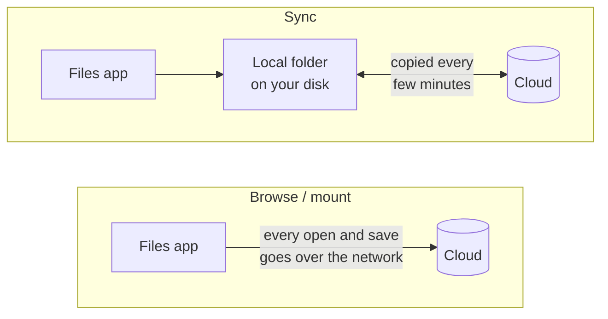

# Google Drive and Proton Drive on Ubuntu

How to get your Google Drive and Proton Drive files on Ubuntu 24.04, whether it runs from the external USB drive ([GUIDE.md](GUIDE.md)) or from the internal disk ([DUAL-BOOT-PLAN.md](DUAL-BOOT-PLAN.md)).

> **Who this is for:** beginners who used the Google Drive or Proton Drive apps on Windows and want the same files on Ubuntu.
>
> **Status:** written in October 2026. Neither Google nor Proton makes a desktop sync app for Linux yet, so everything here uses Ubuntu's built-in tools, free community tools, or Proton's command-line tool. This changes over time, so check [Proton's roadmap](https://proton.me/drive/roadmap) for a Linux app before you start.

---

## Contents

- [Two ways to reach cloud files: browse or sync](#two-ways-to-reach-cloud-files-browse-or-sync)
- [Which option to pick](#which-option-to-pick)
- [Part 1: Google Drive](#part-1-google-drive)
  - [1.1 Browse it in Files (built in, easiest)](#11-browse-it-in-files-built-in-easiest)
  - [1.2 Install a current rclone](#12-install-a-current-rclone)
  - [1.3 Connect rclone to Google Drive](#13-connect-rclone-to-google-drive)
  - [1.4 Option A: mount Google Drive as a folder](#14-option-a-mount-google-drive-as-a-folder)
  - [1.5 Option B: keep a synced offline copy](#15-option-b-keep-a-synced-offline-copy)
  - [1.6 Paid alternative: Insync](#16-paid-alternative-insync)
- [Part 2: Proton Drive](#part-2-proton-drive)
  - [2.1 The web app (works today, nothing to install)](#21-the-web-app-works-today-nothing-to-install)
  - [2.2 Proton's official command-line tool](#22-protons-official-command-line-tool)
  - [2.3 rclone with Proton Drive (beta)](#23-rclone-with-proton-drive-beta)
- [Notes for Ubuntu on a USB drive](#notes-for-ubuntu-on-a-usb-drive)
- [Troubleshooting](#troubleshooting)
- [How to undo it](#how-to-undo-it)
- [Sources](#sources)

---

## Two ways to reach cloud files: browse or sync

On Windows, the Google Drive and Proton Drive apps do both of these quietly. On Linux you choose:

| | **Browse / mount** | **Sync** |
|---|---|---|
| What you get | A folder that shows what's in the cloud. Files download when you open them | A real folder on your disk that holds a copy of the cloud files, and a tool that copies changes both ways |
| Works offline? | No | Yes |
| Uses disk space? | Only a cache | As much as the files you sync |
| Good for | Occasional access, large drives | Files you work on every day |



## Which option to pick

| You want… | Google Drive | Proton Drive |
|---|---|---|
| To open a file now and then, with no setup | [1.1 Files app](#11-browse-it-in-files-built-in-easiest) | [2.1 Web app](#21-the-web-app-works-today-nothing-to-install) |
| A folder that behaves like a drive | [1.4 rclone mount](#14-option-a-mount-google-drive-as-a-folder) | [2.3 rclone mount](#23-rclone-with-proton-drive-beta) (beta) |
| Offline copies kept in sync | [1.5 rclone bisync](#15-option-b-keep-a-synced-offline-copy) or [1.6 Insync](#16-paid-alternative-insync) | Not reliable yet. Use the web app or the CLI, and wait for Proton's Linux app |
| Scripted backups to the cloud | rclone `copy` | [2.2 Proton CLI](#22-protons-official-command-line-tool) |

---

## Part 1: Google Drive

### 1.1 Browse it in Files (built in, easiest)

Ubuntu's **Online Accounts** can add Google Drive to the Files app. Nothing to install.

1. Open **Settings → Online Accounts → Google**.
2. Sign in with your Google account and allow access. Depending on the Ubuntu version, the sign-in page opens in a small window or in your web browser.
3. In the list of what to use the account for, keep **Files** on. Turn off **Mail**, **Calendar**, **Contacts** and so on if you don't want them in Ubuntu's apps.
4. Open **Files**. Your Google address now appears in the left sidebar. Click it to browse your Drive.

What to expect:

- **No offline copies.** Every file is downloaded when you open it, and saved straight back to Google.
- **Slow with big folders.** Folders with hundreds of files can take a while to list. This is a known weakness of the GNOME component behind it (`gvfs`).
- **Google Docs, Sheets and Slides** show up as entries that open in the browser, not as files you can edit in LibreOffice.
- **Strange paths in the terminal.** The files live under `/run/user/1000/gvfs/google-drive:…/` with Google's internal IDs instead of names. Use the Files app, not the terminal, with this option.

For anything more than occasional access, use rclone (below).

### 1.2 Install a current rclone

[rclone](https://rclone.org) is a free, open-source command-line tool that talks to more than 70 cloud services, including Google Drive and Proton Drive. Parts 1.4, 1.5 and 2.3 use it.

> ⚠️ **Don't use `sudo apt install rclone` on Ubuntu 24.04.** Ubuntu's package is an older version (I'm about 85% confident it's 1.60). It has no Proton Drive support (added in 1.64) and lacks the safety options of `bisync` used in 1.5.

Install the current version with rclone's official script:

```bash
sudo apt install -y curl fuse3
sudo -v ; curl https://rclone.org/install.sh | sudo bash
rclone version          # should print v1.7x or newer
```

`fuse3` is what lets rclone show a cloud drive as a normal folder ("mount" it). It's usually installed already.

To update rclone later, run the `curl … | sudo bash` line again.

### 1.3 Connect rclone to Google Drive

rclone calls each connected account a **remote**. Create one named `gdrive`:

```bash
rclone config
```

Answer the questions like this (press **Enter** to accept a default):

| Prompt | Answer |
|---|---|
| `n) New remote` … | `n` |
| `name>` | `gdrive` |
| `Storage>` | `drive` (Google Drive) |
| `client_id>` | Enter (blank). See the note below |
| `client_secret>` | Enter (blank) |
| `scope>` | `1` (full access to all files) |
| `service_account_file>` | Enter (blank) |
| `Edit advanced config?` | `n` |
| `Use web browser to automatically authenticate…?` | `y`. A browser tab opens: sign in and click **Allow** |
| `Configure this as a Shared Drive (Team Drive)?` | `n` (unless you use a work Shared Drive) |
| `Keep this "gdrive" remote?` | `y`, then `q` to quit |

Test it:

```bash
rclone lsd gdrive:          # lists the folders at the top of your Drive
```

> **About the blank `client_id`:** rclone then uses its own shared Google access key, which thousands of people share. Google limits how fast it can be used, so big transfers can be slow. If that bothers you, rclone's documentation explains how to create your own free key in the Google Cloud Console (*"Making your own client_id"*: https://rclone.org/drive/#making-your-own-client-id). It takes about 15 minutes. For normal use, the shared one is fine.

### 1.4 Option A: mount Google Drive as a folder

This makes `~/GoogleDrive` show your whole Drive, like 1.1 but faster, with normal file names, and usable from the terminal and every app.

Try it once by hand:

```bash
mkdir -p ~/GoogleDrive
rclone mount gdrive: ~/GoogleDrive --vfs-cache-mode full
```

Leave that terminal open and look at `~/GoogleDrive` in Files. Press `Ctrl + C` in the terminal to stop.

`--vfs-cache-mode full` keeps a local copy of files you open (in `~/.cache/rclone`). Without it, many apps can't save files on the mount.

**Start it automatically at login** with a small *systemd user service* (a background job that belongs to your account, no `sudo` needed):

```bash
mkdir -p ~/.config/systemd/user
nano ~/.config/systemd/user/rclone-gdrive.service
```

Paste this, then save with `Ctrl + O`, `Enter`, `Ctrl + X`:

```ini
[Unit]
Description=Mount Google Drive at ~/GoogleDrive with rclone

[Service]
Type=notify
ExecStartPre=/usr/bin/mkdir -p %h/GoogleDrive
ExecStart=/usr/bin/rclone mount gdrive: %h/GoogleDrive \
    --vfs-cache-mode full \
    --vfs-cache-max-size 10G \
    --dir-cache-time 5m
ExecStop=/usr/bin/fusermount3 -u %h/GoogleDrive
Restart=on-failure
RestartSec=30

[Install]
WantedBy=default.target
```

Turn it on:

```bash
systemctl --user daemon-reload
systemctl --user enable --now rclone-gdrive.service
systemctl --user status rclone-gdrive.service      # should say "active (running)"
```

- `--vfs-cache-max-size 10G` caps the local cache at about 10 GB. Lower it if your drive is small.
- `--dir-cache-time 5m` means a file added from another device can take up to 5 minutes to appear.
- `Restart=on-failure` with `RestartSec=30` retries every 30 seconds if there's no internet yet at login.

What to expect: still **no offline access**. If the network drops, the folder hangs or shows errors until it's back.

### 1.5 Option B: keep a synced offline copy

`rclone bisync` ("bidirectional sync") keeps a local folder and a cloud folder the same: changes on either side are copied to the other. It's the closest thing to the Windows Drive app.

> **Sync one folder, not the whole Drive.** Pick a folder for the files you use on this laptop, e.g. `Laptop` in your Drive. A whole Drive can be bigger than the USB drive, and a smaller sync is quicker and safer.

**1. Create the folders and do a dry run** (shows what would happen, changes nothing):

```bash
mkdir -p ~/GoogleDriveSync
rclone mkdir gdrive:Laptop
rclone bisync gdrive:Laptop ~/GoogleDriveSync \
    --resync --drive-skip-gdocs --dry-run
```

**2. The first real run.** `--resync` is needed **only the first time**. It makes both sides contain everything from both sides:

```bash
rclone bisync gdrive:Laptop ~/GoogleDriveSync \
    --resync --drive-skip-gdocs --verbose
```

**3. Later runs** (this is the command the timer below runs):

```bash
rclone bisync gdrive:Laptop ~/GoogleDriveSync \
    --drive-skip-gdocs --resilient --recover \
    --conflict-resolve newer --max-lock 2m --verbose
```

What the options do:

| Option | Why |
|---|---|
| `--drive-skip-gdocs` | Skips Google Docs, Sheets and Slides. They aren't real files, and syncing them as exported `.docx`/`.xlsx` copies leads to confusing duplicates. Keep using them in the browser |
| `--resilient --recover` | After an interrupted run (lost Wi-Fi, laptop shut down), continue normally next time instead of stopping and asking for `--resync` |
| `--conflict-resolve newer` | If a file changed on both sides, keep the newer one. The other is kept too, renamed with `.conflict1` in its name |
| `--max-lock 2m` | If a run crashed and left a lock file, ignore it after 2 minutes |

**4. Run it automatically every 15 minutes** with a systemd timer. Create two files:

```bash
nano ~/.config/systemd/user/rclone-gdrive-bisync.service
```

```ini
[Unit]
Description=Two-way sync of Google Drive "Laptop" with ~/GoogleDriveSync

[Service]
Type=oneshot
ExecStart=/usr/bin/rclone bisync gdrive:Laptop %h/GoogleDriveSync \
    --drive-skip-gdocs --resilient --recover \
    --conflict-resolve newer --max-lock 2m \
    --log-file %h/.cache/rclone-gdrive-bisync.log --log-level INFO
```

```bash
nano ~/.config/systemd/user/rclone-gdrive-bisync.timer
```

```ini
[Unit]
Description=Run the Google Drive two-way sync every 15 minutes

[Timer]
OnBootSec=3min
OnUnitActiveSec=15min

[Install]
WantedBy=timers.target
```

Turn it on and check it:

```bash
systemctl --user daemon-reload
systemctl --user enable --now rclone-gdrive-bisync.timer
systemctl --user list-timers                       # shows the next run
tail -n 20 ~/.cache/rclone-gdrive-bisync.log       # what the last run did
```

Rules of thumb:

- 🔁 **Run the sync by hand before you shut down** if you changed something in the last 15 minutes: `systemctl --user start rclone-gdrive-bisync.service`.
- 🛑 **Bisync refuses to delete more than half the files in one run.** That's a safety check, not a bug. If you really did delete that much, run it once by hand with `--force`.
- 🔐 **For sensitive files**, put a [Cryptomator](https://cryptomator.org) vault inside `~/GoogleDriveSync`. Google then only sees encrypted files. [DUAL-BOOT-PLAN.md](DUAL-BOOT-PLAN.md#key-decisions-and-why) explains this setup, including the Android side.

### 1.6 Paid alternative: Insync

[Insync](https://www.insynchq.com) is a commercial app with a normal window and settings, and is the closest to Google's own Drive app. It has a `.deb` package for Ubuntu. It costs a one-time licence per Google account (check the site for the current price) and has a free trial. Choose it if you'd rather not use the terminal; it's not needed otherwise.

---

## Part 2: Proton Drive

**The state of things in October 2026:**

- **No official desktop app for Linux yet.** Proton announced in June 2026 that a Linux client is in development, but has given no release date.
- **An official command-line tool exists** (released June 2026). It can list, upload and download files, but it doesn't sync on its own.
- **rclone supports Proton Drive**, but marks it as **beta**, and in 2026 the rclone forum has several reports of login errors.

So for now: use the web app for everyday access, and the CLI or rclone for backups. Because Proton encrypts everything on your device before uploading, you don't need Cryptomator for Proton Drive.

### 2.1 The web app (works today, nothing to install)

Open https://drive.proton.me in Firefox and sign in. You can upload by dragging files from the Files app into the browser window, and download as usual.

To keep it handy, right-click its tab → **Pin Tab**.

### 2.2 Proton's official command-line tool

> ℹ️ I couldn't check Proton's own documentation while writing this, so the commands below come from news reports and community guides about version 0.4.x. Run `proton-drive help` to see the commands your version actually has.

**Install:**

1. Download the **Linux x64** version from https://proton.me/download/drive/cli (or from https://proton.me/drive/download). It's a single file.
2. Move it into place and make it runnable. If the downloaded file has a version number in its name, use that name in the `mv` line:

   ```bash
   mkdir -p ~/.local/bin
   mv ~/Downloads/proton-drive ~/.local/bin/proton-drive
   chmod +x ~/.local/bin/proton-drive
   ```

3. **Log out and back in** if `~/.local/bin` didn't exist before. Ubuntu only adds it to your command path at login.
4. The tool stores your login in Ubuntu's keyring (the same place your Wi-Fi passwords are kept). On a normal Ubuntu desktop that's already set up. If it complains about `libsecret` or D-Bus, run `sudo apt install libsecret-1-0 dbus-x11`.

**Use it:**

```bash
proton-drive auth login                                    # sign in
proton-drive filesystem list /my-files                     # list your Drive
proton-drive filesystem upload ~/Documents/report.pdf /my-files/Documents
proton-drive filesystem download /my-files/Documents ~/Downloads/
proton-drive auth logout
```

`/my-files` is the top of your Drive (*My files* in the web app).

Community projects build sync or mounting on top of this tool (for example `lafontaj/proton-drive-cli-sync` on GitHub). They're unofficial and young; read their README and code before giving them your account.

### 2.3 rclone with Proton Drive (beta)

This gives Proton Drive the same mount and copy options as Google Drive in Part 1. It's marked **beta**: test it with unimportant files first, and keep another copy of anything important.

**Before you start:**

- Install a current rclone ([1.2](#12-install-a-current-rclone)). Ubuntu's own package is too old for Proton Drive.
- Sign in to https://drive.proton.me in a browser at least once, so your account's Drive is set up.
- Have your **2FA app** ready if you use two-factor authentication. You'll type a fresh 6-digit code during setup.

**Connect** with `rclone config`:

| Prompt | Answer |
|---|---|
| `n) New remote` … | `n` |
| `name>` | `proton` |
| `Storage>` | `protondrive` |
| `username>` | your Proton address |
| `password>` | `y`, then type your Proton password twice |
| `2fa>` | the current 6-digit code, or Enter if you don't use 2FA |
| `mailbox_password>` (if asked) | only if your account uses Proton's old **two-password mode**; otherwise Enter |
| `Edit advanced config?` | `n` |
| `Keep this "proton" remote?` | `y`, then `q` |

**Test and use it:**

```bash
rclone lsd proton:                                          # top-level folders
rclone copy ~/Documents/report.pdf proton:Documents --progress
rclone copy proton:Documents ~/ProtonDownloads --progress
```

**Mount it** like Google Drive in [1.4](#14-option-a-mount-google-drive-as-a-folder), with `proton:` and `~/ProtonDrive` instead of `gdrive:` and `~/GoogleDrive` (also in a copy of the service file named `rclone-proton.service`):

```bash
mkdir -p ~/ProtonDrive
rclone mount proton: ~/ProtonDrive --vfs-cache-mode full
```

For backups, prefer **one-way** `rclone copy` (or `rclone sync`, which also deletes files in the cloud that you deleted locally) over `bisync`, until Proton's Linux support is out of beta. A one-way backup can't damage your local files.

---

## Notes for Ubuntu on a USB drive

If Ubuntu runs from the external drive ([GUIDE.md](GUIDE.md)):

- 💾 **Mind the space.** The rclone cache (1.4, 2.3) and the synced folder (1.5) both live on the USB drive. Keep the cache limit small (`--vfs-cache-max-size`) and sync only the folders you need.
- 🐢 **A flash drive makes syncing slow.** Thousands of small files are hard on cheap flash drives. An external SSD handles it fine.
- 🔌 **Shut down properly**, as always. Unplugging the drive while a sync or mount is writing can corrupt files, and the next `bisync` run may then need `--resync`.
- 🪟 **Give Ubuntu its own synced folder.** Windows' Drive app and Ubuntu's rclone can both sync the same Drive, each with its own local copy. Don't point rclone at the Windows Drive app's folder on `C:`: two sync tools on one folder fight each other.

---

## Troubleshooting

| Symptom | Likely cause | Fix |
|---|---|---|
| `didn't find backend called "protondrive"` | rclone from Ubuntu's package, which is too old | Install the current version ([1.2](#12-install-a-current-rclone)); check with `rclone version` and `which rclone` (should be `/usr/bin/rclone` from the script) |
| `didn't find section in config file` | The remote name in the command doesn't match the one you created | `rclone listremotes` shows the names. Use them with the colon, e.g. `gdrive:` |
| `~/GoogleDrive` shows *"Transport endpoint is not connected"* | rclone stopped or crashed while mounted | `fusermount3 -uz ~/GoogleDrive`, then `systemctl --user restart rclone-gdrive.service` |
| Mount service fails right after login | No network yet | It retries every 30 s. Check with `journalctl --user -u rclone-gdrive.service` |
| Bisync stops with *"cannot find prior listings"* or *"must run --resync"* | First run, or the state files were lost | Run the first-run command from 1.5 step 2 again (with `--resync`) |
| Bisync stops with *"too many deletes"* | More than half the files would be deleted | Check that it's intended, then run once by hand with `--force` |
| Files named `….conflict1` appear | The same file changed on two devices between syncs | Compare them, keep the right one, delete the other |
| Google transfers are slow, or `rateLimitExceeded` / `403` errors | rclone's shared Google key is busy | Normal now and then. For heavy use, make your own `client_id` (see the note in 1.3) |
| `token expired` / `invalid_grant` for Google | Your Google sign-in was revoked or expired | `rclone config reconnect gdrive:` |
| Proton login fails with `422` or `401` errors | The beta backend's login problems, often around 2FA | Update rclone, then re-create the remote with a fresh 2FA code. Check the rclone forum for current reports |
| Google Drive in Files is very slow or shows nothing | Known `gvfs` weakness with big folders | Wait for it to load, or use rclone (1.4) instead |
| `proton-drive: command not found` | `~/.local/bin` isn't on your command path yet | Log out and back in, or run it as `~/.local/bin/proton-drive` |

---

## How to undo it

Nothing here touches your cloud files unless you delete them yourself.

1. **Stop the services and timers:**
   ```bash
   systemctl --user disable --now rclone-gdrive-bisync.timer rclone-gdrive.service
   rm ~/.config/systemd/user/rclone-gdrive*.{service,timer}
   systemctl --user daemon-reload
   ```
   (Same for `rclone-proton.service` if you created it.)
2. **Remove the rclone accounts:** `rclone config delete gdrive` and `rclone config delete proton`. Then revoke rclone's access at https://myaccount.google.com/permissions.
3. **Remove rclone itself:** `sudo rm /usr/bin/rclone /usr/local/share/man/man1/rclone.1`.
4. **Remove local copies** you no longer need, after checking they're also in the cloud: `~/GoogleDriveSync`, `~/.cache/rclone`.
5. **Built-in Google Drive:** **Settings → Online Accounts → Google → Remove**.
6. **Proton CLI:** `proton-drive auth logout`, then `rm ~/.local/bin/proton-drive`.

---

## Sources

- rclone documentation: Google Drive (https://rclone.org/drive/), Proton Drive (https://rclone.org/protondrive/, *"added in v1.64.0"*, beta), bisync (https://rclone.org/bisync/), mount (https://rclone.org/commands/rclone_mount/), install (https://rclone.org/install/)
- rclone forum reports from 2025–2026 on Proton Drive: login errors (https://forum.rclone.org/t/cannot-use-the-proton-drive-remote/53944), mount problems on Ubuntu 24.04 (https://forum.rclone.org/t/mount-protondrive-on-linux-fails/53717), *"didn't find backend called protondrive"* on an older rclone (https://forum.rclone.org/t/proton-drive-gopenpgp-error-in-reading-key-ring-openpgp/49179)
- Proton Drive roadmap: https://proton.me/drive/roadmap
- OMG! Ubuntu, June 2026, on Proton's Linux client plans: https://www.omgubuntu.co.uk/2026/06/proton-drive-linux-client
- It's FOSS on the Proton Drive CLI: https://itsfoss.com/news/proton-drive-cli/
- FOSS Linux, Proton Drive CLI setup guide (commands, `libsecret` and `dbus-x11`): https://www.fosslinux.com/158454/proton-drive-linux-cli-setup.htm
- OMG! Ubuntu on GNOME Online Accounts file access (no offline mode): https://www.omgubuntu.co.uk/2024/04/set-up-onedrive-file-access-in-ubuntu
- GNOME `gvfs` issue on slow Google Drive transfers: https://gitlab.gnome.org/GNOME/gvfs/-/issues/724
- Insync: https://www.insynchq.com · Cryptomator: https://cryptomator.org

---

*This is a community-knowledge guide, not official Google, Proton or Canonical documentation. Proton's Linux tools in particular are changing quickly. Check their pages before you rely on the commands here.*
