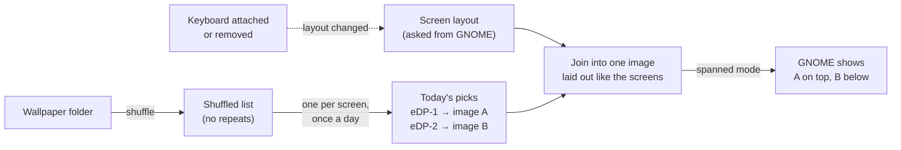

# A different wallpaper on each screen, shuffled daily

A small program that gives each of the Zenbook Duo's screens its own wallpaper, picked at random from a folder and changed once a day.

> **Who this is for:** anyone running Ubuntu with GNOME (the default desktop) from [GUIDE.md](GUIDE.md) or [DUAL-BOOT-PLAN.md](DUAL-BOOT-PLAN.md) who wants changing wallpapers on both screens.
>
> **Status:** written in October 2026 for Ubuntu 24.04 (GNOME 46). It was tested against a simulated GNOME display service: two screens, the keyboard attached and removed, rotated screens, 200 % scaling and a new day. It has not yet been run on a real Duo, so please [report problems](https://github.com/Toldry/zenbook-duo-linux-guide/issues).

---

## Contents

- [Why a custom program](#why-a-custom-program)
- [What it does](#what-it-does)
- [Install](#install)
- [Settings](#settings)
- [Everyday use](#everyday-use)
- [How it works](#how-it-works)
- [Limitations](#limitations)
- [Troubleshooting](#troubleshooting)
- [How to undo it](#how-to-undo-it)
- [Sources](#sources)

---

## Why a custom program

GNOME has **one** wallpaper setting for all screens, and its Settings app has no slideshow. Windows, macOS and KDE Plasma all have a per-screen shuffled slideshow built in. GNOME doesn't.

The only way to show different pictures on GNOME is to join them into **one** image laid out like your screens. Then you set it in GNOME's **spanned** mode, which stretches one image across all screens, so each screen shows its own part. Every per-screen wallpaper tool for GNOME works this way.

The existing tools didn't fit:

| Tool | Problem |
|---|---|
| [Variety](https://github.com/varietywalls/variety) | Well maintained, but shows the same picture on all screens |
| [HydraPaper](https://gitlab.com/gabmus/hydrapaper) | Per-screen, but no shuffle and no timer |
| [Superpaper](https://github.com/hhannine/superpaper) | Per-screen with shuffle, but the last release was in 2022. It changes the picture at every login, and doesn't notice when the Duo's lower screen turns off |

---

## What it does

- Picks **one image per screen** from your wallpaper folder, at random.
- **Shuffles without repeats:** every image is shown once before any comes back, and the two screens never show the same image on the same day (unless the folder has only one image).
- **Changes once a day,** at a time you choose (midnight by default). It also catches up after the laptop wakes from sleep.
- **Follows the keyboard:** when you put the keyboard on the lower screen and that screen turns off, the top screen gets a full image within about 2 seconds. When you take the keyboard off, the lower screen gets today's picture back. Rotating the laptop works the same way.
- Keeps full sharpness at the Duo's 200 % scaling, and fills each screen without stretching. Images are scaled and cropped from the center.



---

## Install

### Step 1: Get the files

The program lives in this repository, in [`tools/daily-wallpaper/`](tools/daily-wallpaper/). Open a terminal (`Ctrl+Alt+T`) and run:

```bash
sudo apt install git python3-gi python3-pil
git clone https://github.com/Toldry/zenbook-duo-linux-guide.git ~/zenbook-duo-linux-guide
```

`python3-gi` lets the program talk to GNOME, and `python3-pil` (Pillow) handles the images. Ubuntu usually has both already; the command just makes sure.

### Step 2: Run the installer

```bash
~/zenbook-duo-linux-guide/tools/daily-wallpaper/install.sh
```

The installer:

1. Copies the program to `~/.local/bin/daily-wallpaper`.
2. Creates the settings file `~/.config/daily-wallpaper/config.ini`, unless it already exists.
3. Creates the folder `~/Pictures/Wallpapers`.
4. Installs and starts a background service that runs whenever you're logged in.

### Step 3: Add your images

Copy your wallpapers into `~/Pictures/Wallpapers` (or point the settings at another folder, see below). JPEG, PNG, WebP, BMP and TIFF work. Within a minute the screens change. To see the result immediately:

```bash
~/.local/bin/daily-wallpaper --next
```

**Tip:** images at least as large as the screen (2880 × 1800 on the Duo) look sharpest. Landscape images suit the normal layout. Portrait images suit the laptop turned sideways (book mode).

### Updating later

```bash
cd ~/zenbook-duo-linux-guide && git pull
./tools/daily-wallpaper/install.sh
```

Your settings and today's pictures are kept.

---

## Settings

Edit `~/.config/daily-wallpaper/config.ini` with any text editor, for example:

```bash
gnome-text-editor ~/.config/daily-wallpaper/config.ini
```

```ini
[wallpaper]
folder = ~/Pictures/Wallpapers
change_time = 00:00
include_subfolders = yes
```

| Setting | What it does | Default |
|---|---|---|
| `folder` | The folder to take images from. `~` means your home folder | `~/Pictures/Wallpapers` |
| `change_time` | When new pictures are picked each day, as 24-hour `HH:MM`. For example `06:00` keeps yesterday's pictures until 6 in the morning | `00:00` |
| `include_subfolders` | `yes` also uses images in folders inside `folder`; `no` uses only the top level | `yes` |

Changes take effect within a minute; there's no need to restart anything. If you change `folder`, the shuffle starts over from the new folder.

---

## Everyday use

| To… | Run |
|---|---|
| Get new pictures right now | `~/.local/bin/daily-wallpaper --next` |
| See today's pictures and the settings in use | `~/.local/bin/daily-wallpaper --status` |
| See what the service has been doing | `journalctl --user -u daily-wallpaper -n 30` |
| Pause it (until the next login) | `systemctl --user stop daily-wallpaper` |
| Pause it for good | `systemctl --user disable --now daily-wallpaper` |
| Turn it back on | `systemctl --user enable --now daily-wallpaper` |

After your next login you can drop the `~/.local/bin/` part: Ubuntu adds that folder to your command path once it exists.

**Images added to the folder** join the shuffle at the start of the next round, once every current image has been shown. To include them right away, delete the saved state (`rm ~/.local/state/daily-wallpaper/state.json`), then run `--next`.

---

## How it works

For anyone curious, or fixing something:

1. **Screen layout.** The program asks GNOME's display service (`org.gnome.Mutter.DisplayConfig`, over D-Bus) where each screen is, how big it is, and whether it's rotated or scaled. This is the same source the Settings app uses. It works on Wayland and needs no X11 tools.
2. **Picking.** It keeps a shuffled list of every image in the folder and takes the next one off the list for each screen. Picks are stored per screen name, such as `eDP-1` and `eDP-2` (`--status` shows yours). So a screen that turns off and on during the day gets the same picture back.
3. **Joining.** It scales and crops each picture to fill its screen, places it where that screen sits in the layout, and saves one JPEG.
4. **Setting.** It points GNOME's wallpaper setting (`org.gnome.desktop.background`, for both light and dark mode) at that JPEG, in `spanned` mode.
5. **Waiting.** The service checks every minute whether a new day has started. It also listens for GNOME's "monitors changed" signal and rebuilds the image within about 2 seconds of a change.

Files it uses:

| Path | Contents |
|---|---|
| `~/.local/bin/daily-wallpaper` | The program (a single Python file) |
| `~/.config/systemd/user/daily-wallpaper.service` | The background service definition |
| `~/.config/daily-wallpaper/config.ini` | Your settings |
| `~/.local/state/daily-wallpaper/state.json` | Today's picks and the remaining shuffle |
| `~/.local/state/daily-wallpaper/wallpaper-*.jpg` | The current joined image (old ones are deleted) |

---

## Limitations

- **GNOME only.** It depends on GNOME's display service and wallpaper setting. On KDE Plasma, use Plasma's built-in per-screen slideshow instead.
- **The login screen and the lock screen aren't changed.** I'm about 70 % sure GNOME 46's lock screen shows a blurred copy of the desktop wallpaper. If so, it shows the joined image too.
- **One folder for both screens.** There's no option for a separate folder per screen.
- **The Settings app looks odd.** Its wallpaper preview shows the joined image. Picking a wallpaper there works, but the service replaces it at the next daily change or screen-layout change. Stop the service first if you want your own pick to stay.

---

## Troubleshooting

| Symptom | Likely cause | Fix |
|---|---|---|
| The installer says *"Missing Python libraries"* | `python3-gi` or `python3-pil` isn't installed | `sudo apt install python3-gi python3-pil`, then run the installer again |
| Wallpaper never changes; the log says *"No images found"* or *"Wallpaper folder not found"* | The folder is empty, or `folder` in the settings has a typo | Check with `~/.local/bin/daily-wallpaper --status`; fix the folder or add images |
| The log says *"Invalid setting"* | `change_time` isn't `HH:MM`, or `include_subfolders` isn't `yes`/`no` | Fix the line in `config.ini` |
| The log says *"Skipping unreadable image"* | A damaged file, or a format Pillow can't read (for example HEIC from phones) | Delete it or convert it to JPEG. The program picks another image meanwhile |
| `--next` says *"couldn't read the monitor layout from GNOME"* | Run outside a GNOME session (over SSH, or on another desktop) | Run it from a terminal on the laptop's own desktop |
| The service isn't running after login | It wasn't enabled, or it failed at start | `systemctl --user status daily-wallpaper`, then `journalctl --user -u daily-wallpaper -n 50` |
| One screen shows two half-pictures, or the picture is squashed | The image was built for a different layout and the rebuild didn't run | Run `~/.local/bin/daily-wallpaper --once`. If it keeps happening, please [open an issue](https://github.com/Toldry/zenbook-duo-linux-guide/issues) with the output of `journalctl --user -u daily-wallpaper -n 50` |
| Pictures look blurry | The images are smaller than the screens | Use images of at least 2880 × 1800 |

---

## How to undo it

```bash
~/zenbook-duo-linux-guide/tools/daily-wallpaper/uninstall.sh
```

This stops and removes the service and the program, deletes the saved state and the joined image, and puts back Ubuntu's default wallpaper. It keeps your images and your settings file. To remove the settings too:

```bash
rm -r ~/.config/daily-wallpaper
```

To do the same by hand, without the script:

```bash
systemctl --user disable --now daily-wallpaper
rm ~/.config/systemd/user/daily-wallpaper.service ~/.local/bin/daily-wallpaper
systemctl --user daemon-reload
rm -r ~/.local/state/daily-wallpaper
gsettings reset org.gnome.desktop.background picture-uri
gsettings reset org.gnome.desktop.background picture-uri-dark
gsettings reset org.gnome.desktop.background picture-options
```

---

## Sources

- GNOME's wallpaper settings: one setting for all screens, and the `spanned` mode: [gsettings-desktop-schemas, `org.gnome.desktop.background`](https://gitlab.gnome.org/GNOME/gsettings-desktop-schemas/-/blob/master/schemas/org.gnome.desktop.background.gschema.xml.in)
- GNOME's display service, used to read the screen layout: [Mutter's `org.gnome.Mutter.DisplayConfig` D-Bus interface](https://gitlab.gnome.org/GNOME/mutter/-/blob/main/data/dbus-interfaces/org.gnome.Mutter.DisplayConfig.xml)
- That GNOME has no per-screen wallpaper of its own: [OMG Ubuntu (2018)](https://www.omgubuntu.co.uk/2018/01/different-wallpaper-each-monitor-ubuntu-linux), [GNOME Shell feature request](https://gitlab.gnome.org/GNOME/gnome-shell/-/issues/7033)
- The joined-image ("spanned") method used by other tools: [HydraPaper man page](https://www.mankier.com/1/hydrapaper)
- Background services that start with the desktop session: [systemd.special, `graphical-session.target`](https://www.freedesktop.org/software/systemd/man/latest/systemd.special.html)
- Image scaling and cropping: [Pillow `ImageOps.fit`](https://pillow.readthedocs.io/en/stable/reference/ImageOps.html)
- The alternatives compared: [Variety](https://github.com/varietywalls/variety), [HydraPaper](https://gitlab.com/gabmus/hydrapaper), [Superpaper](https://github.com/hhannine/superpaper)
