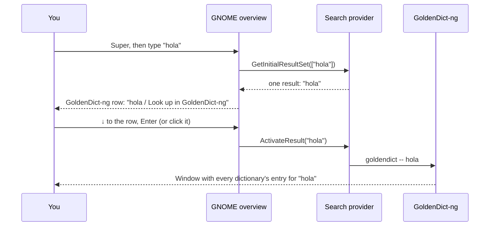

# Look up words from the Super search

Press `Super`, type a word in English, Spanish or Hebrew, and press `↓` then `Enter`. GoldenDict-ng opens with the word's definitions, synonyms and translations. Everything works offline.

> **Who this is for:** anyone running Ubuntu with GNOME (the default desktop) from [GUIDE.md](GUIDE.md) or [DUAL-BOOT-PLAN.md](DUAL-BOOT-PLAN.md) who wants a quick offline dictionary.
>
> **Status:** written in October 2026 for Ubuntu 24.04 (GNOME 46). The parts it relies on are the same in GNOME 47 to 49, so it should also work on Ubuntu 24.10 to 26.04. The search provider was tested against simulated GNOME Shell calls on D-Bus. It has not yet been run on a real Duo, so please [report problems](https://github.com/Toldry/zenbook-duo-linux-guide/issues).

---

## Contents

- [Why a small add-on is needed](#why-a-small-add-on-is-needed)
- [What you get](#what-you-get)
- [1. Install GoldenDict-ng](#1-install-goldendict-ng)
- [2. Add dictionaries](#2-add-dictionaries)
- [3. Install the search provider](#3-install-the-search-provider)
- [4. Turn it on in Settings](#4-turn-it-on-in-settings)
- [5. Try it](#5-try-it)
- [Optional: only search with a prefix](#optional-only-search-with-a-prefix)
- [How it works](#how-it-works)
- [Limitations](#limitations)
- [Troubleshooting](#troubleshooting)
- [How to undo it](#how-to-undo-it)
- [Sources](#sources)

---

## Why a small add-on is needed

**Settings → Search** has two parts:

- **App Search** is one switch for all results that come from apps (the overview's own app and settings matches are always on).
- **Search Results** lists every installed app that offers results to the overview. You can switch each one on or off and drag them into the order you like.

An app only appears in that list if it ships a *search provider*: a small program GNOME asks for results on every keystroke. GoldenDict-ng doesn't ship one, so with settings alone, typing `hola` after `Super` only finds the GoldenDict-ng app itself, not the word.

This guide adds the missing search provider: one Python script ([`tools/goldendict-search/`](tools/goldendict-search/)) and two small config files. It uses only what Ubuntu already has (Python and its GNOME bindings). No launcher such as Ulauncher or Albert is needed, and no GNOME extension. Once it's installed, GoldenDict-ng shows up under **Search Results** like any other app.

---

## What you get



- **One row per search.** The overview shows a **GoldenDict-ng** group with a single result: what you typed. Choosing it opens that word or phrase in GoldenDict-ng, which searches all your dictionaries at once.
- **Any language, any script.** Hebrew typed right to left works the same as English or Spanish. Switch keyboard layouts with `Super+Space` as usual.
- **Definitions show in GoldenDict-ng, not in the overview.** The overview only has room for a title and one line, so the row is a shortcut, not the answer. See [Limitations](#limitations).

---

## 1. Install GoldenDict-ng

GoldenDict-ng is the maintained successor of GoldenDict. Ubuntu's `goldendict` package is the old original, so install the `-ng` one. Open a terminal (`Ctrl+Alt+T`) and run:

```bash
sudo apt install goldendict-ng
```

This adds the command `goldendict` and a **GoldenDict-ng** entry in the app grid.

<details>
<summary>Using the Flatpak instead</summary>

The Flathub version is usually newer than Ubuntu's. The search provider works with it too.

```bash
sudo apt install flatpak
flatpak remote-add --if-not-exists flathub https://dl.flathub.org/repo/flathub.flatpakrepo
flatpak install flathub io.github.xiaoyifang.goldendict_ng
```

The Flatpak can't see your home folder by default, so give it read access to the folder where the dictionaries will go (step 2):

```bash
mkdir -p ~/Dictionaries
flatpak override --user --filesystem=~/Dictionaries:ro io.github.xiaoyifang.goldendict_ng
```

It also can't read dictionaries installed with `apt` into `/usr/share`, so the optional WordNet step below doesn't apply to it.

Install only one of the two versions. If both are installed, the search provider uses the `apt` one.

</details>

Open **GoldenDict-ng** once from the app grid, then close it. That creates its settings folder.

---

## 2. Add dictionaries

GoldenDict-ng comes with no dictionaries. The easiest good ones for English, Spanish and Hebrew are extracts of the English Wiktionary, already converted to StarDict format (a format GoldenDict-ng reads) by the Wiktionary-Dictionaries project. Each entry has definitions, and many have synonyms and translations.

### Step 1: Download them

About 27 MB in total:

```bash
mkdir -p ~/Dictionaries
cd ~/Dictionaries
base="https://raw.githubusercontent.com/Vuizur/Wiktionary-Dictionaries/master"
for language in English Spanish Hebrew; do
    file="${language}-English Wiktionary dictionary stardict.tar.gz"
    wget -O "$file" "$base/${file// /%20}"
    tar -xzf "$file"
    rm "$file"
done
```

This gives three folders:

| Folder | Look up | Explained in |
|---|---|---|
| `English-English Wiktionary dictionary stardict` | English words | English |
| `Spanish-English Wiktionary dictionary stardict` | Spanish words | English |
| `Hebrew-English Wiktionary dictionary stardict` | Hebrew words | English |

These files were built in November 2022. For newer data, or other languages, see [kaikki.org](https://kaikki.org/), which the project builds from.

### Step 2 (optional): Add the WordNet thesaurus

WordNet is a large English dictionary grouped by meaning, so it's good for synonyms. Ubuntu packages it for the `dictd` dictionary server, and GoldenDict-ng reads those files directly (I'm about 85% confident of that; if WordNet doesn't show up after step 3, skip it). Not for the Flatpak.

```bash
sudo apt install dict-wn dict-moby-thesaurus
```

`dict-moby-thesaurus` adds the Moby Thesaurus, a plain list of about 30,000 English words with their synonyms. Both install into `/usr/share/dictd`.

### Step 3: Point GoldenDict-ng at them

1. Open **GoldenDict-ng**.
2. Open the menu **Edit → Dictionaries** (or press `F3`).
3. On the **Sources → Files** tab, click **Add…** and choose the `Dictionaries` folder in your home folder.
4. Tick **Recursive** next to it, so the subfolders are read.
5. If you did step 2, click **Add…** again and choose `/usr/share/dictd`.
6. Click **OK**. GoldenDict-ng indexes the dictionaries, which takes a few seconds the first time.

Type `casa` into GoldenDict-ng's search box to check: the Spanish-English entry should appear.

---

## 3. Install the search provider

### Step 1: Get the files

The provider lives in this repository, in [`tools/goldendict-search/`](tools/goldendict-search/):

```bash
sudo apt install git
git clone https://github.com/Toldry/zenbook-duo-linux-guide.git ~/zenbook-duo-linux-guide
```

If you already cloned it for another tool from this guide, update it instead:

```bash
cd ~/zenbook-duo-linux-guide && git pull
```

### Step 2: Run the installer

```bash
~/zenbook-duo-linux-guide/tools/goldendict-search/install.sh
```

It asks for your password once. The installer:

1. Checks that GoldenDict-ng and Python's GNOME bindings (`python3-gi`, part of Ubuntu Desktop) are installed.
2. Copies the provider to `~/.local/bin/goldendict-search-provider`.
3. Tells D-Bus how to start the provider when GNOME first needs it. D-Bus is the message bus desktop programs use to talk to each other.
4. Registers the provider with GNOME in `/usr/local/share/gnome-shell/search-providers/`. GNOME only looks in system folders for these, which is why it needs your password.
5. Makes GNOME reload its list of providers by switching **App Search** off and on again, so there is no need to log out.

---

## 4. Turn it on in Settings

1. Open **Settings → Search**. If Settings was already open, close and reopen it so it picks up the new provider.
2. Make sure **App Search** is on. With it off, no app gives results, this one included.
3. Under **Search Results**, find **GoldenDict-ng** and make sure its switch is on. New providers start switched on.
4. Optional: drag **GoldenDict-ng** by its handle (⋮⋮) higher or lower. The order here is the order of the groups in the overview. Put it at the top if you'll use it often, or at the bottom if you want it out of the way of file and app results.

```
Settings → Search
┌──────────────────────────────────────────────┐
│ App Search                            [ ON ] │
│ Search Locations                           › │
├──────────────────────────────────────────────┤
│ Search Results                               │
│ ⋮⋮  GoldenDict-ng                     [ ON ] │
│ ⋮⋮  Files                             [ ON ] │
│ ⋮⋮  Calculator                        [ ON ] │
│ ⋮⋮  Settings                          [ ON ] │
│ …                                            │
└──────────────────────────────────────────────┘
```

---

## 5. Try it

1. Press `Super` and type `hola`.
2. Under the app matches, a **GoldenDict-ng** group shows one row: **hola**, *Look up in GoldenDict-ng*.
3. Press `↓` until that row is highlighted and press `Enter`, or click it.

GoldenDict-ng opens with the entries for *hola*. If it was already open, it shows the new word in the same window.

Tips:

- **`Enter` alone runs the first result.** That's the GoldenDict-ng row only when no app or setting matches what you typed. If `Enter` opened an app instead, use `↓` first.
- **Phrases work.** Typing `dar a luz` looks up the whole phrase.
- **Clicking the GoldenDict-ng icon** at the left of the group does the same as clicking the row.

---

## Optional: only search with a prefix

By default the GoldenDict-ng row appears for every search, including when you're looking for an app or a file. If that's too much clutter, make it appear only when your query starts with a prefix, such as `d `:

1. Open `~/.local/bin/goldendict-search-provider` in a text editor.
2. Change the line `QUERY_PREFIX = ""` to `QUERY_PREFIX = "d "`.
3. Stop the running copy so GNOME starts the edited one at the next search:

   ```bash
   pkill -f goldendict-search-provider
   ```

Now `Super`, `d hola` looks up *hola*, and plain `hola` doesn't show the row. Running the installer again puts back the default, so redo the edit after updating.

---

## How it works

GNOME's overview asks every search provider for results over D-Bus, using the `org.gnome.Shell.SearchProvider2` interface. The provider is a short Python script that answers five questions:

| GNOME asks | The provider answers |
|---|---|
| `GetInitialResultSet` (you started typing) | One result: the query itself, or nothing if it's empty or lacks the prefix |
| `GetSubsearchResultSet` (you typed more) | The same, for the longer query |
| `GetResultMetas` (what to show) | The query as the title, *Look up in GoldenDict-ng* below it, and GoldenDict-ng's icon |
| `ActivateResult` (you chose the row) | Runs `goldendict -- <query>` (or `flatpak run … -- <query>`) |
| `LaunchSearch` (you clicked the group's icon) | The same |

GoldenDict-ng only allows one copy of itself to run. When it's already open, a second `goldendict <word>` hands the word to the open window and exits. The `--` makes sure a query such as `-ing` is looked up, not read as an option.

The provider doesn't run all the time. D-Bus starts it the first time you type in the overview after logging in, and it quits after 5 minutes without a search.

Files it uses:

| Path | Contents |
|---|---|
| `~/.local/bin/goldendict-search-provider` | The provider |
| `~/.local/share/dbus-1/services/io.github.toldry.GoldenDictSearch.service` | Tells D-Bus how to start the provider |
| `/usr/local/share/gnome-shell/search-providers/goldendict-search-provider.ini` | Tells GNOME the provider exists and that it belongs to GoldenDict-ng |
| `~/Dictionaries/` | The Wiktionary dictionaries |

---

## Limitations

- **No definitions in the overview.** The row only repeats your query. Showing a definition there would mean reading the dictionary files from the provider, which needs a separate dictionary tool such as `sdcv` and would only have one line of space anyway.
- **No spelling suggestions.** The row offers exactly what you typed, even if no dictionary has it. GoldenDict-ng then suggests close matches in its word list.
- **The window may not come to the front.** If GoldenDict-ng is already open behind other windows, GNOME sometimes shows a *"GoldenDict-ng is ready"* notification instead of raising it. This is GNOME's protection against apps stealing focus. I'm not sure how often it happens with GoldenDict-ng; closing GoldenDict-ng after each lookup avoids it.
- **The registration is for all users, the provider for one.** Other accounts on the laptop see GoldenDict-ng under **Search Results**, but it gives them no results until they run the installer too.
- **The Wiktionary files are from 2022** and Hebrew coverage is thinner than English or Spanish.

---

## Troubleshooting

| Symptom | Likely cause | Fix |
|---|---|---|
| The installer says *"GoldenDict-ng isn't installed"* | Step 1 skipped, or only the old `goldendict` package installed | `sudo apt install goldendict-ng` |
| **GoldenDict-ng** isn't listed under **Search Results** | Settings was open during the install, or the `.ini` file is missing | Close and reopen Settings. Check with `ls /usr/local/share/gnome-shell/search-providers/` |
| It's listed, but no GoldenDict-ng row appears in the overview | GNOME hasn't reloaded its providers | In **Settings → Search**, switch **App Search** off and on again. If that doesn't help, log out and back in |
| Still no row | The provider fails to start | Run `~/.local/bin/goldendict-search-provider` in a terminal, search in the overview, and read the errors. Also check `journalctl --user -b \| grep -i goldendict` |
| The row appears, but choosing it does nothing | GoldenDict-ng can't be started | Run `goldendict hola` in a terminal and read the error |
| GoldenDict-ng opens but finds nothing | No dictionaries loaded | Redo [step 2.3](#step-3-point-goldendict-ng-at-them); check that **Recursive** is ticked |
| WordNet doesn't appear in GoldenDict-ng | Its `dictd` files weren't recognized | Remove `/usr/share/dictd` from the sources; the Wiktionary English dictionary covers synonyms too |

---

## How to undo it

```bash
~/zenbook-duo-linux-guide/tools/goldendict-search/uninstall.sh
```

This removes the provider and its two config files and asks for your password once. GoldenDict-ng and the dictionaries stay.

To do the same by hand:

```bash
pkill -f goldendict-search-provider
rm ~/.local/bin/goldendict-search-provider
rm ~/.local/share/dbus-1/services/io.github.toldry.GoldenDictSearch.service
sudo rm /usr/local/share/gnome-shell/search-providers/goldendict-search-provider.ini
```

Then switch **App Search** off and on in **Settings → Search**.

To also remove GoldenDict-ng and the dictionaries:

```bash
sudo apt remove goldendict-ng dict-wn dict-moby-thesaurus
rm -r ~/Dictionaries
```

---

## Sources

- GoldenDict-ng, its install options and Ubuntu package name: https://github.com/xiaoyifang/goldendict-ng and https://xiaoyifang.github.io/goldendict-ng/install/
- GoldenDict-ng's command line (a word as argument, handed to a running window): https://github.com/xiaoyifang/goldendict-ng/blob/staged/src/main.cc
- GoldenDict-ng on Flathub: https://flathub.org/apps/io.github.xiaoyifang.goldendict_ng
- Ubuntu 24.04's `goldendict-ng` package and its files: https://packages.ubuntu.com/noble/goldendict-ng
- Wiktionary dictionaries in StarDict format: https://github.com/Vuizur/Wiktionary-Dictionaries
- The Wiktionary data they're built from: https://kaikki.org/
- WordNet: https://wordnet.princeton.edu/ and the Ubuntu package https://packages.ubuntu.com/noble/dict-wn
- Writing a GNOME search provider: https://developer.gnome.org/documentation/tutorials/search-provider.html
- How GNOME Shell finds search providers (system data folders only, `DesktopId`, `Version`): https://gitlab.gnome.org/GNOME/gnome-shell/-/blob/gnome-46/js/ui/remoteSearch.js
- GNOME Shell reloading providers when the search settings change: https://gitlab.gnome.org/GNOME/gnome-shell/-/blob/gnome-46/js/ui/search.js
- The **App Search** and **Search Results** settings: https://gitlab.gnome.org/GNOME/gnome-control-center/-/blob/gnome-46/panels/search/cc-search-panel.ui
- D-Bus service activation files: https://dbus.freedesktop.org/doc/dbus-specification.html#message-bus-starting-services
