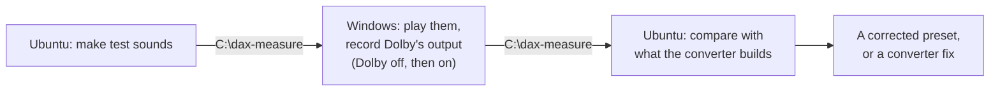

# Record what Dolby does on Windows, to match it on Linux

A step-by-step guide to recording the Zenbook Duo's Dolby processing on Windows and comparing it with the EasyEffects preset on Ubuntu, so the remaining difference can be found and fixed instead of guessed.

> **Who this is for:** anyone who rebuilt the Windows Dolby tuning with [speaker-tuning-to-easyeffects](https://github.com/antoinecellerier/speaker-tuning-to-easyeffects) and still finds the speakers worse on Ubuntu. Background: [the speaker report](reports/Zenbook%20Duo%20Linux%20speaker%20fix.md).
>
> **Time needed:** about 1–1.5 hours, most of it on Windows.
>
> **Status:** written in October 2026 from the converter's own measurement tools (`tools/measure_dax/`, version 430e3a5). It hasn't been run on a Duo yet, so please [report problems](https://github.com/Toldry/zenbook-duo-linux-guide/issues).

---

## Contents

- [Why record Windows](#why-record-windows)
- [What you need](#what-you-need)
- [Part 1: Make the test sounds (Ubuntu)](#part-1-make-the-test-sounds-ubuntu)
- [Part 2: Record Dolby (Windows)](#part-2-record-dolby-windows)
- [Part 3: Compare (Ubuntu)](#part-3-compare-ubuntu)
- [Troubleshooting](#troubleshooting)
- [How to undo it](#how-to-undo-it)
- [Sources](#sources)

---

## Why record Windows

The converter rebuilds Dolby from its settings file (the tuning XML). That file doesn't describe everything Dolby does: it has no settings for Dolby's "virtual bass", it only says the volume leveler's companion compression is on, not how it's set, and it says nothing about other processing in the Realtek driver. Recording Dolby's actual output shows all of that.

Windows can record its own sound output digitally ("loopback"), right after Dolby has processed it. No microphone is needed. You play test sounds once with Dolby off and once with Dolby on; the difference is exactly what Dolby adds.



**What it can't see:** anything after Dolby, i.e. a possible Realtek codec EQ and the amplifiers. Those need a microphone measurement (see the report).

---

## What you need

| Item | Notes |
|---|---|
| The converter, already cloned | `~/workspace/speaker-tuning-to-easyeffects` in this guide; adjust the path if yours differs |
| ~100 MB free on the Windows partition | Files pass between the systems through `C:\dax-measure`, which Ubuntu sees as `/run/media/$USER/OS/dax-measure` |
| Windows with **Dolby Access** | Already on the Duo. Start → type *Dolby* to check |
| Internet on Windows | To install Python once |

---

## Part 1: Make the test sounds (Ubuntu)

### 1.1 Install what the tools need

```bash
sudo apt install python3-numpy python3-scipy python3-matplotlib espeak-ng
cd ~/workspace/speaker-tuning-to-easyeffects
git pull
```

`espeak-ng` makes the speech test sound. Without it, the tool uses a noise substitute.

### 1.2 Generate the test sounds

```bash
mkdir -p ~/dax-measure && cd ~/dax-measure
python3 ~/workspace/speaker-tuning-to-easyeffects/tools/measure_dax/make_stimulus.py
ls stimulus_*.wav | wc -l
```

This writes every test sound (about 250 MB) plus a `.json` file for each into `~/dax-measure`. The last line should print a number around 20.

### 1.3 Copy what Windows needs to the Windows partition

Open the Windows partition in **Files** (it's in the sidebar, often called *OS*). Then copy the capture script and three groups of test sounds into `C:\dax-measure`: the basic tone-shape set, the stereo-width set, and the leveler set (loudness at seven levels):

```bash
WIN=/run/media/$USER/OS/dax-measure
mkdir -p "$WIN"
cp ~/workspace/speaker-tuning-to-easyeffects/tools/measure_dax/capture_dax.py "$WIN/"
cd ~/dax-measure
for s in sweep sweep_quiet pink pink_quiet multitone \
         stereo_pink stereo_correlated \
         pink60 pink48 pink30 pink24 pink14; do
    cp "stimulus_$s.wav" "stimulus_$s.json" "$WIN/"
done
ls "$WIN" | wc -l     # expect 25
```

Every `.wav` needs its `.json` next to it; the analysis reads the sound's layout from it. If `mkdir` says *Read-only file system*, see [Troubleshooting](#troubleshooting).

Shut Ubuntu down and start Windows.

---

## Part 2: Record Dolby (Windows)

All commands here are PowerShell. Open **Terminal** (right-click Start → **Terminal**).

### 2.1 Install Python and the recording packages (once)

```powershell
winget install -e --id Python.Python.3.12
```

**Close the terminal and open a new one** so it finds `python`, then:

```powershell
python --version
python -m pip install sounddevice numpy scipy soundfile pycaw comtypes pyaudiowpatch
```

`python --version` should print `Python 3.12.x`. If it opens the Microsoft Store instead, Python isn't on the path yet: open a new terminal again, or reinstall from <https://www.python.org/downloads/> with **Add python.exe to PATH** ticked.

### 2.2 Set up the speakers

1. **Settings → System → Sound → Speakers → Output settings → Format**: pick any **48000 Hz** entry. The script refuses to record at any other rate.
2. Make sure the **built-in speakers** are the default output (not headphones, HDMI or Bluetooth), and that they're **not muted**.
3. Set the volume **low** (10–20%). The laptop plays sweeps and noise during recording. The recording is taken before the volume control, so the level doesn't affect the result.
4. Close music, video and browser tabs that might make sounds.

### 2.3 Go to the files

The files from 1.3 are in `C:\dax-measure`:

```powershell
cd C:\dax-measure
```

### 2.4 Record with Dolby off

Open **Dolby Access** → **Dolby Atmos for built-in speakers** → switch it **off**. Then run:

```powershell
$sounds = 'sweep','sweep_quiet','pink','pink_quiet','multitone',
          'stereo_pink','stereo_correlated',
          'pink60','pink48','pink30','pink24','pink14'
foreach ($s in $sounds) { python capture_dax.py --stimulus "stimulus_$s.wav" --label off }
```

Each sound plays for 10–30 seconds; the whole round takes about 5 minutes. Leave the laptop alone while it runs. Each recording lands in `C:\dax-measure\captures\` as `loopback_<sound>_off.wav` plus a `.json`.

### 2.4b Record with all sound effects off (optional, 2 minutes)

Switching Dolby off in Dolby Access leaves the Realtek effects that Windows runs after Dolby (see [the effect chain](research_notes/Zenbook%20Duo%20Linux%20speaker%20fix/windows_dolby_chain.md#addendum-2026-10-29-the-effect-chain-read-from-the-users-own-windows-install)). This round turns every effect off, so comparing it with 2.4 shows whether the Realtek ones change the sound.

Open **Settings → System → Sound → Speakers → Audio enhancements** and pick **Off**. Then run:

```powershell
foreach ($s in 'sweep','pink') { python capture_dax.py --stimulus "stimulus_$s.wav" --label off --out captures-raw }
```

`--out captures-raw` keeps these recordings apart from the 2.4 ones, which have the same names. Set **Audio enhancements** back to **Device Default Effects** afterwards, or Dolby won't run in 2.5.

### 2.5 Record with Dolby on

In **Dolby Access**, switch Dolby Atmos back **on** and pick the profile you normally listen with (✔ in the left-hand list). This guide uses **Music** with the **intelligent equalizer** on **Balanced**, because that is what the author's Duo had set. To check yours from Ubuntu, with the Windows partition open in Files:

```bash
grep -E 'SelectedMainProfile|ieq-bands-set' /run/media/$USER/OS/ProgramData/Dolby/DAX3/Runtime.xml
```

If yours shows another profile, use its name (`dynamic`, `movie`, `game`, `voice`) in place of `music` here and in Part 3. Build the Linux preset from the same profile (`--profile music` for the converter), or the comparison is between two different tunings. Then run:

```powershell
foreach ($s in $sounds) { python capture_dax.py --stimulus "stimulus_$s.wav" --label music }
```

(If you closed the terminal in between, define `$sounds` again first, as in 2.4.)

The script compares each recording with the matching Dolby-off one. If it warns that a capture is *"essentially identical to the OFF baseline"*, Dolby wasn't on: check Dolby Access and run that sound again. If it asks you to confirm the Dolby profile, answer `y` when Dolby Access shows the profile you picked.

### 2.6 Check the recordings

```powershell
(Get-ChildItem C:\dax-measure\captures\loopback_*.wav).Count    # expect 24
```

They stay in `C:\dax-measure`, where Ubuntu picks them up. You can set the speaker format and volume back as they were. Shut Windows down (**Shut down**, not Restart, so the speakers start cleanly in Ubuntu) and start Ubuntu.

---

## Part 3: Compare (Ubuntu)

### 3.1 Copy the recordings from the Windows partition

Open the Windows partition in **Files** again, then:

```bash
WIN=/run/media/$USER/OS/dax-measure
mkdir -p ~/dax-measure/captures
sudo bash -c 'cp "$1"/captures/loopback_* "$2"/captures/; [ -d "$1"/captures-raw ] && cp -r "$1"/captures-raw "$2"/' _ "$WIN" ~/dax-measure
sudo chown -R "$USER:" ~/dax-measure
ls ~/dax-measure/captures/loopback_*.wav | wc -l     # expect 24
```

The copy runs as root because Ubuntu doesn't let your user into folders that Windows created (measured on the Duo, 2026-10-29: `cp` failed with *Permission denied*). It runs inside `bash -c` so the `*` is expanded as root too. `chown` then makes the copies yours.

### 3.2 Run the analysis

The analysis also reads the Dolby tuning file the preset was built from, on the Windows partition, so keep it open. Then:

```bash
cd ~/dax-measure
XML=$(ls /run/media/$USER/OS/Windows/System32/DriverStore/FileRepository/dax3_ext_*/DEV_0294_SUBSYS_10431C43_PCI_SUBSYS_1C431043.xml | head -1)
echo "$XML"
python3 ~/workspace/speaker-tuning-to-easyeffects/tools/measure_dax/analyze.py captures/loopback_*.wav \
    --xml "$XML" --profile music --curve balanced 2>&1 | tee analysis-summary.txt
```

`echo` should print one path ending in `.xml`. The analysis takes a minute and writes into `~/dax-measure`:

| File | What it shows |
|---|---|
| `analysis-summary.txt` | Everything the command printed |
| `compare_loopback_pink_music_…png` | Dolby's real tone shape against the one the converter builds. **The most useful picture.** Within about 1 dB means the converter's curve is right |
| `spectrum_stereo_*_music_*.npz` and the summary's side/mid lines | How much Dolby widens the stereo image |
| `analysis_*.txt` | Per-recording details, including whether Dolby behaves like a fixed filter |

Open the pictures with `xdg-open ~/dax-measure/compare_loopback_pink_music_*_L.png`.

### 3.3 What to do with the results

- **Share them** in this project's conversation, or [open an issue](https://github.com/Toldry/zenbook-duo-linux-guide/issues): `analysis-summary.txt` and the `compare_*.png` pictures are enough to start. The tone-shape, width and leveler numbers say which part of preset B to change.
- **Help the converter:** its author asked for exactly these recordings for ASUS laptops. Zip them and attach them to a [device report](https://github.com/antoinecellerier/speaker-tuning-to-easyeffects/issues/new?template=device-report.yml), with the XML:
  ```bash
  cd ~/dax-measure && zip -r zenbook-duo-ux8406ma-dax-captures.zip captures analysis-summary.txt compare_*.png
  ```

Unmount the Windows partition afterwards (the eject icon in Files).

---

## Troubleshooting

| Symptom | Likely cause | Fix |
|---|---|---|
| `endpoint default samplerate is 44100 Hz` | The speaker format isn't 48 kHz | Step 2.2, point 1 |
| `No Dolby installation detected` | The default output isn't the built-in speakers | Step 2.2, point 2. If the speakers are the default and Dolby Access shows Atmos on, add `--no-apo-check` to the command |
| `capture is essentially identical to the OFF baseline` | Dolby was off during the Dolby-on round, or the profile didn't change | Switch Dolby Atmos on in Dolby Access and run that sound again |
| `endpoint is muted — capture will be silent` | The speakers are muted | Unmute them and run that sound again |
| The Dolby-off check complains about sidelobes on the sweep | Another Windows sound effect is active | **Settings → System → Sound → Speakers → Audio enhancements: Off** for the Dolby-off round only, then back to *Device Default Effects* for the Dolby-on round |
| `python` opens the Microsoft Store | Python isn't on the path | Step 2.1 |
| `analyze.py` says a `.json` is missing | A sound was copied without its `.json` | Copy both files again (1.3, 3.1) |
| `mkdir` or `cp` in 1.3 says *Read-only file system* | Windows was hibernated or shut down with Fast Startup, so Ubuntu mounts its partition read-only to protect it | In Windows: **Control Panel → Power Options → Choose what the power buttons do → Change settings that are currently unavailable**, untick **Turn on fast startup**, then **Shut down**. Or run 1.3 from Windows instead, copying from Ubuntu's files if Windows can reach them |

---

## How to undo it

- **Windows:** delete `C:\dax-measure`. To remove Python: `winget uninstall -e --id Python.Python.3.12`. Set the speaker format back in **Settings → System → Sound** if you changed it.
- **Ubuntu:** `rm -r ~/dax-measure`. The preset and the converter are untouched.

---

## Sources

- The converter's measurement tools and their instructions: https://github.com/antoinecellerier/speaker-tuning-to-easyeffects/blob/master/tools/measure_dax/README.md
- Why the tuning file isn't the whole story (the volume leveler, virtual bass, the Realtek codec database): the converter's research notes, https://github.com/antoinecellerier/speaker-tuning-to-easyeffects/tree/master/docs/research
- Windows loopback recording: https://learn.microsoft.com/en-us/windows/win32/coreaudio/loopback-recording
- Installing Python with winget: https://learn.microsoft.com/en-us/windows/package-manager/winget/
- Background and the earlier steps: [reports/Zenbook Duo Linux speaker fix.md](reports/Zenbook%20Duo%20Linux%20speaker%20fix.md)
