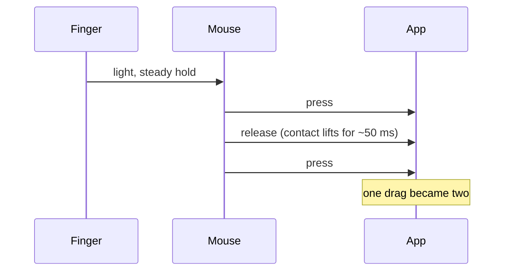

# Fix a mouse drag that breaks into several clicks

A small background program that stops a worn mouse button from cutting a
press-and-hold (dragging a window, selecting text, moving a file) into
several separate clicks.

> **Who this is for:** anyone on Ubuntu whose mouse drags break apart unless
> they press the button hard. It was written for a Logitech MX Vertical on
> Bluetooth, but works for any mouse.
>
> **Status:** written in October 2026 on Ubuntu with GNOME. The filter was
> tested against simulated button events, not yet on the real mouse, so
> please [report problems](https://github.com/Toldry/zenbook-duo-linux-guide/issues).

---

## Contents

- [The cause](#the-cause)
- [Check that this is your problem](#check-that-this-is-your-problem)
- [Install](#install)
- [Settings](#settings)
- [How it works](#how-it-works)
- [Limitations](#limitations)
- [The permanent fix](#the-permanent-fix)
- [How to undo it](#how-to-undo-it)
- [Sources](#sources)

---

## The cause

Inside the button is a small switch. When it wears out, a light press doesn't
keep the metal contact firmly closed. While you hold the button, the
contact lifts for a moment and touches again, and the mouse reports this as
a release followed by a new press. Apps see the release, so the drag ends.



On the MX Vertical this was measured with `evtest` on 2026-10-27. During
drags the mouse sent `BTN_LEFT` release, then press again, **46 to 52 ms**
later, while the pointer kept moving and the finger stayed down. The
Bluetooth connection did not drop at the time (nothing in the kernel or
Bluetooth logs).

Ubuntu's input library, libinput, already filters switch bounce, but only
gaps of a few milliseconds, and you can't change that window. A 50 ms
gap gets through.

The same mouse on Windows 11, also over Bluetooth, didn't show the problem.
Why is still unclear. One guess, unconfirmed, is that Linux's
Bluetooth connection uses a shorter report interval (about 7 ms in the
capture), which catches short contact lifts that a slower link would miss.

---

## Check that this is your problem

```bash
sudo apt install evtest
sudo evtest
```

Pick your mouse from the list, then hold the left button lightly and drag
around until a drag breaks. Press `Ctrl+C` to stop. Lines like these, while
your finger never lifted, confirm it:

```
Event: time 1793117338.590, type 1 (EV_KEY), code 272 (BTN_LEFT), value 0
Event: time 1793117338.642, type 1 (EV_KEY), code 272 (BTN_LEFT), value 1
```

The difference between the two times (here 0.052 s = 52 ms) is the gap the
filter has to cover.

To rule out a Bluetooth dropout instead, run `sudo journalctl -kf` while you
drag. A new `input: ... Mouse as /devices/...` line at the moment the
drag breaks means the connection dropped, and this filter won't help.

---

## Install

```bash
sudo apt install python3-evdev
cd zenbook-duo-linux-guide/tools/mouse-debounce
./install.sh
```

It asks for your password, because the program has to read the mouse
directly. It starts right away and at every boot. Check that it found the
mouse:

```bash
journalctl -u mouse-debounce -n 10
```

You should see `debouncing Logitech MX Vertical Advanced Ergonomic Mouse
(/dev/input/event26), 70 ms`.

---

## Settings

The defaults are the mouse name `MX Vertical` and a 70 ms window. To change
them:

```bash
sudo systemctl edit mouse-debounce
```

and add, for example:

```ini
[Service]
Environment=MOUSE_DEBOUNCE_DEVICE="Logitech G305"
Environment=MOUSE_DEBOUNCE_HOLD_MS=90
```

The device text only has to be part of the name `evtest` shows. Set the
window a little above the longest gap you saw in `evtest`.

---

## How it works

The program takes the mouse for itself, so GNOME no longer sees it
directly, and passes every event on through a virtual mouse called
`debounced-mouse`. It changes one thing: when the left button is released,
it waits 70 ms before passing the release on. If the button is pressed again
within that time, it throws away both the release and the new press, so
to GNOME the button never let go.

If the mouse disconnects (sleep, out of range, switched off), the program
waits and takes it over again when it comes back.

---

## Limitations

- Every real release of the left button reaches apps 70 ms later. Most people
  don't notice this. Gamers might.
- A double-click where you press again less than 70 ms after letting go
  becomes a single click. Normal double-clicks are slower than that.
- Only the left button is filtered.
- If the switch gets worse and its gaps grow beyond the window, drags break
  again. Raise the window, or replace the switch.

---

## The permanent fix

The filter hides the symptom. A new switch fixes the cause, on every
computer.

- Check the warranty first. Logitech's warranty on MX mice is usually 1 to 2
  years, depending on the country.
- The MX Vertical ships with Omron D2FC-F-7N(10M) switches. iFixit has a guide
  that replaces them with the longer-lasting Omron D2FC-F-K(50M). It needs
  soldering, and the screws are hidden under the rubber base.
- A cheaper, temporary fix is contact cleaner sprayed into the switch.

---

## How to undo it

```bash
cd zenbook-duo-linux-guide/tools/mouse-debounce
./uninstall.sh
```

---

## Sources

- libinput button debouncing, which explains why libinput doesn't catch this:
  https://wayland.freedesktop.org/libinput/doc/1.9.0/button_debouncing.html
- libinput issue with the same symptom on Logitech mice (spurious release and
  press while the button is held, aborted drags):
  https://gitlab.freedesktop.org/libinput/libinput/-/issues/425
- libinput issue where its own filter didn't catch a "nervous" button:
  https://gitlab.freedesktop.org/libinput/libinput/-/issues/584
- Red Hat bug, click bouncing on a new mouse:
  https://bugzilla.redhat.com/show_bug.cgi?id=1463373
- iFixit, MX Vertical switch replacement:
  https://documents.cdn.ifixit.com/pdf/ifixit/guide_138168_en.pdf
- The same idea in python-evdev, for a Logitech double-click problem
  (Portuguese):
  https://www.tabnews.com.br/Salomeu/duplo-clique-fantasma-no-mouse-logitech-contornei-no-linux-com-python-evdev
