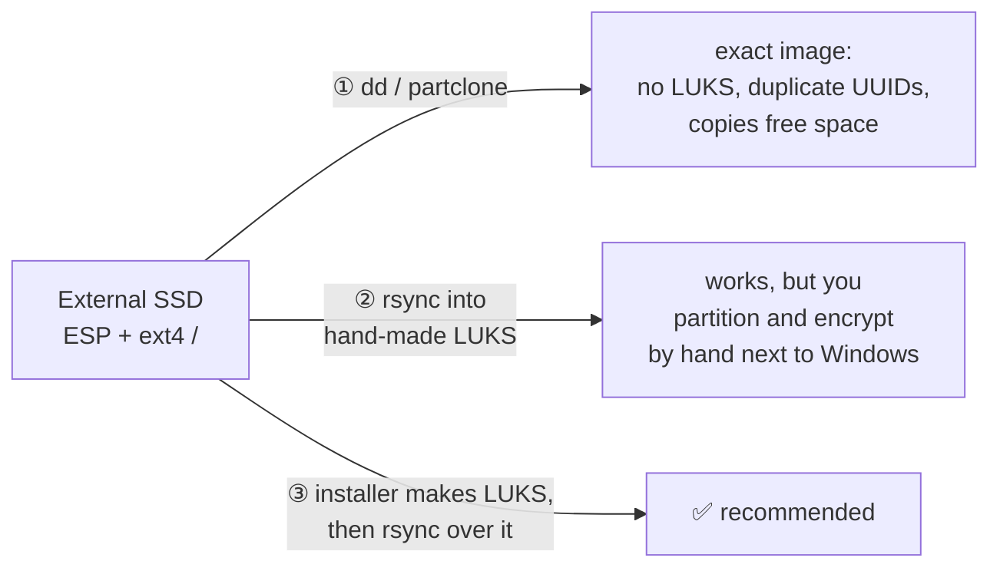

# Moving the external Ubuntu onto the internal disk, without redoing it

An alternative to [DUAL-BOOT-PLAN.md](DUAL-BOOT-PLAN.md)
Phase 3–4. Instead of "fresh install, then copy the home folder", it does
**"fresh encrypted install, then replace its contents with the whole external
system"**. Every app, `/etc` tweak, PAM edit, the Duo add-on, the
mouse-chatter filter and the snaps come along.

Phases 1–2 of the plan (testing, cleaning and decrypting `C:`, shrinking it)
stay exactly as they are.

> **Status:** plan, not yet carried out. Written on 2026-11-16 for the
> UX8406MA running Ubuntu 26.04.1 from an external SSD with Secure Boot on.
> It assumes the external drive was set up as [GUIDE.md §6.4](GUIDE.md#64-partition-the-target-drive-manually-the-important-part) says: an ESP and
> one plain ext4 `/`, no LUKS, no LVM. Check that first (step 0).

---

## Why this method, and not the others



| Method | What goes wrong | Verdict |
|---|---|---|
| **① `dd` / `partclone`** of the partitions | Copies the unencrypted ext4 as-is, so it can't land inside LUKS without extra work. Gives the internal copy the **same filesystem UUIDs** as the SSD, so with both plugged in, GRUB and `fstab` may mount the wrong one. The target must be at least as big as the source *partition*, not just the used space | ❌ |
| **② `rsync` into a LUKS container you create by hand** (`cryptsetup luksFormat`, `mkfs`, then fix `fstab`/`crypttab`, initramfs, `grub-install`) | Works, and is the classic way. But you'd make the partition, LUKS and ESP layout by hand next to Windows, which is exactly the part where a typo hurts | ⚠️ fallback |
| **③ Installer first, then `rsync` over it** | The installer does the risky parts it is built for: the partition in the free space, LUKS + LVM, sharing the ESP, the firmware boot entry. You keep its `fstab` and `crypttab` and copy everything else | ✅ |

Method ③ also **degrades gracefully**. If the copy step fails in some way you
can't fix, you're left with a working fresh encrypted install, and you fall
back to the original plan (copy the home folder). The external SSD is only
ever mounted **read-only**, so it stays your fallback throughout.

## Confidence

- **~90 %** that it works first time by following the steps below. That's up
  from the earlier 70 %, because the clash with encryption is gone: the
  installer makes the LUKS volume, and the copy only fills it.
- **~99 %** that you end up with a working system without losing anything,
  counting the fallbacks.
- What's left in the 10 %:
  - Ubuntu 26.04 builds the startup image (initramfs) with **dracut**, which
    replaced initramfs-tools in 25.10. Rebuilding it inside a `chroot` for an
    encrypted disk is well trodden on Fedora, but I haven't seen it done on
    Ubuntu 26.04. Step 5.4 checks the result before you reboot.
  - The plan's existing open question: does the 26.04 installer offer
    **encryption with "Install alongside Windows"**? If not, use method ②.
    It's the same copy with the partition made by hand, and the steps are
    longer.

None of these touch Windows. The Windows risks are the plan's Phase 2
(decrypting and shrinking `C:`) and the installer step, both unchanged.

## What you need

- The **external SSD** with the current system. It's only read from.
- A **USB stick with the Ubuntu 26.04.x installer**, the same version as the
  external system. That's the only extra device.
- About **1–2 hours** after Phase 2 is done. Most of that is the copy:
  roughly 1 minute per 5–10 GB from a USB-C SSD.

---

## Step 0: Check the external system (read-only, now)

Run these on the external Ubuntu. They change nothing.

Partition layout and filesystems. Look for `crypto_LUKS` or `LVM2_member`,
which would change some steps:

```bash
lsblk -o NAME,SIZE,FSTYPE,UUID,MOUNTPOINTS
```

What's mounted from where:

```bash
cat /etc/fstab
```

Whether anything is encrypted now (normally "No such file"):

```bash
cat /etc/crypttab
```

How much the copy has to move. The internal Ubuntu partition (~800 GB) must
be bigger than this:

```bash
df -h /
```

Which initramfs tool is in use (expect `dracut` on 26.04):

```bash
command -v dracut update-initramfs
```

Boot entries and Secure Boot:

```bash
sudo efibootmgr -v
```

```bash
mokutil --sb-state
```

## Step 1: Prepare the external system (while running it)

1. Install the tools an encrypted system needs to start. On an unencrypted
   system they do nothing, so this is harmless:
   ```bash
   sudo apt install cryptsetup lvm2 efibootmgr os-prober
   ```
2. Update fully and clean the package cache, so less gets copied:
   ```bash
   sudo apt update && sudo apt full-upgrade
   ```
   ```bash
   sudo apt clean
   ```
3. Let GRUB list Windows later:
   ```bash
   echo 'GRUB_DISABLE_OS_PROBER=false' | sudo tee -a /etc/default/grub
   ```
4. Back up your home folder somewhere else as well (Déjà Dup, or the cloud).
   The plan never writes to the SSD, but two copies are better than one.

## Step 2: The plan's Phases 1–2

Do them as written: test the installer's encryption option, back up Windows
files, decrypt `C:`, shrink it, and leave the space **unallocated**.

## Step 3: Install a minimal encrypted Ubuntu

1. **Unplug the external SSD.** Then the installer can't pick it by mistake.
2. Boot the 26.04 installer stick (`Esc` at power-on), docked keyboard,
   charger in.
3. **Install Ubuntu alongside Windows Boot Manager** → disk setup:
   **Encrypt with a passphrase** (*LVM with disk encryption*).
   - **Not** *Hardware-backed disk encryption* (TPM). That builds a
     completely different, snap-based boot chain that a copied normal system
     won't fit into.
   - **Default selection**, no extra apps. They get replaced anyway.
4. Use the **same username** as on the external system. Any password works,
   because the copy brings your old one back.
5. Choose the LUKS passphrase. **This** is the one you'll type at every boot.
6. Finish, reboot once into the new system to see that the passphrase prompt
   and the desktop work, then shut down.

## Step 4: Copy the external system over it (from the live session)

Boot the installer stick again → **Try Ubuntu**. Plug in the external SSD.
Open a terminal.

### 4.1 Find the partitions

```bash
lsblk -o NAME,SIZE,FSTYPE,LABEL,MOUNTPOINTS
```

Note these (the names here are examples; **use yours**):

| What | Example | How to recognise it |
|---|---|---|
| External root | `/dev/sda2` | on the USB drive (`sda`), `ext4`, the big one |
| Internal LUKS | `/dev/nvme0n1p5` | on `nvme0n1`, `crypto_LUKS` |
| Internal `/boot` | `/dev/nvme0n1p4` | on `nvme0n1`, `ext4`, ~2 GB, if the installer made one |
| Internal ESP | `/dev/nvme0n1p1` | on `nvme0n1`, `vfat`, ~260 MB, shared with Windows |

If GNOME auto-mounted anything from these, unmount it in Files first.

### 4.2 Mount the source read-only

```bash
sudo mkdir -p /mnt/src /mnt/dst
```

```bash
sudo mount -o ro /dev/sda2 /mnt/src
```

### 4.3 Unlock and mount the target

```bash
sudo cryptsetup open /dev/nvme0n1p5 cryptroot
```

```bash
sudo vgchange -ay
```

```bash
ls /dev/mapper/
```

Mount the logical volume it lists (usually `ubuntu--vg-ubuntu--lv`), then
`/boot` if there is one, then the ESP:

```bash
sudo mount /dev/mapper/ubuntu--vg-ubuntu--lv /mnt/dst
```

```bash
sudo mount /dev/nvme0n1p4 /mnt/dst/boot
```

```bash
sudo mount /dev/nvme0n1p1 /mnt/dst/boot/efi
```

### 4.4 Keep a copy of the installer's settings

The copy replaces `/etc` with the external system's version. Keep the
installer's next to it, so you can compare in 5.3:

```bash
sudo cp -a /mnt/dst/etc /mnt/dst/installer-etc
```

### 4.5 Copy

```bash
sudo rsync -aHAXx --numeric-ids --delete --info=progress2 --exclude=/etc/fstab --exclude=/etc/crypttab --exclude=/boot/efi --exclude=/swap.img --exclude=/installer-etc /mnt/src/ /mnt/dst/
```

What the parts do:

- `-aHAX --numeric-ids`: everything, with permissions, owners, hard links,
  ACLs and extended attributes, kept exactly as they are.
- `-x`: stay on the source filesystem.
- `--delete`: remove the fresh install's files that the external system
  doesn't have, so the result is the external system, not a mix.
- The `--exclude`s keep the new install's **`fstab` and `crypttab`** (they
  name the internal disk's UUIDs), the **shared ESP** (Windows' boot files
  live there), the new swap file, and the saved settings. Excluded files are
  also protected from `--delete`.

## Step 5: Make the copy start from the internal disk (chroot)

### 5.1 Enter the copied system

```bash
for d in dev proc sys run; do sudo mount --rbind /$d /mnt/dst/$d; done
```

```bash
sudo chroot /mnt/dst /bin/bash
```

From here, commands run *inside* the copied system.

### 5.2 Check `fstab` and `crypttab` point at the internal disk

```bash
cat /etc/fstab /etc/crypttab
```

```bash
blkid
```

The UUIDs in both files must appear in `blkid`'s output on `nvme0n1…`
devices, and none on the external drive.

Then check whether the external `fstab` had anything extra you want to keep,
such as a data drive. `/mnt/src` isn't visible inside the chroot, so run this
in a **second terminal**, outside it:

```bash
diff /mnt/dst/installer-etc/fstab /mnt/src/etc/fstab
```

Add any lines you want to keep to `/etc/fstab` by hand.

### 5.3 Bring back what the installer configured for encryption

Show which installer settings about booting and encryption the copy replaced:

```bash
diff -r /installer-etc/dracut.conf.d /etc/dracut.conf.d
```

```bash
diff /installer-etc/default/grub /etc/default/grub
```

- Files that exist **only** in `/installer-etc/dracut.conf.d`: copy them back
  into `/etc/dracut.conf.d/`.
- In `/etc/default/grub`, keep the external version (it has the Duo's
  `i915.enable_psr=0`), but if the installer's `GRUB_CMDLINE_LINUX…` lines had
  anything about `luks`, `crypt` or `rd.`, add it to the external lines.

### 5.4 Rebuild the startup image, and check it

On 26.04 (dracut):

```bash
dracut --regenerate-all --force
```

If step 0 showed `update-initramfs` instead:

```bash
update-initramfs -u -k all
```

Check that the image can unlock the disk. Each command should print several
lines; **no output means stop here**:

```bash
lsinitrd /boot/initrd.img-$(ls /lib/modules | sort -V | tail -1) | grep -E 'cryptsetup|lvm'
```

(On initramfs-tools, use `lsinitramfs` instead of `lsinitrd`.)

### 5.5 Reinstall the boot loader on the internal ESP

```bash
grub-install --target=x86_64-efi --efi-directory=/boot/efi --bootloader-id=ubuntu
```

On Ubuntu, with `shim-signed` installed, this puts the Secure-Boot-signed
shim in front of GRUB. It writes only `\EFI\ubuntu` on the ESP and leaves
`\EFI\Microsoft` alone.

```bash
update-grub
```

Its output should name your kernels and **Windows Boot Manager**.

### 5.6 Leave

```bash
exit
```

```bash
sudo umount -R /mnt/dst
```

```bash
sudo vgchange -an && sudo cryptsetup close cryptroot
```

```bash
sudo umount /mnt/src
```

**Shut Down**, unplug the external SSD and the stick, power on.

## Step 6: First boot

1. Type the LUKS passphrase (docked keyboard). Log in with your **old**
   password.
2. Check the basics:
   ```bash
   findmnt /
   ```
   It should show `/dev/mapper/ubuntu--vg-ubuntu--lv`, not `sda`.
   ```bash
   duo doctor
   ```
3. Do the plan's Phase 3 steps 5–7: the clock fix in Windows, boot order
   (`F2` → **Boot**, Ubuntu first), and boot Windows once from the GRUB menu.
4. Delete the saved installer settings once all is well:
   ```bash
   sudo rm -rf /installer-etc
   ```
5. Keep the external SSD **untouched for a week**. To boot it in an
   emergency: plug it in, `Esc`, pick the USB drive. It has its own ESP and
   `BOOTX64.EFI` ([GUIDE.md 7.3](GUIDE.md#73-make-the-usb-drive-boot-on-its-own-recommended)), so it doesn't depend on the internal disk.

## If something goes wrong

| Symptom | Likely cause | Fix |
|---|---|---|
| Passphrase prompt never appears; drops to an `(initramfs)` or `dracut:/#` shell | Startup image lacks cryptsetup/LVM | Live stick → 4.3 → 5.1 → 5.3–5.4 again. Check that `cryptsetup` and `lvm2` are installed in the chroot |
| "Security violation" at boot | GRUB installed without shim | 5.5 again; check `dpkg -l shim-signed grub-efi-amd64-signed` |
| No Windows in the GRUB menu | os-prober off | Step 1.3, then `sudo update-grub` |
| Laptop boots straight into Windows | Boot order | `F2` → **Boot** → Ubuntu first |
| Anything you can't fix | | Boot the external SSD (still untouched). Worst case: reinstall on the internal disk and follow the original plan's Phase 4 |

## Sources

- [DUAL-BOOT-PLAN.md](DUAL-BOOT-PLAN.md) and [GUIDE.md](GUIDE.md) §6–7: the external drive's
  layout and the target layout.
- Ubuntu 26.04 installer's disk options (*Encrypt with a passphrase* = LVM +
  LUKS; *Hardware-backed* = TPM):
  https://ubuntu.com/desktop/docs/en/26.04/reference/advanced-disk-setup-features/
- Dracut became Ubuntu's initramfs tool in 25.10:
  https://discourse.ubuntu.com/t/spec-switch-to-dracut/54776 and
  https://omgubuntu.co.uk/2025/09/ubuntu-25-10-switches-to-dracut-by-default
