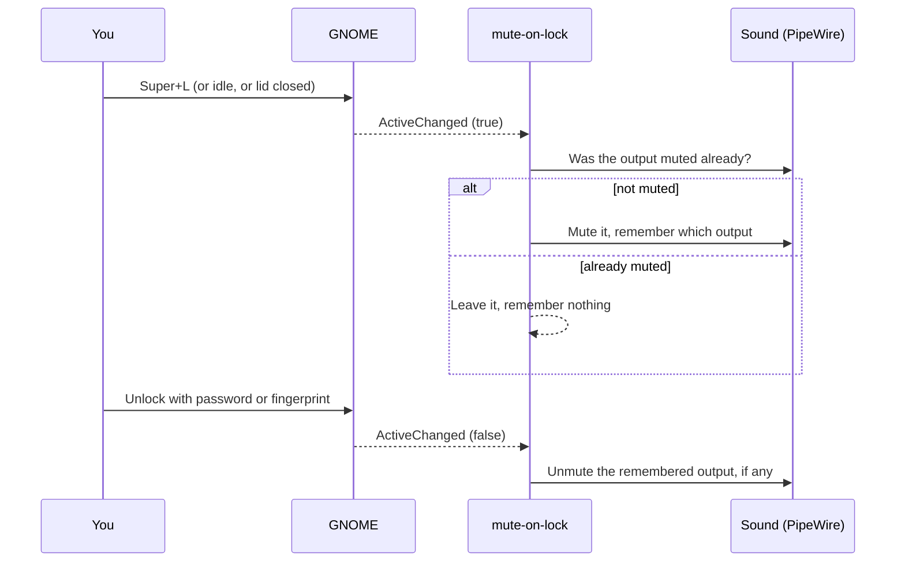

# Mute the sound while the screen is locked

A small background program that mutes the laptop's sound whenever you lock the screen (`Super+L`) and unmutes it when you unlock it again. If the sound was already muted before you locked, it stays muted.

> **Who this is for:** anyone running Ubuntu with GNOME (the default desktop) from [GUIDE.md](GUIDE.md) or [DUAL-BOOT-PLAN.md](DUAL-BOOT-PLAN.md) who doesn't want notification sounds, calls or music coming out of a locked laptop.
>
> **Status:** written in October 2026 for Ubuntu 24.04 (GNOME 46, PipeWire). It was tested against simulated lock and unlock signals. It has not yet been run on a real Duo, so please [report problems](https://github.com/Toldry/zenbook-duo-linux-guide/issues).

---

## Contents

- [Why a custom program](#why-a-custom-program)
- [What it does](#what-it-does)
- [Install](#install)
- [Everyday use](#everyday-use)
- [How it works](#how-it-works)
- [Limitations](#limitations)
- [Troubleshooting](#troubleshooting)
- [How to undo it](#how-to-undo-it)
- [Sources](#sources)

---

## Why a custom program

GNOME has no setting for this, and no place to run a command when the screen locks. It does announce every lock and unlock on D-Bus, the message bus that desktop programs use to talk to each other. A program that listens for that announcement can do anything on lock, here: mute.

---

## What it does



- **Locks of every kind count**, not only `Super+L`: locking from the top-bar menu, the screen blanking after you've been idle, and closing the lid or suspending (Ubuntu locks the screen before it suspends).
- **"Woken up" means unlocked.** After the laptop wakes from sleep, it shows the lock screen and stays muted there. The sound comes back once you've unlocked. This way nothing plays at a lock screen that anyone nearby could hear.
- **It only undoes its own mute.** If you had muted the sound yourself before locking, unlocking leaves it muted.
- **It mutes the current output** (the one the sound icon in the top bar controls), whether that's the speakers, wired headphones or a Bluetooth headset. Other outputs aren't touched.

---

## Install

### Step 1: Get the files

The program lives in this repository, in [`tools/mute-on-lock/`](tools/mute-on-lock/). Open a terminal (`Ctrl+Alt+T`) and run:

```bash
sudo apt install git
git clone https://github.com/Toldry/zenbook-duo-linux-guide.git ~/zenbook-duo-linux-guide
```

If you already cloned it for another tool from this guide, update it instead:

```bash
cd ~/zenbook-duo-linux-guide && git pull
```

### Step 2: Run the installer

```bash
~/zenbook-duo-linux-guide/tools/mute-on-lock/install.sh
```

The installer:

1. Checks that `wpctl` (PipeWire's volume command) and `gdbus` (GNOME's D-Bus command) are there. Both come with Ubuntu Desktop.
2. Copies the program to `~/.local/bin/mute-on-lock`.
3. Installs and starts a background service that runs whenever you're logged in.

### Step 3: Try it

Play some music, press `Super+L`, and the music goes quiet. Unlock, and it's back. To see what the program did:

```bash
journalctl --user -u mute-on-lock -n 10
```

```
Locked: muted output 52
Unlocked: unmuted output 52
```

---

## Everyday use

| To… | Run |
|---|---|
| See what it has been doing | `journalctl --user -u mute-on-lock -n 30` |
| Check that it's running | `systemctl --user status mute-on-lock` |
| Pause it (until the next login) | `systemctl --user stop mute-on-lock` |
| Pause it for good | `systemctl --user disable --now mute-on-lock` |
| Turn it back on | `systemctl --user enable --now mute-on-lock` |

---

## How it works

The program is a short shell script:

1. **Listening.** It runs `gdbus monitor` on GNOME's lock-screen service (`org.gnome.ScreenSaver`, despite the name). GNOME sends the signal `ActiveChanged` with `true` when the screen locks or blanks, and with `false` when you unlock.
2. **On lock,** it asks PipeWire, with `wpctl`, for the current output and whether it's muted. If it isn't, it mutes it and writes the output's number to `~/.local/state/mute-on-lock/muted-output-id`.
3. **On unlock,** if that file exists, it unmutes that output and deletes the file.
4. **At login,** if the file is still there (say the battery ran out while the screen was locked), it unmutes the output and deletes the file. PipeWire remembers the mute across restarts, so otherwise the sound would stay muted.

It writes down the output's number instead of just unmuting "whatever is current" so that the right output comes back even if a different one became current while the screen was locked, for example because Bluetooth headphones connected.

Files it uses:

| Path | Contents |
|---|---|
| `~/.local/bin/mute-on-lock` | The program |
| `~/.config/systemd/user/mute-on-lock.service` | The background service definition |
| `~/.local/state/mute-on-lock/muted-output-id` | Exists only while the screen is locked and the program muted something |

---

## Limitations

- **Muting isn't pausing.** Music and videos keep playing silently while the screen is locked, so you miss what played meanwhile. Use the pause key before locking if that matters.
- **Only the current output.** If a call app sends its ringtone to a different output than the current one, that output isn't muted.
- **An output that goes away while locked** (Bluetooth headphones switched off) can't be unmuted at unlock. When it reconnects, it may come back muted; click the sound icon to unmute it.
- **The volume keys still work on the lock screen.** Pressing mute or volume-up there unmutes the sound until you unlock. The program doesn't fight that.
- **GNOME only.** Other desktops announce locks differently.

---

## Troubleshooting

| Symptom | Likely cause | Fix |
|---|---|---|
| The installer says *"Missing the 'wpctl' command"* | An older Ubuntu that still uses PulseAudio instead of PipeWire, or a minimal install | `sudo apt install wireplumber libglib2.0-bin`, then run the installer again. On Ubuntu older than 22.10, this tool doesn't apply |
| Nothing is muted on lock, and the log is empty | The service isn't running | `systemctl --user status mute-on-lock`; if it isn't active, `systemctl --user enable --now mute-on-lock` |
| The log says *"Lost the connection to GNOME's screen lock"* | GNOME Shell restarted, or you're not in a GNOME session | The service restarts by itself after 10 seconds. If it keeps happening, check that you're on GNOME |
| The log says *"no sound output found"* | No sound device was active when the screen locked | Nothing to fix; there was nothing to mute |
| Sound stays muted after unlocking | You had muted it before locking (the log says *"already muted"*), or the output disappeared while locked | Unmute it from the sound icon |

---

## How to undo it

```bash
~/zenbook-duo-linux-guide/tools/mute-on-lock/uninstall.sh
```

This stops and removes the service and the program, and unmutes the sound if the program had muted it.

To do the same by hand, without the script:

```bash
systemctl --user disable --now mute-on-lock
rm ~/.config/systemd/user/mute-on-lock.service ~/.local/bin/mute-on-lock
systemctl --user daemon-reload
rm -r ~/.local/state/mute-on-lock
wpctl set-mute @DEFAULT_AUDIO_SINK@ 0
```

---

## Sources

- GNOME's lock-screen D-Bus service and its `ActiveChanged` signal: https://gitlab.gnome.org/GNOME/gnome-shell/-/blob/main/data/dbus-interfaces/org.gnome.ScreenSaver.xml
- GNOME's screen-lock settings (`lock-enabled`, `lock-delay`): https://gitlab.gnome.org/GNOME/gsettings-desktop-schemas/-/blob/master/schemas/org.gnome.desktop.screensaver.gschema.xml.in
- The `gdbus` command, including `monitor` and `call`: https://manpages.ubuntu.com/manpages/noble/man1/gdbus.1.html
- `wpctl`, PipeWire's volume command, and the `@DEFAULT_AUDIO_SINK@` name: https://pipewire.pages.freedesktop.org/wireplumber/tools/wpctl.html
- Ubuntu switching to PipeWire for sound in 22.10: https://discourse.ubuntu.com/t/kinetic-kudu-release-notes/27976
- Background services that start with the desktop session: https://www.freedesktop.org/software/systemd/man/latest/systemd.special.html
