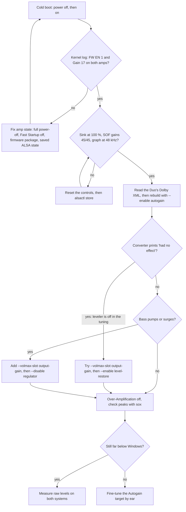
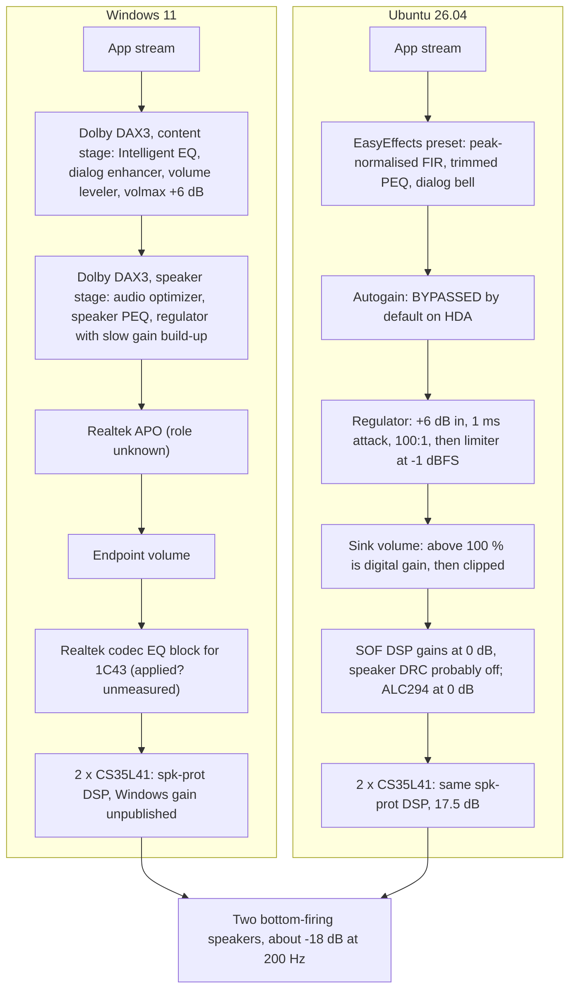

# Win back the Zenbook Duo's missing decibels

On Linux, the presets are underpowered, not your speakers (confidence: medium-high). After a cold boot, Ubuntu 26.04's kernel 7.0 drives both CS35L41 amplifiers at **17.5 dB**, exactly the `amplifier_gain` in the tuning file Cirrus built for this laptop, so on the evidence available the hardware ceiling matches Windows. What Linux lacks is the processing that makes Windows *sound* loud. Dolby's volume leveler adds roughly **+8 to +9 dB on normal program material and up to +22 dB on quiet passages**, and speaker-tuning-to-easyeffects ships it **bypassed by default** on HDA laptops. Its presets also peak-normalise the correction filter and trim the EQ, which left them **8–12 dB below Dolby** on the converter's test laptop, and their fast per-band regulator, fed a +6 dB boost, flattens bass on the deep-threshold tunings ASUS uses. Dolby-Balanced, Detailed and Warm differ by **about 1 dB**, so trying all three was really one test. Over-Amplification cannot close the gap: it is up to **+11 dB of plain digital gain**, applied *after* EasyEffects' −1 dBFS limiter, so **above 104% it hard-clips** every limited peak, which is most likely the "sounds worse" you heard. The fix, in order: spend two minutes confirming in the kernel log that both amps report `FW EN: 1` and `Gain: 17`, since a warm boot from Windows or a firmware fallback costs 13 dB and would explain everything. Then regenerate the preset with `--enable autogain`, which took a sibling Zenbook with the same codec and amps from "way quieter" to "almost perfect", add `--volmax-slot output-gain` if the bass pumps, set the sink to 100% with Over-Amplification off, and only then measure. Three questions remain open: whether the Duo's Dolby tuning turns the leveler on at all, whether Windows applies an extra Realtek codec EQ that exists for only this laptop and one sibling, and what amp gain the Windows Cirrus driver programs.

## Seven suspects, ranked: presets first, amplifiers last

The table ranks causes by how likely they are on *your* setup. That setup is Ubuntu 26.04.1 with kernel 7.0, `linux-firmware-misc` 20260319, PipeWire 1.6.2, WirePlumber 0.5.13 and EasyEffects 8.1.2, with a cold boot from the USB drive. Likelihood and the order you check things in are not the same. The amp-firmware check comes first in the sequence even though it is ranked low: it takes two minutes and gives a definite answer, and when it fails it costs **13 dB**, more than any preset flag can recover.

| Rank | Suspect | How likely on your setup | What it costs | Effort |
|---|---|---|---|---|
| 1 | Converter defaults leave out Dolby's loudness stages: leveler bypassed, correction filter peak-normalised, EQ trimmed | High (confidence: medium-high) | 6–12 dB of average loudness on other laptops | 10 min: re-run the converter with flags |
| 2 | Over-Amplification above about 104% clips after the limiter | High that it causes the "worse" sound once you lean on it (confidence: high on mechanism) | Up to 10 dB of hard clipping on loud masters | 1 min |
| 3 | Regulator fed +6 dB with a 1 ms attack, on a deep-threshold ASUS tuning | Medium: 29 of 33 ASUS ALC294 tunings are deep, but the Duo's own values are unread | Loud bass 7–9 dB under Dolby; pumping or "surges" | 10 min |
| 4 | No psychoacoustic bass, on speakers that are about 18 dB down at 200 Hz | The acoustics are certain; whether Windows adds virtual bass on this model is unknown | Thin, small sound | Hours (PipeWire filter-chain) |
| 5 | Windows-only layers: a Realtek codec EQ block for SSID 10431C43, and an unpublished Windows amp gain | Unknown (confidence: low) | Unknown; the sibling's block holds a −12 dB notch and +4 dB lifts | Needs a measurement |
| 6 | Amp-side failure states: firmware not running (warm boot, fallback, saved ALSA state), or a right-amp duck caused by a VSPK asymmetry (hypothesis) | Low on cold boots (confidence: medium-high) | −13 dB plus harshness | 2 min to check |
| 7 | Stray mixer or graph state: SOF DSP gains, a stacked SOF compressor, the sink left at WirePlumber's 40% first-boot volume, a graph running above 48 kHz, a `soft-mixer` rule | Low | 0 to 26 dB, depending on the control | 3 min |

The flowchart below is the sequence the next section walks through, with exact commands.



## Diagnose and fix in six steps, about 30 minutes

Every Linux command below is bash on Ubuntu. Windows-side commands are PowerShell (run as administrator where noted). Card `0` is the SOF card (`sof-hda-dsp`) on this laptop. If a `-c0` command fails, run `cat /proc/asound/cards` and use the number shown next to `sof-hda-dsp`.

### Step 1 (2 minutes): prove both amplifiers run their firmware

Do this after a **cold boot**: power off completely, then power on. Play any sound once before you run the commands.

```bash
journalctl -k -b 0 --no-pager | grep -E 'Bound - SSID|Firmware Loaded|Calibration|Falling back|Unable to find|SPI speed|Bypassing|reverting to dsp bypass|PUP_DONE'
journalctl -k -b 0 --no-pager | grep 'DSP1:' | grep -iE '10431c43|spk-prot\.(wmfw|bin)|Tuning Release'
amixer -c0 cget iface=CARD,name='L0 DSP1 Firmware Load' | tail -1
amixer -c0 cget iface=CARD,name='R0 DSP1 Firmware Load' | tail -1
```

A healthy boot looks like the example below (journalctl prefixes each line with a timestamp). The SPI bus number, the `R0=` calibration values and `SPKID` (0 or 1) are specific to each unit. The second command should list `cs35l41-dsp1-spk-prot-10431c43.wmfw` and `…-10431c43-spkid0-l0.bin` / `-r0.bin` (or `spkid1`), plus a line with the path `…\UX8406\Tuning Release…`. Both `amixer` lines should print `: values=on`.

```text
cs35l41-hda spi1-CSC3551:00-cs35l41-hda.0: Calibration applied: R0=10223
cs35l41-hda spi1-CSC3551:00-cs35l41-hda.0: Firmware Loaded - Type: spk-prot, Gain: 17
cs35l41-hda spi1-CSC3551:00-cs35l41-hda.0: CS35L41 Bound - SSID: 10431C43, BST: 1, VSPK: 1, CH: L, FW EN: 1, SPKID: 0
cs35l41-hda spi1-CSC3551:00-cs35l41-hda.1: Calibration applied: R0=10307
cs35l41-hda spi1-CSC3551:00-cs35l41-hda.1: Firmware Loaded - Type: spk-prot, Gain: 17
cs35l41-hda spi1-CSC3551:00-cs35l41-hda.1: CS35L41 Bound - SSID: 10431C43, BST: 1, VSPK: 0, CH: R, FW EN: 1, SPKID: 0
```

| You see | What it means | Loudness cost | Fix |
|---|---|---|---|
| Both amps show `FW EN: 1` and `Gain: 17`, a `Calibration applied` line each, `DSP1:` lines naming `10431c43` files, and both controls `values=on` | Healthy: the UX8406 tuning is running at 17.5 dB amp gain | None | Go to Step 2 |
| `Failed waiting for CS35L41_PUP_DONE_MASK: -110` | The amps were not power-cycled (you restarted from Windows, or Fast Startup is on) and are playing without their DSP | Harsh, crackly, quiet | Power off from Ubuntu and boot again from off. In Windows, turn off Fast Startup (below) and always use **Shut down**, not Restart. Do not reload or re-bind the driver; that makes it worse |
| `Falling back to default firmware.` followed by `FW EN: 1`, often with `SPKID: -19` | The DSP runs Cirrus's generic tuning, which is literally named "Fixed_Attenuation" | Large: owners of the sibling UX3405MA heard one-third to one-quarter of Windows volume | If SPKID is negative, the BIOS is missing the speaker-ID GPIO: update the BIOS and report it to linux-sound. If SPKID is 0 or 1, run `sudo apt install --reinstall linux-firmware-misc` and cold boot |
| `Unable to find firmware and tuning`, `reverting to dsp bypass`, `SPI speed is too slow`, `Bypassing Firmware.`, `Fail to start dsp`, or `FW EN: 0` | DSP bypass: the driver uses a fixed **4.5 dB** amp gain and no speaker protection | **−13 dB** | `sudo apt install linux-firmware linux-firmware-misc`, then cold boot. For the SPI-speed case, update the BIOS and report it upstream |
| `FW EN: 0` with no warning, or `values=off` | The firmware is disabled, or a saved ALSA state switched it off again | −13 dB | Commands below |

To turn Fast Startup off and confirm it, use an admin PowerShell window on Windows. (`powercfg` is spelled the same in cmd. The guide's section 2.2 shows the same change through the GUI.)

```powershell
powercfg /h off
(Get-ItemProperty 'HKLM:\SYSTEM\CurrentControlSet\Control\Session Manager\Power').HiberbootEnabled   # expect 0
```

For the last row of the table, run this on Ubuntu:

```bash
grep -rs cs35l41 /etc/modprobe.d/                                        # expect no output; delete any firmware_autostart=0 line
cat /sys/module/snd_hda_scodec_cs35l41/parameters/firmware_autostart     # expect Y
amixer -c0 cset iface=CARD,name='L0 DSP1 Firmware Load' on               # run with nothing playing
amixer -c0 cset iface=CARD,name='R0 DSP1 Firmware Load' on
# If it is "off" again after every boot, move the saved mixer state aside, then cold boot:
sudo systemctl stop alsa-restore
sudo mv /var/lib/alsa/asound.state /var/lib/alsa/asound.state.bak
sudo poweroff
```

For direct proof of the gain the amps are using, read their gain register while music plays. This is untested on this model, so treat the expected values as a guide (confidence: medium).

```bash
sudo sh -c 'grep -H "^6c04:" /sys/kernel/debug/regmap/*CSC3551*/registers'
# 6c04: 00000233 -> DSP running, 17.5 dB PCM gain (healthy)
# 6c04: 00000084 -> DSP bypass, 4.5 dB
# 6c04: 00000000 -> muted (nothing was playing)
```

While the log is open, check the `VSPK:` field. A 2024 Duo log shows `VSPK: 1` on the left amp and `VSPK: 0` on the right. A 2026 patch thread for the Zenbook 14 UX3405CA blames exactly that asymmetry for a volume drop about one second after playback starts. The cause there was "power imbalance protection", and the fix is not merged in mainline. For the Duo this is a hypothesis (confidence: low). If your log shows the same pattern, run `speaker-test -c 2 -t wav -l 1` and listen for a quieter right side. Then play a steady tone and listen for a dip about 1 s in. If you hear either, it is an upstream bug to report with your log. There is no user-side fix.

### Step 2 (3 minutes): rule out stray volume and DSP state

```bash
gsettings get org.gnome.desktop.sound allow-volume-above-100-percent
wpctl status | sed -n '/Sinks:/,/Sources:/p'
wpctl get-volume @DEFAULT_AUDIO_SINK@
wpctl inspect @DEFAULT_AUDIO_SINK@ | grep -E 'node.name|profile'
amixer -c0 sget Master | tail -1; amixer -c0 sget Speaker | tail -1
amixer -c0 cget name='Pre Mixer Analog Playback Volume' | tail -1
amixer -c0 cget name='Post Mixer Analog Playback Volume' | tail -1
amixer -c0 cget name='Post Mixer Analog Playback DRC switch' | tail -1
grep -rsl soft-mixer ~/.config/wireplumber /etc/wireplumber
pw-top          # while music plays; read the RATE column of the speaker node, press q to quit
```

| Check | Expected | If not | Fix |
|---|---|---|---|
| `allow-volume-above-100-percent` | `false` while you test | `true` | `gsettings set org.gnome.desktop.sound allow-volume-above-100-percent false` |
| Hardware speaker sink (marked `*`) | `Volume: 1.00` | e.g. `0.40`, WirePlumber's first-boot default | `wpctl set-volume @DEFAULT_AUDIO_SINK@ 1.0` |
| "Easy Effects Sink" in the list | `1.00` | Lower | `wpctl set-volume <its ID number> 1.0` |
| `node.name` / profile | Contains `HiFi` and `Speaker` | `pro-audio` (no hardware volume handling) | Pick the HiFi/Speaker profile again (GNOME Settings → Sound, or `pavucontrol` → Configuration) |
| `Master` / `Speaker` | `[100%] [0.00dB] [on]` with the sink at 100% | Below 0 dB | Usually a `soft-mixer` rule (last row); remove it |
| Pre/Post Mixer Analog Playback Volume | `: values=45,45` (45 = 0 dB) | Below 45 | `amixer -c0 cset name='Pre Mixer Analog Playback Volume' 100%`, the same for `Post`, then `sudo alsactl store` |
| DRC switch | Probably `values=off` on 26.04 | `on` | A 10:1 SOF compressor is stacked after EasyEffects. For A/B listening run `amixer -c0 cset name='Post Mixer Analog Playback DRC switch' off` |
| `soft-mixer` grep | No output | A file name | Delete the rule, then `systemctl --user restart wireplumber pipewire pipewire-pulse` |
| `pw-top` RATE | `48000` | `96000` or `192000` | The preset's convolver plays 5.9 or 11.8 dB hot and can crackle. Pin 48 kHz (below) |

If `cget` reports that it cannot find an element, list the real names with `amixer -c0 controls | grep -iE 'mixer|drc'`. To pin the graph to 48 kHz (a standard PipeWire setting), run:

```bash
mkdir -p ~/.config/pipewire/pipewire.conf.d
printf 'context.properties = {\n  default.clock.rate = 48000\n  default.clock.allowed-rates = [ 48000 ]\n}\n' > ~/.config/pipewire/pipewire.conf.d/10-rate-48k.conf
systemctl --user restart pipewire pipewire-pulse wireplumber
```

### Step 3 (5 minutes): read what the Duo's Dolby tuning actually asks for

Which of the converter's flags helps depends on four values in the XML you converted (`DEV_0294_SUBSYS_10431C43_PCI_SUBSYS_1C431043.xml`): whether its volume leveler is on, its `volmax-boost`, how deep its regulator thresholds go, and which profile Windows uses. Nobody has published this file's values, so you have to read them yourself.

On Ubuntu:

```bash
XML="$HOME/path/to/DEV_0294_SUBSYS_10431C43_PCI_SUBSYS_1C431043.xml"     # the file you converted
grep -n -E '<profile |volume-leveler-enable|volume-leveler-amount|volmax-boost|threshold_high|default_profile|tuning_version' "$XML"
```

On Windows, the DAX3 tuning files usually sit in a `dax3_ext_*` package folder under the driver store (confidence: medium on the exact folder):

```powershell
$xml = Get-ChildItem 'C:\Windows\System32\DriverStore\FileRepository' -Recurse -Filter 'DEV_0294_SUBSYS_10431C43*.xml' -ErrorAction SilentlyContinue
$xml | Select-Object FullName, LastWriteTime
$xml | Select-String -Pattern '<profile ','volume-leveler-enable','volume-leveler-amount','volmax-boost','threshold_high','default_profile','tuning_version'
pnputil /enum-drivers | Select-String -Pattern 'dax3' -Context 1,4      # which Dolby extension packages are installed
```

| What you find (under the profile Windows uses, normally "dynamic"; Dolby Access shows which) | What it means | What to do |
|---|---|---|
| `volume-leveler-enable` is 1 | Windows runs the leveler, worth about +8 dB on loud and +22 dB on quiet material on other laptops | `--enable autogain` is your biggest single fix |
| `volume-leveler-enable` is 0 | The leveler is off; the gap comes from normalisation and regulator staging | The autogain flag will print "had no effect"; use `--enable level-restore` and `--volmax-slot output-gain` |
| `volmax-boost` 96 | +6 dB (values are in 1/16 dB) | Already in the presets by default |
| `threshold_high` values at or below −320 in several bands | A deep regulator (−20 dB or lower), as in 29 of 33 ASUS ALC294 tunings | Expect pumped bass; use `--volmax-slot output-gain` |
| More than one XML path | Several copies of the tuning exist | The converter picks the highest `tuning_version`, which may not be the copy Windows binds |

Also note that without `--profile`, the converter builds the **first** profile in the file. It reads `default_profile` but does not act on it.

### Step 4 (10 minutes): rebuild the preset with the loudness stages back in

Update the converter, then re-run it with the arguments you used before plus the new flags. Work down this list and stop when it sounds right. Each run is reversible by re-running.

```bash
cd ~/speaker-tuning-to-easyeffects && git pull                  # wherever you cloned it
python3 dolby_to_easyeffects.py <your original arguments> -v --profile dynamic --enable autogain
python3 dolby_to_easyeffects.py <your original arguments> -v --profile dynamic --enable autogain --volmax-slot output-gain
python3 dolby_to_easyeffects.py <your original arguments> -v --profile dynamic --enable autogain --volmax-slot output-gain --disable regulator
python3 dolby_to_easyeffects.py <your original arguments> -v --profile dynamic --enable autogain --volmax-slot output-gain --enable level-restore
```

| Flag | Use it when | What it did elsewhere | Risk |
|---|---|---|---|
| `--enable autogain` | The leveler is 1 in the XML | About +9 dB on −20 dBFS RMS program material; "almost perfect" on a Zenbook UM3406HA | Can saturate when loud sound follows quiet; the quiet background also gets lifted |
| `--volmax-slot output-gain` | Bass pumps or surges, or the regulator is deep | +6.8 dB below 300 Hz, judged "on par with what I heard in Windows" (Lenovo Yoga Slim 7) | Small |
| `--disable regulator` (keep volmax) | Surges persist | +12.7 dB of bass, but out-of-band distortion products rose 20 dB | Removes Dolby's per-band protection. Use only after Step 1 shows `FW EN: 1` |
| `--enable level-restore` | The preset is still quieter than EasyEffects bypassed | +11.3 dB on the converter's dev laptop | Experimental; loud speech picked up artifacts on one device |
| `--disable volmax` | Only to fight distortion | −6 dB | Quieter |

After loading the new preset in EasyEffects, raise the Autogain **Target** a few dB by ear (try −16 to −14 LUFS). If you ever enable Autogain by hand on an old preset, set its **Silence threshold** to about −50 dB, or sounds arriving after silence will crackle. Ubuntu's EasyEffects 8.1.2 also has a known bad default, fixed upstream in 8.1.7: the compressor family's "Pre-mix" controls default to 0 dB instead of −inf, "Users will need to manually update their presets". Open each Multiband Compressor in the preset (the regulator is one), set every Pre-mix control to −inf, and save. Whether the converter's JSON already sets these fields was not verified, so this is a cheap precaution (confidence that it matters here: low-medium).

### Step 5 (2 minutes): fix the gain staging and prove nothing clips

```bash
gsettings set org.gnome.desktop.sound allow-volume-above-100-percent false
wpctl set-volume @DEFAULT_AUDIO_SINK@ 1.0
sudo apt install -y sox pulseaudio-utils
SINK=$(wpctl inspect @DEFAULT_AUDIO_SINK@ | awk -F'"' '/node.name/{print $2}')
timeout 30 parecord -d "$SINK.monitor" ~/sinkmon.wav       # play your loudest track meanwhile
sox ~/sinkmon.wav -n stats 2>&1 | grep -E 'Pk lev dB|RMS lev dB|Flat factor|Pk count'
```

| sox shows | Meaning |
|---|---|
| `Pk lev dB` about −1.0, `Flat factor` 0 | The limiter is doing its job; nothing clips |
| `Pk lev dB` 0.00 with `Flat factor` above 0, or a large `Pk count` | Something after the limiter adds gain: limiter "gain boost" switched on, or a plugin placed after it |
| `RMS lev dB` well below about −20 on loud pop | The chain is quiet: raise the Autogain target or the compressor makeup, inside EasyEffects |

Record with the sink at exactly 100%, so the file holds what the chain hands to the hardware. Every percent above 100 then adds gain on top of the peak you measured: **104% = +1 dB, 110% = +2.5 dB, 125% = +5.8 dB, 150% = +10.6 dB**. Behind a −1 dBFS limiter, only the first +1 dB is clean.

### Step 6 (if still clearly short): try the Duo-measured chain, then measure

If you installed JowiAoun's add-on (the guide's section 8.3), it ships an opt-in speaker chain built and measured on a UX8406MA. Use either it or the Dolby preset, not both stacked, and A/B the two. It has run on only one machine, on Ubuntu 24.04 (confidence it behaves the same on 26.04: medium-low).

```bash
duo speaker-dsp install
# or, from the cloned repository:
cd ~/linux-on-zenbook-duo && ./install.sh --user --speaker-dsp
```

If Windows is still clearly louder after Steps 1–5, run the Windows-versus-Linux measurement in the last section before tuning anything else. It tells you whether the remaining gap is processing or amplifier gain.

## Healthy amps already run at Windows' 17.5 dB

The Duo has **two drivers**, stereo and bottom-firing, each fed by its own CS35L41. Notebookcheck lists the speakers as stereo (https://www.notebookcheck.com/Asus-Zenbook-Duo-OLED-UX8406MA.814545.0.html, search snippet only). The kernel binds exactly two SPI amps through `SND_PCI_QUIRK(0x1043, 0x1c43, "ASUS UX8406MA", ALC245_FIXUP_CS35L41_SPI_2)` (https://github.com/torvalds/linux/blob/v7.0/sound/hda/codecs/realtek/alc269.c#L7317). A 2024 Duo boot log shows the Realtek parser finding a single speaker output, `ALC294: line_outs=1 (0x17...) type:speaker` (https://gitlab.com/asus-linux/asusctl/uploads/7a57ee0864eb3e0ea9bc44d34cc4e62d/dmesg.log). So there is no second, unpowered woofer pair of the kind that needed `SPEAKER2_TO_DAC1` or `BASS_SPEAKER_15` fixes on ROG and Zenbook S16 siblings (confidence: medium-high). The thin bass is acoustic. One owner measured the response with third-octave pink noise on the internal microphone and found **−13.7 dB at 250 Hz, −18.3 dB at 200 Hz and −26.6 dB at 125 Hz** relative to a 630 Hz peak. His reading: "the useful band starts around 300–400 Hz". He describes it as a shape rather than a calibrated curve (https://github.com/JowiAoun/linux-on-zenbook-duo/blob/main/nix/audio.nix). Windows hides this with processing, not with extra drivers.

The firmware side is in better shape than on most ASUS laptops. Cirrus added UX8406MA-specific amp firmware to linux-firmware in 2023 and updated its tuning in July 2024. Ubuntu 26.04 ships the `.wmfw` and all four speaker-ID tuning files in `linux-firmware-misc` (https://packages.ubuntu.com/search?searchon=contents&keywords=10431c43&mode=filename&suite=resolute&arch=any). Read as data, the current tuning is named `UX8406_HX-L_tuning_RDL300Only_ID`. It contains Protect Lite, EQ, DRC and a Rattle Distortion Limiter, and records **`"amplifier_gain": 17.5`** (https://gitlab.com/kernel-firmware/linux-firmware/-/raw/main/cirrus/cs35l41-dsp1-spk-prot-10431c43-spkid0-l0.bin). When the amp's DSP runs, kernel 7.0 writes `AMP_GAIN_PCM = tuning_gain` (https://github.com/torvalds/linux/blob/v7.0/sound/hda/codecs/side-codecs/cs35l41_hda.c#L713-L739). That defaults to `DEFAULT_AMP_GAIN_PCM 17 /* 17.5dB Gain */` (https://github.com/torvalds/linux/blob/v7.0/sound/hda/codecs/side-codecs/cs35l41_hda.h#L24-L26). linux-firmware ships no `.bincfg` override for 10431c43 (https://gitlab.com/kernel-firmware/linux-firmware/-/blob/main/WHENCE), so a healthy Duo runs at exactly the gain its own tuning specifies. Whether the Windows Cirrus driver uses the same 17.5 dB was not found in any source. It is likely, because both come from the same Cirrus LabSuite project (confidence: medium).

The real danger is the failure modes, and each one leaves a distinct line in the log. Without a running DSP, the driver falls back to a hard-coded **4.5 dB** amp gain (https://github.com/torvalds/linux/blob/v7.0/sound/hda/codecs/side-codecs/cs35l41_hda.c#L129-L137). That is **13 dB lower**: about 4.5 times less voltage and 20 times less power, with no speaker protection. Cirrus's own commit message says it plainly: "Without Firmware, audio playback will work, but the volume will be low to ensure safe operation of the CS35L41" (https://github.com/torvalds/linux/commit/d110858a6925827609d11db8513d76750483ec06). The other failure loads Cirrus's generic default tuning instead of the Duo's, which is named `Fixed_Attenuation_Mono_48000` (https://gitlab.com/kernel-firmware/linux-firmware/-/raw/main/cirrus/cs35l41-dsp1-spk-prot.bin). The Duo's closest sibling, the UX3405MA from the same 2023 firmware batch, shows the size of these failures. In 2024 its owners reported "about one-third to one-quarter of Windows volume" with `Falling back to default firmware` and `SPKID: -19`. Once the right firmware loaded on kernel 6.11, it was "as loud as Windows" (https://github.com/smallcms/asus_zenbook_ux3405ma/issues/7). On the Duo, the most common real-world failure is the warm-boot race. JowiAoun recorded "eight failures on one boot with the four boots before it completely clean". In that state the speakers "play without the amp DSP, which sounds harsh, crackly and distorted", and only a full power-off recovers (https://github.com/JowiAoun/linux-on-zenbook-duo/blob/main/system/46-speaker-amp.sh). A stale `/var/lib/alsa/asound.state` restoring `'L0 DSP1 Firmware Load'` to off left one sibling owner's left speaker "very quiet" until he deleted it (https://gist.github.com/lamperez/862763881c0e1c812392b5574727f6ff).

Two tempting amp-side "fixes" are not worth it. The `Calibration applied: R0=…` line comes from the UEFI variable `CirrusSmartAmpCalibrationData`. It sets the protection algorithm's reference resistance and never touches the gain register (https://github.com/torvalds/linux/blob/v7.0/sound/hda/codecs/side-codecs/cs35l41_hda.c#L401-L414). It is a health check, not a loudness knob. A hand-made `.bincfg` file could raise the gain to at most 20.5 dB, which is +3 dB. The parser does no range check on the value (https://github.com/torvalds/linux/blob/v7.0/sound/hda/codecs/side-codecs/cs35l41_hda.c#L474-L527), and Cirrus chose not to ship one for this model, while it did ship 19.5 dB files for the UX3405MA and UM3406HA. Running drivers above the gain their Protect Lite and limiter tuning was built for buys 2–3 dB at an unknown risk to the speakers (confidence: medium on the risk). Software processing recovers three to four times as much safely.

## Dolby's leveler carries the loudness the presets leave out

Windows stacks at least four layers on the speaker signal, and the converter reads only one of them. Dolby's DAX3 APO applies ASUS's tuning XML in two stages. The content stage holds the Intelligent EQ, dialog enhancer, volume leveler and volume maximizer. The speaker stage holds the audio optimizer, speaker PEQ, an optional multiband compressor and the regulator (https://github.com/antoinecellerier/speaker-tuning-to-easyeffects/blob/430e3a501e21bf8fdb615b133d2e8130b17973c1/docs/reference.md). ASUS's driver package then chains a Realtek APO after Dolby, whose job is unknown. Below that, Realtek's kernel driver reads a per-device codec-EQ database. Of 1,098 Realtek subsystem IDs in the converter's corpus, **only two carry an `RTHDAEQ` block: 10431A63 (Zenbook 14 UX3405) and 10431C43, your Duo**. The maintainer stresses that "every block's meaning is an unconfirmed hypothesis" and that whether Windows applies it "is unmeasured". Under the hypothesised layout, the sibling's block would add +6 dB at 100 Hz, −12 dB at 700 Hz and +4 dB at 16 kHz (https://github.com/antoinecellerier/speaker-tuning-to-easyeffects/blob/430e3a501e21bf8fdb615b133d2e8130b17973c1/docs/research/hardware-and-drivers.md#r-realtek-codec-database). If the Duo's block is similar and applied, Windows voicing contains an EQ that no Linux preset reproduces (confidence: low).



The decibels Linux gives away can be counted, though only on other laptops. No Dolby capture exists for any ASUS model.

| Stage | Effect | Where it was measured | Confidence for the Duo |
|---|---|---|---|
| Dolby volume leveler (Windows only, by default) | +8.2 dB on loud and +21.8 dB on quiet pink noise vs Dolby off; about +9 dB on −20 dBFS RMS program | Lenovo Yoga Slim 7 14ARE05; converter test laptops | Medium: depends on whether the Duo's XML enables it |
| FIR peak normalisation plus PEQ trim (Linux preset) | Preset 8–12 dB below Dolby at nominal level; level-restore gave back +11.3 dB | ThinkPad X1 Yoga Gen 7 | High on the mechanism; size unknown for the Duo |
| Volume maximizer (`volmax-boost`) | +6 dB on 78% of "dynamic" profiles | Converter's corpus | Medium |
| Regulator with volmax at its input (Linux default) | Loud bass 7–9 dB under Dolby | Lenovo Yoga Slim 7 | Medium-low; 29 of 33 ASUS ALC294 tunings are deep |
| Over-Amplification (Linux) | Up to +11 dB of gain, clean only for the first +1 dB on limited peaks | GNOME and PipeWire source | High |
| Amp DSP bypass (failure state) | −13 dB amp gain, no protection | Kernel source | High on the mechanism; low likelihood |

The leveler row is the biggest single item. Dolby's "dynamic" output measured **+8.2 dB at the loud level and +21.8 dB at the quiet level** over Dolby off. The maintainer calls the gap left by the bypassed-by-default autogain "an order of magnitude larger than the static-EQ residuals" (https://github.com/antoinecellerier/speaker-tuning-to-easyeffects/blob/430e3a501e21bf8fdb615b133d2e8130b17973c1/docs/research/eq-and-frequency-response.md#r-simplified-schema-ao-units). The converter leaves it off on purpose. Dolby's leveler is steered by media intelligence, while EasyEffects' autogain "has no content awareness". A 2026 attempt to switch it on by default failed listening tests because "the leveler boosts the *legitimate* quiet background by ~14 dB" and "each voice onset rides ~4 dB of overshoot" (https://github.com/antoinecellerier/speaker-tuning-to-easyeffects/blob/master/docs/research/adaptive-processing.md). That is the trade-off you accept with `--enable autogain`. For the owner of a Zenbook UM3406HA, a sibling with the same ALC294 codec, CS35L41 amps and 2023 firmware batch, it was clearly worth it: "Sound is way quiter without auto gain flag. Once you run with --enable-autogain, its almost perfect" (https://github.com/antoinecellerier/speaker-tuning-to-easyeffects/issues/134). ASUS tunings vary, though. A Vivobook's tuning has its leveler disabled, so the flag did nothing there (https://github.com/antoinecellerier/speaker-tuning-to-easyeffects/issues/110). That is why Step 3 reads your XML first.

The second item is structural. The converter builds its correction filter so that "the convolver only ever attenuates". It trims the EQ by its largest boost, a rule the maintainer calls "converter-invented. Nothing says DAX trims broadband level at all" (https://github.com/antoinecellerier/speaker-tuning-to-easyeffects/blob/430e3a501e21bf8fdb615b133d2e8130b17973c1/docs/research/loudness-and-limiting.md#r-peq-anti-clipping-trim). By its own documentation, "a curve whose peak exceeds `volmax-boost` emits a preset quieter than bypass" (https://github.com/antoinecellerier/speaker-tuning-to-easyeffects/blob/430e3a501e21bf8fdb615b133d2e8130b17973c1/docs/research/loudness-and-limiting.md#r-level-restore). The "Correction check passed" message checks only the curve's *shape*; "the absolute level is short by the curve's peak by design". The third item is dynamics. Dolby lets loud bass onsets reach 0 dBFS for 2–5.5 ms and builds gain reduction "over ~100–150 ms". The converter's regulator, with a 1 ms attack and 100:1 ratio, clamps "the same onset instantly". The maintainer calls this "the 'punch' difference the reporter described, measured" (https://github.com/antoinecellerier/speaker-tuning-to-easyeffects/blob/430e3a501e21bf8fdb615b133d2e8130b17973c1/docs/research/loudness-and-limiting.md#r-deep-threshold-bass-loss). ASUS's consumer Dolby package makes this worse: **29 of its 33 ALC294 tunings put the deepest regulator band at or below −20 dB**. On one Vivobook, five midrange bands start limiting 20–29 dB below full scale, and the +6 dB volmax boost sits in front of them (https://github.com/antoinecellerier/speaker-tuning-to-easyeffects/blob/430e3a501e21bf8fdb615b133d2e8130b17973c1/docs/research/loudness-and-limiting.md#r-asus-deep-regulator-thresholds). Moving volmax after the band limiting brought one owner's sound "on par with what I heard in Windows" (https://github.com/antoinecellerier/speaker-tuning-to-easyeffects/issues/44#issuecomment-5399420807).

This also explains why changing presets got you nowhere. The three IEQ voicings are "Dolby-global voicings, not device tunings", identical in every speaker XML, and the converter blends them in at 10% weight. The project says "a subtle difference between the three presets is expected, not a defect", with the three ending up at most about 1 dB apart (https://github.com/antoinecellerier/speaker-tuning-to-easyeffects/blob/430e3a501e21bf8fdb615b133d2e8130b17973c1/docs/reference.md). The missing "body" is a separate matter. Dolby's virtual bass is switched on outside the XML, by product tier: it ran on one HDA ThinkPad and not on another with identical fields. EasyEffects' serial pipeline "cannot express the parallel branch", so the converter offers virtual bass only through its PipeWire filter-chain output (https://github.com/antoinecellerier/speaker-tuning-to-easyeffects/blob/430e3a501e21bf8fdb615b133d2e8130b17973c1/docs/research/virtual-bass.md#r-dax-virtual-bass). Whether Windows runs it on the Duo is unknown. On speakers that are 18 dB down at 200 Hz, though, any harmonic bass Windows adds would be heard as exactly the fullness Linux lacks (confidence: low-medium).

## Over-Amplification clips after the limiter it cannot see

GNOME 50 moved the switch to Settings → Accessibility → Hearing → "Overamplification", subtitled "Allow volume to exceed 100%, with reduced sound quality" (https://github.com/GNOME/gnome-control-center/blob/gnome-50/panels/universal-access/cc-ua-hearing-page.blp). Turning it on raises the slider's top to `PA_VOLUME_UI_MAX`, defined as `pa_sw_volume_from_dB(+11.0)` (https://github.com/pulseaudio/pulseaudio/blob/master/src/pulse/volume.h#L119-L133). On the cubic volume scale that is **152.5%, or ×3.55 in linear gain**. None of it reaches the hardware as analog gain. At 100% the UCM path already puts the codec's `Master` and `Speaker` controls at 0 dB, their maximum. PipeWire applies anything above that in software as `new_soft_volume = real_volume / hardware_volume` (https://github.com/PipeWire/pipewire/blob/master/spa/plugins/alsa/acp/acp.c#L1566). EasyEffects routes app streams *into* its chain by setting their `target.object` (https://github.com/wwmm/easyeffects/blob/master/src/pw_manager.cpp#L467), and the desktop slider keeps controlling the hardware sink *after* it. So the extra gain lands on audio that EasyEffects' limiter has already capped at −1 dBFS. PipeWire's float-to-integer conversion then simply clamps: `SPA_CLAMPF(... , min, max)` (https://github.com/PipeWire/pipewire/blob/master/spa/plugins/audioconvert/fmt-ops.h#L12). The converter's own docs warn that "Over-amplification is digital gain applied after the preset's limiter, so extreme values can clip" (https://github.com/antoinecellerier/speaker-tuning-to-easyeffects/blob/master/docs/troubleshooting.md). For a −1 dBFS ceiling the arithmetic is unforgiving: **104% uses up the only clean decibel**, and 150% hard-clips 9.6 dB of every peak.

This is where the converter's advice and this report seem to conflict, and the conflict resolves easily. One ThinkPad owner reached "close-to-Windows" with autogain, a raised Autogain target and the desktop slider above 100% (https://github.com/antoinecellerier/speaker-tuning-to-easyeffects/blob/master/docs/troubleshooting.md). That works when levelled content sits below the limiter most of the time, so a few percent of headroom stays clean. It fails on loud masters that already hit the ceiling. The safe rule is to get loudness *before* the limiter: Autogain target, compressor makeup, limiter input gain. Then nudge the sink above 100% only while the Step 5 `sox` check still shows no flat-topped peaks (confidence: medium-high).

The rest of the volume chain needs only a quick check. The SOF DSP inserts three gains that PipeWire never touches: `Pre Mixer Analog Playback Volume`, `Post Mixer Analog Playback Volume` and `Pre Mixer Deepbuffer HDA Analog Volume`. The kernel starts them at "0dB for volume controls" (https://github.com/torvalds/linux/blob/master/sound/soc/sof/ipc4-topology.c#L3112). However, `alsactl` restores whatever was last saved, so a lowered value survives reboots without showing on GNOME's slider (confidence: low that yours are lowered). The SOF speaker compressor is a version story worth knowing. alsa-ucm-conf 1.2.12 to 1.2.15.2 (Ubuntu 24.10 to 25.10) switched on a 100 Hz high-pass plus a DRC for the speaker (https://github.com/alsa-project/alsa-ucm-conf/commit/c476091a87a4cd43ad500f0f31baa4a8d35bd153). Decoded, that DRC blob uses a −25 dB threshold, 10:1 ratio and **+12.8 dB makeup**: a loudness boost on normal content, and −3.6 dB on full-scale tones (https://github.com/alsa-project/alsa-ucm-conf/blob/master/ucm2/blobs/sof/ipc4/drc/speaker_default.bin). Ubuntu 26.04 ships 1.2.15.3 (https://launchpad.net/ubuntu/+source/alsa-ucm-conf). A January 2026 commit in that version rewrote the condition so the SOF macro applies only when the speaker-volume variable is *empty*, while the real Speaker device is defined when it is not (https://github.com/alsa-project/alsa-ucm-conf/commit/34c79da9ae38e7f68f9377ad26b573916337a53f). On the Duo, the processing is therefore most likely no longer applied. This comes from reading the files and is untested (confidence: medium); it looks like a regression worth reporting upstream. In practice the DRC is probably off and neither helps nor hurts. If Step 2 shows it on, it is a second compressor stacked after your EasyEffects chain, so switch it off for A/B tests.

Three PipeWire traps round out the list. `api.alsa.soft-mixer = true` leaves "the hardware mixer untouched" (https://github.com/PipeWire/pipewire/blob/master/doc/dox/config/pipewire-props.7.md). That freezes `Master` and `Speaker` wherever UCM's boot sequence left them, which is 60% (https://github.com/alsa-project/alsa-ucm-conf/blob/master/ucm2/HDA/init.conf), about −26 dB if `Speaker` uses the usual 0.75 dB steps (an assumption; check with `amixer`). WirePlumber's default volume for a newly seen route is "`0.4 ^ 3` (40% on the cubic scale)" (https://github.com/PipeWire/wireplumber/blob/master/docs/rst/daemon/configuration/settings.rst#L82), which looks like a cap after a fresh install. And EasyEffects "resamples the convolver kernel to whatever rate the PipeWire graph runs at and compensates no gain". With convolver autogain off, a 48 kHz preset therefore runs **+5.9 dB hot at 96 kHz and +11.8 dB at 192 kHz**, which caused crackle on one converter user's machine (https://github.com/antoinecellerier/speaker-tuning-to-easyeffects/blob/master/docs/research/easyeffects-and-pipewire.md).

## Measure once, then tune past Windows safely

A 30-minute comparison settles what no forum thread can: whether the remaining gap is in the amplifier or in the processing. Nobody has published one for this laptop. Make the test files once on Ubuntu, copy them to Windows, and confirm the copies match.

```bash
sudo apt install -y sox
sox -n -r 48000 -b 16 -c 2 sine1k_-12dBFS.wav synth 30 sine 1000 gain -12
sox -n -r 48000 -b 16 -c 2 sine1k_-24dBFS.wav synth 30 sine 1000 gain -24
sox -n -r 48000 -b 16 -c 2 pink_bp_-6pk.wav   synth 40 pinknoise sinc 200-12000 norm -6
sha256sum *.wav
```

```powershell
Get-FileHash *.wav -Algorithm SHA256        # must match the Linux hashes
```

Fix the geometry: the same table and lid angle, the keyboard in the same place (the speakers fire downward, so the table surface matters), and a phone on a tripod **50 cm** in front of the hinge centre at screen-bottom height. Use the same SPL app with **A-weighting** and a 20–30 s Leq, and average three readings of each file. Play each file at 100% system volume in four modes: Windows with audio enhancements off (W-raw), Windows with Dolby on (W-proc), Linux with EasyEffects bypassed and the SOF DRC off (L-raw), and Linux with your new preset (L-proc). Use a player with no normalisation of its own.

```powershell
# Windows: plays through the shared-mode engine, so Dolby applies unless enhancements are off
(New-Object System.Media.SoundPlayer "$PWD\sine1k_-24dBFS.wav").PlaySync()
```

```bash
# Ubuntu, L-raw: stop EasyEffects (or toggle its global bypass) first
wpctl set-volume @DEFAULT_AUDIO_SINK@ 1.0
pw-play --volume 1.0 sine1k_-24dBFS.wav
```

| Result | Diagnosis | Where to fix it |
|---|---|---|
| L-raw within 1–2 dB of W-raw on the −12 and −24 dBFS sines | The amps get the same gain; the gap is Windows processing | EasyEffects: autogain, level-restore, regulator staging |
| L-raw several dB below W-raw at −24 dBFS, far from any limiter | A gain difference upstream: a mixer or DSP control not at 0 dB, or a different amp gain or tuning | Step 2 controls; otherwise an upstream report with your log |
| Equal at −24 dBFS, but Linux falls behind on the pink noise | Limiting or protection behaves differently: the amp's protection firmware, or the SOF DRC left on | DRC off; compare `Gain:` and tuning name with Step 1 |
| W-proc vs L-proc | How close the preset gets | Iterate Step 4 |

Treat the sines as the honest test. Whether ASUS's "audio enhancements off" toggle bypasses both Dolby and the Realtek APO is unverified. A codec-level `RTHDAEQ` would survive the toggle in any case. A useful threshold follows from the processing numbers: a well-built limited and compressed chain recovers roughly 4–8 dB of perceived loudness. If Windows still wins by more than about **6–8 dB on loudness-normalised content** after that, the cause is very likely on the amplifier side, not in the DSP (confidence: medium).

Two capture methods can turn a "close" result into a "matching" one. WASAPI loopback "can capture the audio stream that is being played by a rendering endpoint device" (https://learn.microsoft.com/en-us/windows/win32/coreaudio/loopback-recording). On Realtek+Dolby laptops that stream includes Dolby but is taken *before* the volume control, so it cannot see the codec EQ or the amps. Record with Audacity's "(loopback)" device in shared mode, and first check that Dolby-on and Dolby-off captures differ. Because the leveler and regulator change gain with level, use stationary pink noise rather than a single sweep. The converter's `tools/measure_dax/` (Windows) and `tools/measure_ee/` (Linux) implement this end to end (https://github.com/antoinecellerier/speaker-tuning-to-easyeffects/blob/master/tools/measure_dax/README.md). The acoustic route captures everything, codec EQ and amps included. Measure Windows and Linux with the same microphone at the same spot and EQ Linux by the *ratio* of the two curves, so most microphone and room errors cancel. A phone works if its input processing can be switched off. A miniDSP UMIK-1 costs about **€115–130** (https://www.rumoh.eu/accessories/measuring/1291/minidsp-umik-1). Limit the match to roughly 150 Hz–16 kHz, keep boosts within 0–3 dB, and import REW's Equalizer APO export into EasyEffects' Equalizer.

If you want the bass Windows may be faking, the proven template is Asahi Linux's chain: Bankstown psychoacoustic bass, a correction FIR, a multiband compressor acting only below 200 Hz, and a final limiter (https://github.com/AsahiLinux/asahi-audio/blob/main/firs/j313/graph.json). Ubuntu 26.04 packages `bankstown-lv2` 1.1.0 (https://packages.ubuntu.com/resolute/bankstown-lv2). EasyEffects cannot host it, so it has to run as a PipeWire filter-chain, which is also where the converter's `--enable virtual-bass` lives. Set Bankstown's `final_hp` equal to its `ceil`. Asahi found that leaving it lower caused "a lot of double amplification… far too much clipping at the low end" (https://github.com/AsahiLinux/asahi-audio/commit/19a3a13). Do not install Ubuntu's `asahi-audio` or `speakersafetyd`; they are Apple-only. The ready-made alternative is JowiAoun's Duo chain from Step 6. It is a 120 Hz high-pass, a bass enhancer (amount 6, scope 200 Hz), a 2:1 compressor at −20 dB with +9 dB makeup, and a −1 dBFS limiter with gain boost off (https://github.com/JowiAoun/linux-on-zenbook-duo/blob/main/lib/speaker_dsp.py). On this exact model it measured **+5.3 dB at −24 dBFS** with peaks bounded at −1.0 dBFS. It replaced an earlier compressor that, in the author's words, made the speakers "*quieter*, by up to 8 dB" on loud material (https://github.com/JowiAoun/linux-on-zenbook-duo/blob/main/nix/audio.nix).

Speaker safety sets the outer limits. Micro-speakers die quickly: Asahi destroyed MacBook tweeters with "a sine sweep, 10-20kHz, 40 seconds, volume 0.8 (~-2dB)", and suspected thermal damage (https://github.com/AsahiLinux/linux/issues/53). Linaro capped ThinkPad X13s speaker gain "until we have active speaker protection in place" (https://lkml.iu.edu/hypermail/linux/kernel/2401.2/03398.html). On the Duo, the CS35L41's protection firmware plays that role, but **only when Step 1 shows `FW EN: 1`**. Compression and makeup gain raise *average* power, which increases thermal stress even while preventing clipping. So keep a limiter at −1 dBFS, keep EQ boosts below 300 Hz within +3 dB, high-pass below the speakers' range, and measure at 70–80 dB SPL with short sweeps and pauses. If you hear rattle, a sudden loss of treble, or audible ducking, back off by 6 dB or more.

## Conclusion

Windows does not mainly win on maximum volume. It wins on loudness *density*: Dolby keeps the average level high with a leveler, a maximizer applied after limiting, and slow limiting that lets transients through. On a healthy boot both systems drive the same amp DSP at what is, as far as the evidence shows, the same 17.5 dB, and both let peaks reach roughly full scale. The knob Linux needs is gain *before* the limiter. Over-Amplification adds gain *after* it, which is why it degrades the sound instead of rescuing it. On the evidence, the "significantly lower maximum" is a 6–12 dB processing gap, plus thin bass from speakers that cannot reproduce anything below about 300 Hz. It is not a hardware cap, unless Step 1 finds one of the failure states that cost 13 dB.

The Duo is also uncharted territory. There is no Duo report in the converter's tracker, no published Dolby or acoustic capture for any ASUS laptop, and no one has decoded the Realtek codec-EQ block that exists for only this laptop and one sibling. Three cheap readings would answer all three open questions: your XML's `volume-leveler-enable` value, the W-raw versus L-raw sine comparison, and a Dolby-on versus Dolby-off loopback. Posting them to the converter's issue tracker (https://github.com/antoinecellerier/speaker-tuning-to-easyeffects/issues), together with the inverted UCM condition to alsa-ucm-conf, would help the next Duo owner more than any preset.
