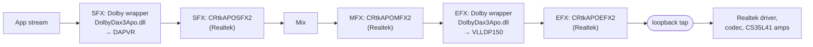

# The Windows speaker chain on the ASUS Zenbook Duo UX8406MA, and how faithfully speaker-tuning-to-easyeffects reproduces it

_Researched 2026-10-13. Converter examined: branch `master` at commit
[430e3a5](https://github.com/antoinecellerier/speaker-tuning-to-easyeffects/commit/430e3a501e21bf8fdb615b133d2e8130b17973c1)
(2026-10-11), which is `v2026.10-5-g430e3a5`. The latest release tag is
[v2026.10](https://github.com/antoinecellerier/speaker-tuning-to-easyeffects/releases/tag/v2026.10).
Labels: **[General DAX3]** means it holds for DAX3 tunings in general, mostly
measured on Lenovo laptops. **[ASUS]** means it was measured on other ASUS
ALC294/CS35L41 laptops. **[UX8406MA]** means it is specific to subsystem
1043:1C43. Several non-GitHub sources (Dolby, Microsoft, Cirrus, patents,
ASUS) could not be opened from this environment, because direct fetches failed.
Claims about them rest on search-engine extracts and are marked "(search
extract)". I could not find the UX8406MA tuning XML
(`DEV_0294_SUBSYS_10431C43_PCI_SUBSYS_1C431043.xml`) posted anywhere public, so
these notes quote no 1C43 parameter values. Gaps in each section say how to read
them from the user's own file._

## 1. What Windows does to the speaker signal, stage by stage (Realtek driver, APO slots, Dolby, codec, Cirrus amps, ASUS software)

### Takeaway
On Windows, the speaker signal passes through Dolby's DAX3 APO, which applies
ASUS's tuning XML in two stages: content processing (CP) and speaker/device
processing (VLLDP). A Realtek APO then runs after Dolby; what it does is
unknown. Next comes the Realtek kernel driver. Realtek's driver database holds a
per-device codec-EQ block (`RTHDAEQ`) for exactly 1043:1C43, and if the codec
applies it, it acts after Dolby. Last come two Cirrus CS35L41 smart amps on SPI,
running Cirrus speaker-protection firmware. The converter translates only the
Dolby XML. The Realtek codec-EQ layer has no Linux equivalent. The amp layer
exists on Linux only if the Cirrus firmware loads.

### Cited Findings
- **APO slots (Windows, general).** Stream effects (SFX) run per application
  stream, before mixing. Mode effects (MFX) run after the mix, for streams that
  share a mode. Endpoint effects (EFX) apply to every stream on the endpoint,
  raw streams included. Microsoft names speaker protection and compensation as
  typical EFX uses — [Microsoft Learn, APO architecture (search extract)](https://learn.microsoft.com/lb-lu/windows-hardware/drivers/audio/audio-processing-object-architecture).
  Each logical device can have one APO of each type — [Microsoft Learn, implementing APOs (search extract)](https://learn.microsoft.com/mt-mt/windows-hardware/drivers/audio/implementing-audio-processing-objects).
- **Order seen in real driver packages.** On a Surface Pro 9, the Realtek INF
  puts Dolby's APO in the stream slot (SFX) and Microsoft's Surface APO in the
  mode and endpoint slots. "Windows runs stream, then mode, then endpoint
  effects, so the Surface chain processes Dolby's output" — [converter, vendor-apo.md](https://github.com/antoinecellerier/speaker-tuning-to-easyeffects/blob/430e3a501e21bf8fdb615b133d2e8130b17973c1/docs/research/vendor-apo.md).
  "The Framework and ASUS extension `.inf`s chain a Realtek APO after Dolby's
  endpoint effect, but that APO's binaries name nothing from this file" — [converter, hardware-and-drivers.md#r-realtek-codec-database](https://github.com/antoinecellerier/speaker-tuning-to-easyeffects/blob/430e3a501e21bf8fdb615b133d2e8130b17973c1/docs/research/hardware-and-drivers.md#r-realtek-codec-database).
- **Dolby's two stages [General DAX3].** The XML carries `tuning-cp` (Content
  Processing: IEQ, graphic EQ, dialog enhancer, surround decoder, volume
  leveler) and `tuning-vlldp` (audio optimizer speaker correction, speaker PEQ,
  multi-band compressor, regulator) — [converter, reference.md](https://github.com/antoinecellerier/speaker-tuning-to-easyeffects/blob/430e3a501e21bf8fdb615b133d2e8130b17973c1/docs/reference.md).
  The converter's model of the flow is "Dialog Enhancer → IEQ → Volume
  Leveler" (CP, Media-Intelligence steered), then "Audio Optimizer → Speaker
  PEQ → MB Compressor → Regulator" (VLLDP). It calls VLLDP the "Very Low
  Latency Driver Path (VLLDP, HW)" — [converter, design-notes.md](https://github.com/antoinecellerier/speaker-tuning-to-easyeffects/blob/430e3a501e21bf8fdb615b133d2e8130b17973c1/docs/design-notes.md).
- **Where Windows loopback taps.** "DAX OFF raw transfer is −0.01 dB at 50%
  master volume. So WASAPI loopback taps the engine mix bus pre-volume" — [converter, loudness-and-limiting.md#r-peq-anti-clipping-trim](https://github.com/antoinecellerier/speaker-tuning-to-easyeffects/blob/430e3a501e21bf8fdb615b133d2e8130b17973c1/docs/research/loudness-and-limiting.md#r-peq-anti-clipping-trim).
  On a second laptop, "Dolby-off is a true bypass, and loopback taps post-APO" — [converter, eq-and-frequency-response.md#r-simplified-schema-ao-units](https://github.com/antoinecellerier/speaker-tuning-to-easyeffects/blob/430e3a501e21bf8fdb615b133d2e8130b17973c1/docs/research/eq-and-frequency-response.md#r-simplified-schema-ao-units).
- **Realtek's codec database (`RTAIODAT.DAT`) [UX8406MA].** The converter's
  maintainer finds that "Realtek's Windows codec driver appears to load
  per-device codec EQs and smart-amp DSP programs from `RTAIODAT.DAT`, a
  database outside the DAX3 XML. No Linux package or kernel quirk carries this
  data." Of the Dolby corpus's 1,098 Realtek-codec subsystem IDs, only two
  carry an `RTHDAEQ` block: `10431A63` (Zenbook 14 UX3405) and `10431C43` (the
  UX8406MA). Only `RTKVHD64.sys`, the kernel driver, names the file. The
  container layout is verified, but "every block's meaning is an unconfirmed
  hypothesis". "Whether Windows applies `RTHDAEQ0` on the Zenbook is
  unmeasured. If the EQ runs in the codec … it sits after the point a Windows
  loopback capture taps, so only an acoustic capture can validate it" — [converter, hardware-and-drivers.md#r-realtek-codec-database](https://github.com/antoinecellerier/speaker-tuning-to-easyeffects/blob/430e3a501e21bf8fdb615b133d2e8130b17973c1/docs/research/hardware-and-drivers.md#r-realtek-codec-database).
- **What such a block can do (sibling example).** Under the hypothesised
  layout, the UX3405's `ASUS1A63` block enables three bands: +6 dB at 100 Hz
  (200 Hz wide), −12 dB at 700 Hz (150 Hz wide) and +4 dB at 16 kHz (10 kHz
  wide), plus a 1st-order high-pass at 77 Hz. The resulting response would be
  "+4.0 dB at 100 Hz, −11.6 dB at 700 Hz and +4.0 dB at 16 kHz". The 1C43
  block's content is not published — [converter, hardware-and-drivers.md#r-realtek-codec-database](https://github.com/antoinecellerier/speaker-tuning-to-easyeffects/blob/430e3a501e21bf8fdb615b133d2e8130b17973c1/docs/research/hardware-and-drivers.md#r-realtek-codec-database).
- The same database holds `rtkhdasetting/` ZIP archives, "such as
  `AsusCusDat.zip` with a `Gen3pKey.dat` property-key store, apparently Realtek
  APO settings". They are unread — [converter, hardware-and-drivers.md](https://github.com/antoinecellerier/speaker-tuning-to-easyeffects/blob/430e3a501e21bf8fdb615b133d2e8130b17973c1/docs/research/hardware-and-drivers.md#r-realtek-codec-database).
- **Amps [UX8406MA].** The kernel's Realtek quirk table has
  `SND_PCI_QUIRK(0x1043, 0x1c43, "ASUS UX8406MA", ALC245_FIXUP_CS35L41_SPI_2)`:
  two CS35L41 amps on SPI — [Linux, sound/hda/codecs/realtek/alc269.c (line 7902 on 2026-10-13)](https://github.com/torvalds/linux/blob/master/sound/hda/codecs/realtek/alc269.c).
  ASUS's spec page lists "Smart Amp Technology … harman/kardon (Premium)" for
  the UX8406 — [ASUS techspec (search extract)](https://asus.com/laptops/for-home/zenbook/asus-zenbook-duo-2024-ux8406/techspec).
- **Where ASUS ships the tuning.** "The download ASUS titles *Dolby Atmos
  driver*" carries the DAX3 tunings, while "*Realtek Audio Driver*,
  `Audio_DriverOnly_Dolby_…`, held none despite its name". The converter's
  corpus holds ASUS's `ext_realtek_asus_consumer` package (67 XMLs, from
  `ASUS_Z_V10.123.533.43_16509_2.exe`) — [converter, corpus.md](https://github.com/antoinecellerier/speaker-tuning-to-easyeffects/blob/430e3a501e21bf8fdb615b133d2e8130b17973c1/docs/corpus.md).
  The RTAIODAT table above counts `10431C43` among the Dolby corpus's subsystem
  IDs, so the maintainer holds the UX8406MA XML — [converter, hardware-and-drivers.md](https://github.com/antoinecellerier/speaker-tuning-to-easyeffects/blob/430e3a501e21bf8fdb615b133d2e8130b17973c1/docs/research/hardware-and-drivers.md#r-realtek-codec-database).
- **Several copies of one tuning can differ.** One ThinkPad subsystem ID ships
  in two packages. The device package (`tuning_version=24`) has an active
  regulator. "A generic `dax3_ext_rtk` copy (`tuning_version=1`) has an
  all-zero, inert regulator" — [converter, loudness-and-limiting.md#r-volmax-boost-slot](https://github.com/antoinecellerier/speaker-tuning-to-easyeffects/blob/430e3a501e21bf8fdb615b133d2e8130b17973c1/docs/research/loudness-and-limiting.md#r-volmax-boost-slot).
  When auto-discovery finds several matches, the converter picks the highest
  `tuning_version` — [converter, lib/dax/discover.py L531–563, L783–795](https://github.com/antoinecellerier/speaker-tuning-to-easyeffects/blob/430e3a501e21bf8fdb615b133d2e8130b17973c1/lib/dax/discover.py#L531-L563).
  The #110 ASUS reporter's copy came from `dax3_ext_rtk`, not the ASUS package,
  "so byte identity is unconfirmed" — [converter, loudness-and-limiting.md#r-asus-deep-regulator-thresholds](https://github.com/antoinecellerier/speaker-tuning-to-easyeffects/blob/430e3a501e21bf8fdb615b133d2e8130b17973c1/docs/research/loudness-and-limiting.md#r-asus-deep-regulator-thresholds).
- **Windows user state.** One issue reporter extracted Dolby's `Runtime.xml`
  from a Windows partition. It showed `volume-leveler-enable` 1, a partial
  surround virtualizer enabled, and a 20-band `graphic-equalizer-bands` list — [converter issue #9](https://github.com/antoinecellerier/speaker-tuning-to-easyeffects/issues/9).
  A forum user reports that the Dolby app updates `Runtime.xml` in
  `C:\ProgramData\Dolby\DAX3` when settings change. This is anecdotal — [TechPowerUp forum (search extract)](https://techpowerup.com/forums/goto/post?id=4476525).
- **ASUS software.** ASUS's "Two-Way AI Noise Cancelation" output works through
  a separate virtual output device, "AI Noise-Cancelling Output (ASUS
  Utility)", that a call app selects. It is described for gaming notebooks and
  motherboards — [ASUS FAQ 1044576 (search extract)](https://www.asus.com/support/faq/1044576/).

### Inferences
- **[UX8406MA]** At least four layers shape the Windows sound: Dolby (CP +
  VLLDP), a Realtek APO after Dolby, a probable codec-side Realtek EQ, and
  Cirrus amp DSP firmware. Only Dolby's layer is in the XML the converter
  reads. Confidence: high that the layers exist (driver files and kernel quirk),
  low on what the Realtek APO and the `RTHDAEQ` block actually do.
- **[UX8406MA]** If the 1C43 `RTHDAEQ` block is applied on Windows and resembles
  the UX3405's, Windows would add several dB of EQ that no Linux preset
  reproduces, possibly including a deep midrange notch and bass and treble
  lifts. That could explain part of a "worse than Windows" impression that no
  converter flag can fix. Confidence: low. The 1C43 content is unread, and
  application on Windows is unmeasured.
- **[General]** Windows loopback measurements, including the converter's own
  `tools/measure_dax/`, capture Dolby (and any later APOs) but not codec EQ, amp
  DSP or the volume control. Matching Windows by loopback alone therefore
  cannot capture the codec and amp layers. Confidence: medium-high (follows from
  the measured pre-volume tap, and from the codec block's kernel-only reader).
- **[UX8406MA]** The XML the user converted may not be the one Windows loads.
  Several `dax3_ext_*` copies can exist, and the converter picks the highest
  `tuning_version`, not the copy the installed INF binds. Confidence: medium (a
  documented mechanism; unknown whether it applies here).
- **[ASUS]** The AI noise-cancelling output does not affect normal media
  playback, because it is a separate output device. Confidence: medium
  (documented for gaming notebooks only).

### Gaps
- What the Realtek APO after Dolby does (passthrough, format conversion or
  effects) is unknown. Its binaries were only string-searched.
- The 1C43 `RTHDAEQ` contents are undecoded, and whether Windows applies the
  block is unmeasured. The user could test it with a phone or measurement-mic
  sweep: Windows with Dolby off against Linux with no preset. They could also
  read the block from `RTAIODAT.DAT` in their Realtek driver folder, using the
  container layout the converter documents (MDTR header, 28-byte records and
  entries).
- Where VLLDP runs (in the EFX APO, an offloaded DSP or elsewhere) is not
  established. The converter's "HW" label is its own reading.
- Which `dax3_ext_*` package is bound on the user's Windows install, and its
  `tuning_version`. Device Manager's driver details or `pnputil /enum-drivers`
  would show it.
- No evidence was found of a separate Harman Kardon or ASUS speaker APO beyond
  Dolby and Realtek. The "harman/kardon (Premium)" certification is presumably
  realised through the Dolby tuning, but that is unverified.

## 2. Which DAX3 features are active for the built-in speakers, what each does, and what the XML tags mean

### Takeaway
**[General DAX3]** The speaker tuning combines several stages:
- Content stages: a dynamic, MI-steered Intelligent EQ; a speech-gated dialog
  enhancer; an MI-steered volume leveler on the "dynamic" profile; and a
  volume-maximizer ceiling (`volmax-boost`, typically +6 dB).
- Speaker stages: a static 20-band audio-optimizer correction, speaker PEQ
  biquads, an optional multi-band compressor (rare outside "music"), and the
  audio regulator. The regulator is a 20-band distortion limiter with per-band
  fixed thresholds and timbre-preserving coupling.

The virtualizer, graphic EQ, bass enhancer, volume modeler and pre/post gain are
dormant or frozen in essentially every speaker tuning. The Windows XML uses long
hyphenated tag names. The four-letter codes in the question (dvle, vmb, artp and
so on) are Dolby's internal parameter IDs from older Android configurations, and
most map one-to-one onto the long tags.

**[ASUS]** In ASUS's ALC294 tunings, deep regulator thresholds are the norm.
Whether the leveler is enabled varies from tuning to tuning.

### Cited Findings
**Units and tuning structure**
- Most dB fields are 1/16-dB fixed point. "A user set ±12 dB in DAX on Windows
  and the settings file stored ±192" — [converter, design-notes.md](https://github.com/antoinecellerier/speaker-tuning-to-easyeffects/blob/430e3a501e21bf8fdb615b133d2e8130b17973c1/docs/design-notes.md).
  The unit was confirmed on a second laptop: the audio optimizer matched its DAX
  on/off delta to a mean of about 0.7 dB — [converter, eq-and-frequency-response.md#r-simplified-schema-ao-units](https://github.com/antoinecellerier/speaker-tuning-to-easyeffects/blob/430e3a501e21bf8fdb615b133d2e8130b17973c1/docs/research/eq-and-frequency-response.md#r-simplified-schema-ao-units).
- The tags the converter parses live in each `profile`, under `tuning-cp` and
  `tuning-vlldp` — [converter, lib/dax/parse.py](https://github.com/antoinecellerier/speaker-tuning-to-easyeffects/blob/430e3a501e21bf8fdb615b133d2e8130b17973c1/lib/dax/parse.py):
  - **IEQ**: `ieq-enable`, `ieq-amount`, plus the `constant/ieq_*` curves.
  - **Audio optimizer**: `audio-optimizer-enable`, and
    `audio-optimizer-bands/ch_00,ch_01` (or `gain_l`/`gain_r`).
  - **Speaker PEQ**: `speaker-peq-enable`, and `speaker-peq-filters/filter`
    with `type`, `f0`, `gain`, `q`, `s` and `order`.
  - **Volume leveler**: `volume-leveler-enable`, `-amount`, `-in-target`,
    `-out-target`, plus the `-compressor-enable` and `-drc-enable` bits.
  - **Volume maximizer**: `volmax-boost`.
  - **Dialog enhancer**: `dialog-enhancer-enable`, `-amount`.
  - **Surround**: `surround-decoder-enable`, `surround-boost`.
  - **Virtual bass**: the `virtual-bass-*` fields.
  - **Multi-band compressor**: `mb-compressor-enable`, `-tuning`
    (`band_group_N`, `group_count`), `-target-power-level`.
  - **Regulator**: `regulator-speaker-dist-enable`, `regulator-tuning`
    (`threshold_high`, `threshold_low`, `isolated_band`),
    `regulator-distortion-slope`, `-timbre-preservation`, `-stress-amount`,
    `-overdrive`, `-relaxation-amount`.
  - **Profile default**: `setting/default_profile`.

**Content stages (`tuning-cp`)**
- **Intelligent EQ.** The three voicing curves (`ieq_balanced`, `ieq_detailed`,
  `ieq_warm`) are "Dolby-global voicings, not device tunings": every speaker
  XML carries the same 20-value arrays — [converter, cross-device-findings.md §1](https://github.com/antoinecellerier/speaker-tuning-to-easyeffects/blob/430e3a501e21bf8fdb615b133d2e8130b17973c1/docs/cross-device-findings.md).
  `ieq-amount` is 10 on 97% of IEQ-enabled dynamic rows — [same, §10](https://github.com/antoinecellerier/speaker-tuning-to-easyeffects/blob/430e3a501e21bf8fdb615b133d2e8130b17973c1/docs/cross-device-findings.md).
  The profile carries `mi-ieq-steering-enable=1`: "DAX applies the IEQ through
  content-adaptive Media Intelligence steering, not a static EQ" — [converter, eq-and-frequency-response.md#r-ieq-amount-scaling](https://github.com/antoinecellerier/speaker-tuning-to-easyeffects/blob/430e3a501e21bf8fdb615b133d2e8130b17973c1/docs/research/eq-and-frequency-response.md#r-ieq-amount-scaling).
  Dolby's whitepaper describes the Intelligent Equalizer as "continuously
  monitoring the spectral balance of the audio, comparing it to a desired tone,
  and dynamically adjusting an equalization filter" — [Dolby PC Entertainment Experience v4 white paper (search extract)](https://professional.dolby.com/siteassets/pdfs/dolby-pc-entertainment-experience-v4-white-paper.pdf).
  `ieq-enable` is 0 on roughly 45% of dynamic-profile rows — [converter, lib/dax/parse.py](https://github.com/antoinecellerier/speaker-tuning-to-easyeffects/blob/430e3a501e21bf8fdb615b133d2e8130b17973c1/lib/dax/parse.py#L195-L210).
- **Dialog enhancer.** "DAX's DE is evidently speech-gated". DAX output for
  `movie` (DE=5) and `game` (DE=0) was "identical to ±0.00 dB on *both* speech
  and pink" in a 2026-06-13 capture — [converter, adaptive-processing.md#r-dialog-enhancer-gain-ceiling](https://github.com/antoinecellerier/speaker-tuning-to-easyeffects/blob/430e3a501e21bf8fdb615b133d2e8130b17973c1/docs/research/adaptive-processing.md#r-dialog-enhancer-gain-ceiling).
  Dolby says its dialogue enhancer clarifies speech by suppressing interfering
  sound — [Dolby Atmos for sound bars (search extract)](https://professional.dolby.com/siteassets/tv/home/dolby-atmos/dolby-atmos-for-sound-bar-applications.pdf).
- **Volume leveler.**
  - `volume-leveler-in-target` and `-out-target` are −320 (−20 dBFS) on every
    device. `volume-leveler-amount` (0–10) on `dynamic` is 5 on 49% of rows —
    [converter, cross-device-findings.md §1, §3](https://github.com/antoinecellerier/speaker-tuning-to-easyeffects/blob/430e3a501e21bf8fdb615b133d2e8130b17973c1/docs/cross-device-findings.md).
  - `mi-dv-leveler-steering-enable=1` appears on 4205 of 4225 dynamic rows and
    "effectively none elsewhere" — [same, §11](https://github.com/antoinecellerier/speaker-tuning-to-easyeffects/blob/430e3a501e21bf8fdb615b133d2e8130b17973c1/docs/cross-device-findings.md).
  - Dolby's whitepaper says the leveler gauges perceived loudness and adjusts
    it to a consistent level, per channel and per band, to avoid pumping —
    [Dolby whitepaper (search extract)](https://professional.dolby.com/siteassets/pdfs/dolby-pc-entertainment-experience-v4-white-paper.pdf).
- **Volume maximizer (`volmax-boost`).** It is 6 dB on 78% of dynamic rows
  (range 4–8 dB). The `voice` profile goes up to 9 dB — [converter, cross-device-findings.md §4](https://github.com/antoinecellerier/speaker-tuning-to-easyeffects/blob/430e3a501e21bf8fdb615b133d2e8130b17973c1/docs/cross-device-findings.md).
  Dolby's PC material: the Volume Maximizer boosts the digital signal "by as
  much as 12 dB" after the leveler, with a look-ahead limiter to avoid clipping —
  [Dolby whitepaper (search extract)](https://professional.dolby.com/siteassets/pdfs/dolby-pc-entertainment-experience-v4-white-paper.pdf);
  [Dolby Advanced Audio v2 page (search extract)](https://professional.dolby.com/tv/dolby-advanced-audio-v2/).
- **Surround and virtualizer.** On 2-channel content DAX widened by
  essentially nothing: an S/M delta of +0.01 dB with `surround-boost=96`,
  identical to 0 and to Dolby off — [converter, adaptive-processing.md#r-surround-boost-stereo-base](https://github.com/antoinecellerier/speaker-tuning-to-easyeffects/blob/430e3a501e21bf8fdb615b133d2e8130b17973c1/docs/research/adaptive-processing.md#r-surround-boost-stereo-base).
- **Dormant stages.** `bass-enhancer-enable`, `virtual-bass-mode`,
  `graphic-equalizer-enable` and `volume-modeler-enable` are 0 on every device.
  `pregain`, `system-gain` and `calibration-boost` are always 0, and `postgain`
  is 0 on all but 66 rows — [converter, cross-device-findings.md §1](https://github.com/antoinecellerier/speaker-tuning-to-easyeffects/blob/430e3a501e21bf8fdb615b133d2e8130b17973c1/docs/cross-device-findings.md).
- **Virtual bass is decided outside the XML.** DAX "runs VBE on the dev X1
  Yoga, an HDA device: odd harmonics at near-fundamental amplitude on a 50 Hz
  tone". On a second laptop with identical VBE fields, DAX applies none. "Engine
  generation and product tier covary" (INF SKU `DolbyAccessNoGaming` vs
  `DolbyAtmosSpeakerSystem`) — [converter, virtual-bass.md#r-dax-virtual-bass](https://github.com/antoinecellerier/speaker-tuning-to-easyeffects/blob/430e3a501e21bf8fdb615b133d2e8130b17973c1/docs/research/virtual-bass.md#r-dax-virtual-bass).
- **Sliding bass.** It is enabled on 156 XMLs, with peak boost 3.0–18.6 dB and
  a 180–300 Hz crossover. Its semantics are unknown, and it is also gated by the
  registry value `HKR,Streaming_Speaker,DolbySlidingBass`, set per hardware ID
  in the INFs — [converter, cross-device-findings.md §14](https://github.com/antoinecellerier/speaker-tuning-to-easyeffects/blob/430e3a501e21bf8fdb615b133d2e8130b17973c1/docs/cross-device-findings.md).

**Speaker stages (`tuning-vlldp`)**
- **Audio optimizer.** A per-channel 20-band static correction (L/R
  asymmetric on some devices), gated by `audio-optimizer-enable` — [converter, reference.md](https://github.com/antoinecellerier/speaker-tuning-to-easyeffects/blob/430e3a501e21bf8fdb615b133d2e8130b17973c1/docs/reference.md).
  Dolby: it "improves the frequency response of a PC's built-in speakers" — [Dolby Advanced Audio v2 (search extract)](https://professional.dolby.com/tv/dolby-advanced-audio-v2/).
- **Speaker PEQ.** Filter types 1 (bell), 3 (high shelf), 4 (low shelf), 6/8
  (low-pass) and 7/9 (high-pass) — [converter, lib/preset/bands.py L244–315](https://github.com/antoinecellerier/speaker-tuning-to-easyeffects/blob/430e3a501e21bf8fdb615b133d2e8130b17973c1/lib/preset/bands.py#L244-L315).
- **Multi-band compressor.** It is "the exception, not the rule": enabled on
  189 of 4225 dynamic rows (4%) but 36% of music rows, where it often serves as
  a loudness maximiser — [converter, cross-device-findings.md §2](https://github.com/antoinecellerier/speaker-tuning-to-easyeffects/blob/430e3a501e21bf8fdb615b133d2e8130b17973c1/docs/cross-device-findings.md).
- **Audio regulator.**
  - `threshold_high` spans [−60, 0] dB in 1/16 dB, and is 0 dB on 66% of band
    samples. `threshold_low` equals `threshold_high − 12 dB` on 99.7% of
    samples. A −60 dB "rail" on bands 0–2 appears on about 10% of profiles —
    [converter, cross-device-findings.md §14](https://github.com/antoinecellerier/speaker-tuning-to-easyeffects/blob/430e3a501e21bf8fdb615b133d2e8130b17973c1/docs/cross-device-findings.md).
  - `regulator-distortion-slope=16` (read as a true brickwall) is set on 95.7%
    of profile rows that declare it — [converter, design-notes.md](https://github.com/antoinecellerier/speaker-tuning-to-easyeffects/blob/430e3a501e21bf8fdb615b133d2e8130b17973c1/docs/design-notes.md).
  - `regulator-timbre-preservation` is corpus-frozen at 12 (0.75),
    `regulator-relaxation-amount` at 96 and `regulator-overdrive` at 0 — [converter, loudness-and-limiting.md#r-regulator-timbre-knee](https://github.com/antoinecellerier/speaker-tuning-to-easyeffects/blob/430e3a501e21bf8fdb615b133d2e8130b17973c1/docs/research/loudness-and-limiting.md#r-regulator-timbre-knee); [cross-device-findings.md §1](https://github.com/antoinecellerier/speaker-tuning-to-easyeffects/blob/430e3a501e21bf8fdb615b133d2e8130b17973c1/docs/cross-device-findings.md).
  - Dolby: "Custom-calibrated for specific PC models, Audio Regulator
    eliminates or reduces noise caused by the combination of overdriven speakers
    and amplifiers" — [Dolby Advanced Audio v2 (search extract)](https://professional.dolby.com/tv/dolby-advanced-audio-v2/).
- **Dolby patents on the regulator.**
  - In Dolby's "distortion reducing multi-band compressor with timbre
    preservation" family (inventor Alan Seefeldt, priority 2010), each band has
    a fixed distortion threshold. "If a frequency band receives significant gain
    reduction due to being above its fixed threshold, then the time-varying
    thresholds of other frequency bands are also decreased" — [WO2011115944A1 (search extract)](https://patents.google.com/patent/WO2011115944A1/und);
    [US10256785 (search extract)](https://patents.google.com/patent/US10256785).
  - A later Dolby family says "the Audio Regulator of the Dolby Audio API"
    attenuates bands according to thresholds tied to the playback system's
    distortion characteristics, cannot boost, and, by attenuating neighbouring
    bands to preserve timbre, "can offset bass enhancement and even reduce
    overall playback volume" — [US11616482 (search extract)](https://patents.google.com/patent/US11616482);
    [US 2021/0265966 (search extract)](https://patents.justia.com/patent/20210265966).

**ASUS tunings [ASUS]**
- In ASUS's consumer Dolby package (`ext_asus_consumer_AIO_rtk`
  v10.123.533.43, 67 XMLs), 29 of the 33 ALC294 tunings have their deepest
  regulator band at or below −20 dB, 3 sit above −20 dB, and 1 has no active
  band — [converter, loudness-and-limiting.md#r-asus-deep-regulator-thresholds](https://github.com/antoinecellerier/speaker-tuning-to-easyeffects/blob/430e3a501e21bf8fdb615b133d2e8130b17973c1/docs/research/loudness-and-limiting.md#r-asus-deep-regulator-thresholds).
- **#110 (Vivobook S14 S5406, ALC294 1043:10C4):**
  - The regulator has five active bands, 328–1031 Hz, at −28.6, −20.2, −27.0,
    −21.0 and −25.6 dB, with slope 1.00 (100:1). Volmax is +6.0 dB — [loudness-and-limiting.md#r-asus-deep-regulator-thresholds](https://github.com/antoinecellerier/speaker-tuning-to-easyeffects/blob/430e3a501e21bf8fdb615b133d2e8130b17973c1/docs/research/loudness-and-limiting.md#r-asus-deep-regulator-thresholds).
  - The run printed a 4-band multi-band compressor, and a speaker correction of
    −5.0 dB at 1313 Hz and +2.0 dB at 9 kHz. The leveler is disabled in that
    tuning, so `--enable autogain` had no effect — [issue #110](https://github.com/antoinecellerier/speaker-tuning-to-easyeffects/issues/110).
- **#134 (Zenbook 14 OLED UM3406HA, ALC294 1043:1C03, CS35L41):** "Sound is way
  quiter without auto gain flag. Once you run with --enable-autogain, its almost
  perfect." That tuning therefore has its leveler enabled — [issue #134](https://github.com/antoinecellerier/speaker-tuning-to-easyeffects/issues/134).

**Four-letter parameter IDs (DAP/DS1)**
- An Android Dolby DS1 config (`ds1-default.xml`) stores profile parameters as
  four-letter codes. In the Movie profile, for example: `aoon=[2] dea=[5]
  ded=[0] deon=[1] dhrg=[0] dhsb=[96] dssb=[96] dssf=[200] dvla=[7] dvle=[1]
  dvme=[0] gebg=[…] geon=[0] iea=[10] ieon=[0] ngon=[2] plb=[0] plmd=[4]
  vdhe=[2] vmb=[144] vmon=[2] vspe=[2]`.
  - The speaker tuning block holds `aobf`/`aobg` (20 band frequencies and
    gains), plus `arbf`, `arbh=[0,…]`, `arbl=[-192,…]`, `arbi`, `arod=[0]`,
    `artp=[12]` and `dssa`.
  - The constants block holds `dvli=[-320] dvlo=[-320]`, along with `gebf`,
    `iebf` and `ienb`.
  - A comment says that on non-speaker endpoints the band gains are unused
    "UNLESS aoon is set 1 (from 2) and plmd is set to 2 (not 4)".
  - Its authorized technologies are audio_optimizer, audio_regulator,
    volume_leveler, volume_maximizer, graphic_equalizer, intelligent_equalizer,
    dialog_enhancer and the speaker and headphone surround virtualizers.
  - Source: [ds1-default.xml on GitHub](https://github.com/ferhung-mtk/android_kernel_huawei_h30t00/blob/master/kernel-3.4/mediatek/config/common/dolby/ds1-default.xml).
- A newer Android `dax-default.xml` (format 2.5) uses the same long names as the
  Windows DAX3 XML: `volume-leveler-amount`, `volmax-boost`,
  `regulator-timbre-preservation`, `regulator-overdrive`,
  `regulator-relaxation-amount`, `mi-ieq-steering-enable`,
  `bass-enhancer-boost`, `virtual-bass-subgains` and so on — [dax-default.xml on GitHub](https://github.com/x2-devel/vendor_vipdax_addon/blob/master/proprietary/etc/dolby/dax-default.xml).

### Inferences
- **The four-letter codes are the same parameters as the long DAX3 tags.** The
  mapping below rests on name patterns and on DS1 values that equal the DAX3
  corpus constants. The Windows XML for this laptop uses the long names, which
  is what the converter parses. Confidence: high where values match, medium on
  name pattern alone, low where marked.

  | Code | DAX3 long tag | Basis |
  |---|---|---|
  | `ieon` / `iea` / `iebt` / `iebf` / `ienb` | `ieq-enable` / `ieq-amount` / `ieq_*` target arrays / band frequencies / band count | `iea`=10 equals the corpus `ieq-amount` of 10 |
  | `deon` / `dea` / `ded` | `dialog-enhancer-enable` / `-amount` / `-ducking` | name pattern |
  | `dvle` / `dvla` / `dvli` / `dvlo` | `volume-leveler-enable` / `-amount` / `-in-target` / `-out-target` | `dvli`/`dvlo` = −320, equal to the DAX3 constant |
  | `dvme` / `dvmc` | `volume-modeler-enable` / `-calibration` | name pattern |
  | `vmon` / `vmb` | volume maximizer on / `volmax-boost` | `vmb`=144 is 9 dB in 1/16 dB |
  | `geon` / `gebg` / `gebf` / `genb` | `graphic-equalizer-enable` / band gains / band frequencies / band count | name pattern |
  | `aoon` / `aobf` / `aobg` | `audio-optimizer-enable` / band frequencies / band gains | the band grid matches |
  | `arbh` / `arbl` / `arbi` / `arod` / `artp` / `arbf` | regulator `threshold_high` / `threshold_low` / `isolated_band` / `regulator-overdrive` / `regulator-timbre-preservation` / band frequencies | `arbl` = −192 matches the high−12 dB pattern; `artp`=12 and `arod`=0 equal the corpus constants |
  | `vdhe` / `vspe` / `dhsb` / `dssb` / `dssf` / `dssa` / `dhrg` | headphone and speaker virtualizer enables / surround boosts / speaker start frequency / speaker angle / headphone reverb gain | `dssb`=96 matches the corpus `surround-boost` of 96 |
  | `plmd` | regulator mode, plausibly off, peak-protection or speaker-distortion | low confidence |

  The codes the question names but the DS1 file lacks are likely DAP v2
  additions:
  - `arra` = `regulator-relaxation-amount` (medium).
  - `bee`/`beb` = `bass-enhancer-enable`/`-boost` (medium).
  - `bex` = bass extraction (low).
  - `vbm` = `virtual-bass-mode` (medium).
  - `aro` = regulator on (low).
  - `vbh` and `dew` are unknown.
- **[General DAX3] Only part of the tuning is static.** The static, device-
  specific part is the audio optimizer, the PEQ and the regulator thresholds,
  plus the MBC when enabled. The intelligent EQ, dialog enhancer and leveler are
  content-adaptive on "dynamic", through MI steering. So a static Linux chain
  can at best match DAX at one operating point. Confidence: high (corpus flags
  plus captures).
- **[General DAX3] The XML's `isolated_band` array probably marks bands
  excluded from the timbre-preserving cross-band coupling the Dolby patent
  describes.** No source confirms its semantics. The converter only uses it to
  decide which 0 dB zones to limit. Confidence: low-medium.
- **[UX8406MA] The 1C43 tuning probably has a deep-threshold regulator.** If it
  belongs to the same ASUS package as #110, the package's ALC294 base rate is 29
  of 33. Whether its leveler is enabled cannot be inferred: ASUS tunings differ
  (#110 off, #134 on). Confidence: medium on the regulator, unknown on the
  leveler.

### Gaps
- The actual 1C43 values are not available here. In the user's XML, under
  `<profile type="dynamic">` (and whichever profile Windows uses), the values to
  read are:
  - `volume-leveler-enable` and `volume-leveler-amount`
  - `volmax-boost`
  - `ieq-enable` and `ieq-amount`
  - `dialog-enhancer-enable` and `-amount`
  - the `mi-*-steering-enable` flags
  - `audio-optimizer-enable` and `-bands`
  - `speaker-peq-filters`
  - `mb-compressor-enable` and `-tuning`
  - `regulator-tuning/threshold_high` and `isolated_band`, and
    `regulator-distortion-slope`
  - `sliding-bass-enable`
  - `setting/default_profile`

  The converter's `-v` output prints most of them.
- No public Dolby document defines `regulator-stress-amount`, `relaxation`,
  `overdrive`, `plmd`, `vbh` or `dew`. Dolby's DAP developer documentation is
  not public.
- It is unknown whether DAX3 applies `volmax-boost` when
  `volume-leveler-enable=0`. No source settles it (see section 4).

## 3. How much loudness the Dolby chain adds, and whether Windows also programs higher amp gain

### Takeaway
**[General DAX3]** Measured on other laptops, DAX's "dynamic" output is about
+8 dB louder than Dolby-off on loud pink noise and about +22 dB louder on quiet
pink noise, through the leveler and maximizer. DAX also lets transients reach
0 dBFS and clamps them only slowly. The converter's default preset measured 8
to 11.5 dB quieter than DAX at nominal level on its development laptop.

On the amp side, the Linux kernel gives the CS35L41 a 17.5 dB default PCM gain
(or the firmware's tuned gain) when its DSP firmware runs, but only 4.5 dB in
bypass. What the Windows Cirrus driver programs was not found.

### Cited Findings
- **Leveler magnitude (Yoga Slim 7 14ARE05, issue #44).** "Broadband pink RMS
  delta (dynamic − off) is +8.2 dB at the loud level and +21.8 dB at the quiet
  level". "The quiet-content gap our bypassed-by-default autogain leaves is an
  order of magnitude larger than the static-EQ residuals" — [converter, eq-and-frequency-response.md#r-simplified-schema-ao-units](https://github.com/antoinecellerier/speaker-tuning-to-easyeffects/blob/430e3a501e21bf8fdb615b133d2e8130b17973c1/docs/research/eq-and-frequency-response.md#r-simplified-schema-ao-units).
  As a 100 Hz–10 kHz mean it is +9.13 / +25.25 dB — [loudness-and-limiting.md#r-deep-threshold-bass-loss](https://github.com/antoinecellerier/speaker-tuning-to-easyeffects/blob/430e3a501e21bf8fdb615b133d2e8130b17973c1/docs/research/loudness-and-limiting.md#r-deep-threshold-bass-loss).
  The reporter "observed that Windows is far louder with Dolby on than off,
  while the Linux preset barely changes level" — [same](https://github.com/antoinecellerier/speaker-tuning-to-easyeffects/blob/430e3a501e21bf8fdb615b133d2e8130b17973c1/docs/research/loudness-and-limiting.md#r-deep-threshold-bass-loss).
- **Absolute converter-vs-DAX offset (ThinkPad X1 Yoga Gen 7).**
  - "The absolute EE−DAX offset is −11.5 dB on `dynamic`/`movie`/`game`".
  - With volume pinned at 50%: "a flat ≈ −8 dB EE−DAX offset (leveler boost +
    our −3 dB trim + convolver peak-normalisation, inseparable)".
  - Source: [converter, loudness-and-limiting.md#r-peq-anti-clipping-trim](https://github.com/antoinecellerier/speaker-tuning-to-easyeffects/blob/430e3a501e21bf8fdb615b133d2e8130b17973c1/docs/research/loudness-and-limiting.md#r-peq-anti-clipping-trim).
  - "Peak normalisation is the ≈−8…−12 dB absolute EE−DAX offset on the dev
    device at nominal level (pink, −17.8 dBFS)" — [same, "Where this stands"](https://github.com/antoinecellerier/speaker-tuning-to-easyeffects/blob/430e3a501e21bf8fdb615b133d2e8130b17973c1/docs/research/loudness-and-limiting.md).
- **DAX is not LTI.** The leveler and regulator "apply time-varying,
  content-adaptive gain":
  - The sweep envelope varied 16–34 dB.
  - "Multitone clipped on 4 of 6 profiles … the peak hit 0 dBFS with up to 113
    clipped samples. The regulator engaged as a hard limiter even at −18 dBFS
    RMS input."
  - "At −42 dBFS the leveler is *more* aggressive."
  - Source: [converter, adaptive-processing.md#r-dax-lti-behaviour](https://github.com/antoinecellerier/speaker-tuning-to-easyeffects/blob/430e3a501e21bf8fdb615b133d2e8130b17973c1/docs/research/adaptive-processing.md#r-dax-lti-behaviour).
- **How DAX treats loud bass (#44).**
  - DAX dynamic lands "0.2–2.8 dB *below* the input on sustained bass".
  - "The onset passes at full static gain". "The peak hits 0.00 dBFS, and every
    clipped sample falls inside the first 2–5.5 ms of a burst".
  - "Gain reduction then builds over ~100–150 ms".
  - DAX THD at 50 Hz is 10.1%, against 2.3–2.6% for the converter's chain.
  - The steady-state ceilings read as "*limit at the decoded threshold, then
    apply the makeup*", a +7.6…+7.8 dB offset against a `volmax-boost` of +7.0.
  - Source: [converter, loudness-and-limiting.md#r-deep-threshold-bass-loss](https://github.com/antoinecellerier/speaker-tuning-to-easyeffects/blob/430e3a501e21bf8fdb615b133d2e8130b17973c1/docs/research/loudness-and-limiting.md#r-deep-threshold-bass-loss).
- **Volmax adds a full +6 dB in the converter.** On broadband pink, both slots
  added "+6.0 dB over no-volmax", with "0 dB give-back" on the dev laptop — [converter, loudness-and-limiting.md#r-volmax-boost-slot](https://github.com/antoinecellerier/speaker-tuning-to-easyeffects/blob/430e3a501e21bf8fdb615b133d2e8130b17973c1/docs/research/loudness-and-limiting.md#r-volmax-boost-slot).
  Dolby markets up to +12 dB for the maximizer — [Dolby Advanced Audio v2 (search extract)](https://professional.dolby.com/tv/dolby-advanced-audio-v2/).
- **Field reports of the loudness gap.**
  - Enabling the leveler in EasyEffects "gained ~+9 dB vs bypassed on −20 dBFS
    RMS program material" — [converter, adaptive-processing.md#r-autogain-default-flip](https://github.com/antoinecellerier/speaker-tuning-to-easyeffects/blob/430e3a501e21bf8fdb615b133d2e8130b17973c1/docs/research/adaptive-processing.md#r-autogain-default-flip).
  - The #25 reporter confirmed "enable + −50 dB gate ≈ Windows loudness on the
    E14" — [same](https://github.com/antoinecellerier/speaker-tuning-to-easyeffects/blob/430e3a501e21bf8fdb615b133d2e8130b17973c1/docs/research/adaptive-processing.md#r-autogain-default-flip).
  - On an IdeaPad, a user found the early preset "so quiet even on 150%", and
    the maintainer agreed it was "quieter in terms of volume" — [issue #9](https://github.com/antoinecellerier/speaker-tuning-to-easyeffects/issues/9).
  - **[ASUS]** On a Zenbook UM3406HA it was "way quiter without auto gain flag"
    — [issue #134](https://github.com/antoinecellerier/speaker-tuning-to-easyeffects/issues/134).
- **Amp gain on Linux.** With the DSP not running, unmute writes
  `AMP_GAIN_PCM 4.5 dB` (mute writes 0.5 dB). With the DSP running, it writes
  `tuning_gain`, read from a tuning-parameter file and otherwise defaulting to
  `DEFAULT_AMP_GAIN_PCM 17 /* 17.5dB Gain */`. The firmware type is "spk-prot",
  and a kernel log line reads "Firmware Loaded - Type: %s, Gain: %d" — [Linux, cs35l41_hda.c](https://github.com/torvalds/linux/blob/master/sound/hda/codecs/side-codecs/cs35l41_hda.c);
  [cs35l41_hda.h L25–26](https://github.com/torvalds/linux/blob/master/sound/hda/codecs/side-codecs/cs35l41_hda.h).
- **Over-amplification on Linux.** The converter's docs say "Over-amplification
  is digital gain applied after the preset's limiter, so extreme values can
  clip" — [converter, troubleshooting.md](https://github.com/antoinecellerier/speaker-tuning-to-easyeffects/blob/430e3a501e21bf8fdb615b133d2e8130b17973c1/docs/troubleshooting.md#troubleshooting-correct-but-too-quiet).

### Inferences
- **[General] Windows is louder mainly in average level, not peak level.** Both
  chains peak near full scale: DAX lets onsets hit 0 dBFS, and the converter's
  brickwall sits at −1 dBFS. So most of the Windows loudness advantage comes
  from three things:
  - **Average level.** The leveler, the maximizer applied after limiting, the
    full unnormalised correction curve, and slow-attack limiting that keeps
    transients.
  - **Analog/amp gain.** This is the other researchers' scope.
  - **Peak headroom.** That is only about 1 dB.

  Raising GNOME's volume above 100% mostly drives a limiter or clips. It does
  not recover the leveler's density. Confidence: medium-high (measured peaks
  plus chain structure; the routing of over-amplification depends on which sink
  is selected, which the PipeWire researcher should confirm).
- **[UX8406MA] The size of the Dolby loudness gain depends on the 1C43 tuning.**
  If its active profile enables the leveler (as on #134), Windows likely runs
  roughly +8 dB (loud content) to +20 dB (quiet content) above Dolby-off, and
  the default converter preset gives none of that back. If the leveler is off
  (as on #110), the gap is smaller and comes from volmax, the FIR normalisation
  and the regulator placement (section 4). Confidence: medium (two ASUS data
  points, Lenovo measurements).
- **[UX8406MA] If the Linux amps run without DSP firmware, they lose about
  13 dB of amp gain** against the default tuned gain (4.5 dB vs 17.5 dB), on top
  of any Dolby gap. That is worth checking first, via the kernel log line above.
  Confidence: high on the code path; whether it applies here is the amp
  researcher's question.

### Gaps
- No UX8406MA-specific Windows measurement exists: a DAX on/off loopback or an
  acoustic SPL comparison.
- What gain or volume the Windows Cirrus driver programs on the CS35L41s, and
  how the Windows volume slider maps to codec or amp volume. No source found.
- Whether DAX applies `volmax-boost` when the leveler is disabled, and whether
  it applies it after the regulator as the #44 capture suggests. One device,
  inference only.

## 4. The converter: what it implements, how it maps each DAX3 field, what it omits, and its known problems

### Takeaway
The converter builds a static EasyEffects chain: Convolver (FIR of the audio
optimizer plus 10% of the IEQ, peak-normalised) → Equalizer (speaker PEQ, with a
negative output trim) → dialog bell → Autogain (bypassed on HDA) → multi-band
compressor (Dolby's MBC, if enabled) → second multi-band compressor as the
per-band regulator (+6 dB volmax on its input, 1 ms attack, 100:1) → brickwall
limiter at −1 dBFS.

Only three things are validated against Windows captures: the 10% IEQ weight,
the audio-optimizer units, and the FIR's accuracy. The dynamics mappings are
invented or unvalidated. The chain also omits the parts of DAX that matter most
for loudness and "life": MI steering, an active leveler, virtual bass in
EasyEffects, sliding bass, the Realtek codec EQ and the normalisation level.
Its "Correction check passed" verifies only that the FIR matches its own target
shape.

### Cited Findings
**Version, scope and claims**
- The version is v2026.10 plus 5 commits. The unreleased section has one
  [AUDIBLE] fix: compressor thresholds below −60 dB now run at −60 dB with less
  makeup. It affects only the ASUS all-in-one tunings 10431EE2, 10431003,
  104312B3 and 10431BF2 — [CHANGELOG.md](https://github.com/antoinecellerier/speaker-tuning-to-easyeffects/blob/430e3a501e21bf8fdb615b133d2e8130b17973c1/CHANGELOG.md);
  [adaptive-processing.md#r-threshold-below-lsp-floor](https://github.com/antoinecellerier/speaker-tuning-to-easyeffects/blob/430e3a501e21bf8fdb615b133d2e8130b17973c1/docs/research/adaptive-processing.md#r-threshold-below-lsp-floor).
- The README promises "the same speaker correction, EQ, and dynamics processing
  as on Windows" and "Confirmed on over 40 laptops". The only ASUS ALC294 entry
  is the Zenbook 14 UX3405 (1043:1A63) — [README](https://github.com/antoinecellerier/speaker-tuning-to-easyeffects/blob/430e3a501e21bf8fdb615b133d2e8130b17973c1/README.md).
  Those two UX3405 reports contain no Windows comparison. One says "much better
  than before"; the other is a bare thanks — [issue #24](https://github.com/antoinecellerier/speaker-tuning-to-easyeffects/issues/24);
  [issue #19](https://github.com/antoinecellerier/speaker-tuning-to-easyeffects/issues/19).
- **Core invariant**: "every parameter emitted traces to a parsed DAX3 XML
  field … The XML→param mappings below are hypotheses about the schema" — [reference.md](https://github.com/antoinecellerier/speaker-tuning-to-easyeffects/blob/430e3a501e21bf8fdb615b133d2e8130b17973c1/docs/reference.md).

**The chain, in order**
- "Convolver → [Bass Enhancer] → Equalizer (PEQ) → Dialog Enhancer EQ →
  Autogain → MB Compressor → Regulator → Limiter". The bass enhancer is emitted
  for SoundWire only — [design-notes.md](https://github.com/antoinecellerier/speaker-tuning-to-easyeffects/blob/430e3a501e21bf8fdb615b133d2e8130b17973c1/docs/design-notes.md);
  [lib/preset/build.py L66–267](https://github.com/antoinecellerier/speaker-tuning-to-easyeffects/blob/430e3a501e21bf8fdb615b133d2e8130b17973c1/lib/preset/build.py#L66-L267).

**Stage 1: Convolver (audio optimizer + IEQ)**
- The target is `AO/16 + (IEQ/16)·(ieq-amount/100)` per channel — [lib/preset/emit.py L284–333](https://github.com/antoinecellerier/speaker-tuning-to-easyeffects/blob/430e3a501e21bf8fdb615b133d2e8130b17973c1/lib/preset/emit.py#L284-L333).
- The FIR is a 4096-tap minimum-phase design at 48 kHz, built by the cepstral
  method. `make_fir` divides each channel by its own peak, so "the convolver only
  ever attenuates" — [lib/preset/fir.py L104–153](https://github.com/antoinecellerier/speaker-tuning-to-easyeffects/blob/430e3a501e21bf8fdb615b133d2e8130b17973c1/lib/preset/fir.py#L104-L153);
  [loudness-and-limiting.md#r-gain-staging-budget](https://github.com/antoinecellerier/speaker-tuning-to-easyeffects/blob/430e3a501e21bf8fdb615b133d2e8130b17973c1/docs/research/loudness-and-limiting.md#r-gain-staging-budget).
- "A curve whose peak exceeds `volmax-boost` emits a preset quieter than
  bypass". In one example, every band lands 9.2 dB short of the tuning. "Over
  the 3051 parsed corpus XMLs … the two combined-curve peaks diverge on 19.1% of
  files", which shifts the stereo balance — [loudness-and-limiting.md#r-level-restore](https://github.com/antoinecellerier/speaker-tuning-to-easyeffects/blob/430e3a501e21bf8fdb615b133d2e8130b17973c1/docs/research/loudness-and-limiting.md#r-level-restore).
- The three voicings end up at most about 1 dB apart. "A subtle difference
  between the three presets is expected, not a defect" — [reference.md](https://github.com/antoinecellerier/speaker-tuning-to-easyeffects/blob/430e3a501e21bf8fdb615b133d2e8130b17973c1/docs/reference.md).
- With `ieq-enable=0`, the profile report says "Windows applies none". The
  build still applies the IEQ at an assumed 10% — [lib/report/profile.py](https://github.com/antoinecellerier/speaker-tuning-to-easyeffects/blob/430e3a501e21bf8fdb615b133d2e8130b17973c1/lib/report/profile.py).

**Stage 2: Equalizer (speaker PEQ)**
- Each XML filter becomes an LSP band: bells as "RLC (BT)", shelves with Q
  derived from S, and HP/LP slope from `order`, with split channels.
- `output-gain` = −max(effective boost), where a bell counts as
  `gain·min(1,2/Q)` and a shelf counts its full gain — [lib/preset/bands.py L244–315](https://github.com/antoinecellerier/speaker-tuning-to-easyeffects/blob/430e3a501e21bf8fdb615b133d2e8130b17973c1/lib/preset/bands.py#L244-L315).
- That trim rule is "converter-invented. Nothing says DAX trims broadband level
  at all" — [loudness-and-limiting.md#r-peq-anti-clipping-trim](https://github.com/antoinecellerier/speaker-tuning-to-easyeffects/blob/430e3a501e21bf8fdb615b133d2e8130b17973c1/docs/research/loudness-and-limiting.md#r-peq-anti-clipping-trim).

**Stage 3: Dialog enhancer**
- A static bell at 2.5 kHz, Q 0.7, with gain = amount/16 × 6 dB — [lib/preset/plugins.py L33–65](https://github.com/antoinecellerier/speaker-tuning-to-easyeffects/blob/430e3a501e21bf8fdb615b133d2e8130b17973c1/lib/preset/plugins.py#L33-L65).
- "Our bell appears to over-apply vs DAX" — [adaptive-processing.md#r-dialog-enhancer-gain-ceiling](https://github.com/antoinecellerier/speaker-tuning-to-easyeffects/blob/430e3a501e21bf8fdb615b133d2e8130b17973c1/docs/research/adaptive-processing.md#r-dialog-enhancer-gain-ceiling).

**Stage 4: Autogain (volume leveler)**
- It is bypassed on HDA unless `--enable autogain`, with target =
  `volume-leveler-out-target`, history window `max(30−5·amount, 10)` s, a −50 dB
  silence gate and the "Geometric Mean (MSI)" reference — [lib/preset/plugins.py L68–112](https://github.com/antoinecellerier/speaker-tuning-to-easyeffects/blob/430e3a501e21bf8fdb615b133d2e8130b17973c1/lib/preset/plugins.py#L68-L112).
- It stays bypassed because "Dolby's volume leveler is MI-steered", while
  EasyEffects' autogain "has no content awareness" — [adaptive-processing.md#r-autogain-bypassed-by-default](https://github.com/antoinecellerier/speaker-tuning-to-easyeffects/blob/430e3a501e21bf8fdb615b133d2e8130b17973c1/docs/research/adaptive-processing.md#r-autogain-bypassed-by-default).
- A 2026-07 attempt to make it the default failed the listening gate. "The
  leveler boosts the *legitimate* quiet background by ~14 dB", and "each voice
  onset rides ~4 dB of overshoot" — [adaptive-processing.md#r-autogain-default-flip](https://github.com/antoinecellerier/speaker-tuning-to-easyeffects/blob/430e3a501e21bf8fdb615b133d2e8130b17973c1/docs/research/adaptive-processing.md#r-autogain-default-flip).
- Dolby's `volume-leveler-compressor` and `-drc` sub-blocks carry "only an
  on/off bit" and are not reproduced — [cross-device-findings.md §14](https://github.com/antoinecellerier/speaker-tuning-to-easyeffects/blob/430e3a501e21bf8fdb615b133d2e8130b17973c1/docs/cross-device-findings.md).

**Stage 5: Multi-band compressor (Dolby's MBC)**
- Each band is a 6-tuple: crossover index; threshold /16; ratio = 32768/coeff;
  attack and release as Q15 block-rate coefficients at 256 samples/block; and
  makeup /16. Knee is −6 dB, with RMS detection, a Middle sidechain, Downward
  mode and the LSP "Modern" compressor — [lib/preset/plugins.py L218–398](https://github.com/antoinecellerier/speaker-tuning-to-easyeffects/blob/430e3a501e21bf8fdb615b133d2e8130b17973c1/lib/preset/plugins.py#L218-L398);
  [reference.md](https://github.com/antoinecellerier/speaker-tuning-to-easyeffects/blob/430e3a501e21bf8fdb615b133d2e8130b17973c1/docs/reference.md).
- "The Q15 format and 256-sample block size are assumed … never measured" — [adaptive-processing.md#r-mbc-ratio-time-constants](https://github.com/antoinecellerier/speaker-tuning-to-easyeffects/blob/430e3a501e21bf8fdb615b133d2e8130b17973c1/docs/research/adaptive-processing.md#r-mbc-ratio-time-constants).

**Stage 6: Regulator (second multi-band compressor)**
- **Zones.** The 20 bands are grouped into at most 8 zones. Merges keep the
  less aggressive threshold.
- **Ratio and knee.** Ratio is `1/(1−slope)`, or 100:1 at a slope of 1. Knee is
  −6 × timbre.
- **Timing and detection.** Attack 1 ms, release 50 ms, Peak sidechain, 1 ms
  sidechain lookahead.
- **Unused fields.** `threshold_low` and `stress` are not used.
- **Volmax.** It goes on `input-gain` by default.
- **Coupled bands.** Since 2026-08-11, zones at 0 dBFS made of non-isolated
  bands are limited at 0 dBFS ("coupled-bands").
- Sources: [lib/preset/plugins.py L401–589](https://github.com/antoinecellerier/speaker-tuning-to-easyeffects/blob/430e3a501e21bf8fdb615b133d2e8130b17973c1/lib/preset/plugins.py#L401-L589);
  [reference.md](https://github.com/antoinecellerier/speaker-tuning-to-easyeffects/blob/430e3a501e21bf8fdb615b133d2e8130b17973c1/docs/reference.md).
- The slope→ratio and timbre→knee mappings are guesses. "The `−6` dB maximum
  knee is a pure guess" — [loudness-and-limiting.md#r-regulator-timbre-knee](https://github.com/antoinecellerier/speaker-tuning-to-easyeffects/blob/430e3a501e21bf8fdb615b133d2e8130b17973c1/docs/research/loudness-and-limiting.md#r-regulator-timbre-knee).
- The attack and release values are "chosen from limiting practice, not
  decoded". On the dev laptop the realised regulator "fits an effective ratio
  ≈1.8 at 234 Hz against the configured 100:1" — [loudness-and-limiting.md#r-fixed-dynamics-constants](https://github.com/antoinecellerier/speaker-tuning-to-easyeffects/blob/430e3a501e21bf8fdb615b133d2e8130b17973c1/docs/research/loudness-and-limiting.md#r-fixed-dynamics-constants).
- On deep-threshold tunings it over-engages:
  - The default placement put loud bass "7–9 dB too quiet" against DAX.
    `--volmax-slot output-gain` was closest to DAX and confirmed by ear ("on par
    with what I heard in Windows") — [loudness-and-limiting.md#r-deep-threshold-bass-loss](https://github.com/antoinecellerier/speaker-tuning-to-easyeffects/blob/430e3a501e21bf8fdb615b133d2e8130b17973c1/docs/research/loudness-and-limiting.md#r-deep-threshold-bass-loss);
    [issue #44 comment](https://github.com/antoinecellerier/speaker-tuning-to-easyeffects/issues/44#issuecomment-5399420807).
  - A second deep tuning showed regulator distortion of 0.4–2.2% and onsets
    passing about 5 dB above the linear build — [loudness-and-limiting.md#r-deep-threshold-distortion](https://github.com/antoinecellerier/speaker-tuning-to-easyeffects/blob/430e3a501e21bf8fdb615b133d2e8130b17973c1/docs/research/loudness-and-limiting.md#r-deep-threshold-distortion).
- **[ASUS]** The #110 reporter heard "surges/bursts", with fewer of them under
  `--disable volmax --disable regulator`. The maintainer suspects "the deep
  per-band limiter, with the +6 dB boost applied before it" and suggested
  `--volmax-slot output-gain`. The issue remains open — [issue #110](https://github.com/antoinecellerier/speaker-tuning-to-easyeffects/issues/110);
  [loudness-and-limiting.md#r-asus-deep-regulator-thresholds](https://github.com/antoinecellerier/speaker-tuning-to-easyeffects/blob/430e3a501e21bf8fdb615b133d2e8130b17973c1/docs/research/loudness-and-limiting.md#r-asus-deep-regulator-thresholds).

**Stage 7: Limiter**
- LSP "Herm Thin" mode, no oversampling, 1 ms lookahead, 1 ms attack, 5 ms
  release, −1 dB threshold, gain-boost off. It is the fallback slot for volmax
  when there is no regulator — [lib/preset/plugins.py L744–772](https://github.com/antoinecellerier/speaker-tuning-to-easyeffects/blob/430e3a501e21bf8fdb615b133d2e8130b17973c1/lib/preset/plugins.py#L744-L772).

**Volmax handling**
- `volmax-boost` is read whether or not the leveler is enabled, and is applied
  statically unless `--disable volmax` — [lib/dax/parse.py L536–543](https://github.com/antoinecellerier/speaker-tuning-to-easyeffects/blob/430e3a501e21bf8fdb615b133d2e8130b17973c1/lib/dax/parse.py#L536-L543);
  [lib/preset/build.py L174–183](https://github.com/antoinecellerier/speaker-tuning-to-easyeffects/blob/430e3a501e21bf8fdb615b133d2e8130b17973c1/lib/preset/build.py#L174-L183).
- Neither slot is derived from Dolby, because "`volmax-boost` is itself a
  CP-stage leveler ceiling" — [reference.md](https://github.com/antoinecellerier/speaker-tuning-to-easyeffects/blob/430e3a501e21bf8fdb615b133d2e8130b17973c1/docs/reference.md).

**What the converter leaves out, and why**
- Per [reference.md, "Not implemented"](https://github.com/antoinecellerier/speaker-tuning-to-easyeffects/blob/430e3a501e21bf8fdb615b133d2e8130b17973c1/docs/reference.md):
  - `filter_coefficients` ("VLLDP-internal analysis filters").
  - `regulator-stress-amount` and `threshold_low`.
  - Compensation for the FIR normalisation (opt-in only).
  - Virtual bass on HDA (PipeWire opt-in only).
  - Pregain, postgain, calibration-boost and system-gain.
  - Bass extraction, volume modeler, graphic EQ, surround and virtualizer, and
    MI steering.
  - The woofer regulator.
  - `ieq-bands-set` and 44.1 kHz.
- `surround-boost` is no longer mapped to widening, because a DAX capture showed
  zero widening — [adaptive-processing.md#r-surround-boost-stereo-base](https://github.com/antoinecellerier/speaker-tuning-to-easyeffects/blob/430e3a501e21bf8fdb615b133d2e8130b17973c1/docs/research/adaptive-processing.md#r-surround-boost-stereo-base).
- Sliding bass is not implemented and not mentioned to users. Dynamic Speaker
  Optimization and the advanced virtualizer are warned about but not
  implemented — [cross-device-findings.md §14](https://github.com/antoinecellerier/speaker-tuning-to-easyeffects/blob/430e3a501e21bf8fdb615b133d2e8130b17973c1/docs/cross-device-findings.md).
- No other built-in EasyEffects plugin (Exciter, Crystalizer, Maximizer, Bass
  Loudness and so on) is used. They are rejected as invention, as validated to
  zero effect, or as static where DAX is content-gated — [adaptive-processing.md#r-unused-ee-builtins](https://github.com/antoinecellerier/speaker-tuning-to-easyeffects/blob/430e3a501e21bf8fdb615b133d2e8130b17973c1/docs/research/adaptive-processing.md#r-unused-ee-builtins).
- Virtual bass:
  - "EasyEffects' serial pipeline cannot express the parallel branch". The
    opt-in VBE runs on the PipeWire path only, scoring S = 4.43, where doing
    nothing scores 10.0, on one laptop — [reference.md](https://github.com/antoinecellerier/speaker-tuning-to-easyeffects/blob/430e3a501e21bf8fdb615b133d2e8130b17973c1/docs/reference.md).
  - Calf BassEnhancer "scores 18.43, worse than doing nothing" — [virtual-bass.md](https://github.com/antoinecellerier/speaker-tuning-to-easyeffects/blob/430e3a501e21bf8fdb615b133d2e8130b17973c1/docs/research/virtual-bass.md#r-dax-virtual-bass).
- The FIR is minimum-phase, while DAX sits "between linear-phase and
  minimum-phase". The project rejects hybrid phase because of its no-latency
  constraint — [eq-and-frequency-response.md#r-dax-phase-response](https://github.com/antoinecellerier/speaker-tuning-to-easyeffects/blob/430e3a501e21bf8fdb615b133d2e8130b17973c1/docs/research/eq-and-frequency-response.md#r-dax-phase-response).

**Validation**
- Validated against DAX captures:
  - The `ieq-amount` /100 reading.
  - The simplified-schema audio-optimizer units.
  - The FIR realisation, by a synthetic check only.
- Unvalidated:
  - The dialog-enhancer ceiling, the regulator slope and knee, the MBC Q15
    decode, the threshold-floor makeup, and the autogain formulas.
  - Coupled-bands: "No DAX capture confirms it".
- Source: [reference.md, "Validated vs unvalidated mappings"](https://github.com/antoinecellerier/speaker-tuning-to-easyeffects/blob/430e3a501e21bf8fdb615b133d2e8130b17973c1/docs/reference.md).
- "Correction check passed" means the built FIR matches "the shape of the
  curve" within `FIR_VERIFY_OK_DB = 0.5` dB at the band centres. "The absolute
  level is short by the curve's peak by design" — [lib/preset/emit.py L186–252, L446–496](https://github.com/antoinecellerier/speaker-tuning-to-easyeffects/blob/430e3a501e21bf8fdb615b133d2e8130b17973c1/lib/preset/emit.py#L186-L252).
- On the dev laptop, after the IEQ fix, the in-band pink EE−DAX RMS fell to
  1.03 dB. That leaves "a ~1 dB HF residual and the LF/leveler gap" — [eq-and-frequency-response.md](https://github.com/antoinecellerier/speaker-tuning-to-easyeffects/blob/430e3a501e21bf8fdb615b133d2e8130b17973c1/docs/research/eq-and-frequency-response.md).
  At 80 Hz the converter was 18.6 dB below DAX on a bass burst — [loudness-and-limiting.md#r-deep-threshold-bass-loss](https://github.com/antoinecellerier/speaker-tuning-to-easyeffects/blob/430e3a501e21bf8fdb615b133d2e8130b17973c1/docs/research/loudness-and-limiting.md#r-deep-threshold-bass-loss).

**Flags**
- `--disable` takes `volmax`, `mbc`, `regulator`, `coupled-bands`, `autogain`,
  `bass-enhancer`, `dialog`, `high-shelf`, `lo-pass` or `vendor-apo`. `--enable`
  takes `autogain`, `level-restore`, `virtual-bass` or `vendor-apo`. Other
  options: `--volmax-slot {input-gain,output-gain}`, `--profile`,
  `--all-profiles`, `--mode`, `-v` and `--doctor` — [dolby-to-easyeffects.md](https://github.com/antoinecellerier/speaker-tuning-to-easyeffects/blob/430e3a501e21bf8fdb615b133d2e8130b17973c1/docs/dolby-to-easyeffects.md);
  [filters.md](https://github.com/antoinecellerier/speaker-tuning-to-easyeffects/blob/430e3a501e21bf8fdb615b133d2e8130b17973c1/docs/filters.md).
- `--enable level-restore` "hands that level back", and is experimental. "On
  the one device that has listened, loud speech picked up audible artifacts" — [filters.md](https://github.com/antoinecellerier/speaker-tuning-to-easyeffects/blob/430e3a501e21bf8fdb615b133d2e8130b17973c1/docs/filters.md).
  On the dev laptop, "Restore is +11.3 dB and volmax +6.0" — [loudness-and-limiting.md#r-level-restore](https://github.com/antoinecellerier/speaker-tuning-to-easyeffects/blob/430e3a501e21bf8fdb615b133d2e8130b17973c1/docs/research/loudness-and-limiting.md#r-level-restore).
- `--enable autogain` prints "had no effect" when the XML's leveler is disabled — [dolby_to_easyeffects.py L985–996](https://github.com/antoinecellerier/speaker-tuning-to-easyeffects/blob/430e3a501e21bf8fdb615b133d2e8130b17973c1/dolby_to_easyeffects.py#L985-L996).
- Without `--profile`, the converter builds the first profile.
  `<setting><default_profile>` "is read but not acted on" — [reference.md](https://github.com/antoinecellerier/speaker-tuning-to-easyeffects/blob/430e3a501e21bf8fdb615b133d2e8130b17973c1/docs/reference.md).

**Open issues and known problems**
- The open issues include:
  - #14, DAX's virtual bass (a fidelity gap).
  - #29, Zenbook S14.
  - #39, ROG Xbox Ally X.
  - #46, the T495 gain-rail tuning.
  - #50, Yoga 7i level-restore.
  - #110, the ASUS Vivobook.
  - #117, Zenbook Pro 16X.
  - #123, "--doctor passes 'LV2 plugins: present' while the chain is dead".
  - #134, ASUS UM3406HA.
  - Source: [open issues list](https://github.com/antoinecellerier/speaker-tuning-to-easyeffects/issues?q=is%3Aissue%20state%3Aopen).
- EasyEffects "resamples the convolver kernel to whatever rate the PipeWire
  graph runs at and compensates no gain", so a graph above 48 kHz plays hot — [reference.md](https://github.com/antoinecellerier/speaker-tuning-to-easyeffects/blob/430e3a501e21bf8fdb615b133d2e8130b17973c1/docs/reference.md).
- A recorded contradiction: two sites take 1 ms of look-ahead despite the
  zero-latency claim — [design-notes.md](https://github.com/antoinecellerier/speaker-tuning-to-easyeffects/blob/430e3a501e21bf8fdb615b133d2e8130b17973c1/docs/design-notes.md).

### Inferences
- **Approximations that matter most on an ASUS ALC294 + CS35L41 laptop**, most
  important first:
  1. **Leveler.** A bypassed or non-adaptive leveler loses about 8–20 dB of
     average loudness where the tuning enables it. Confidence: medium-high.
  2. **FIR normalisation.** It sits typically several dB to about 11 dB below
     the tuning's intent, and volmax only partly compensates. Confidence: high.
  3. **Regulator placement.** On a deep-threshold tuning, a 1 ms-attack
     regulator with volmax at its input (the likely ASUS case) means less bass,
     less punch, and "surges" on music. DAX instead limits slowly and applies
     makeup afterwards. Confidence: medium. That rests on one DAX capture plus
     ASUS #110, and is not measured on 1C43.
  4. **Missing bass stages.** No virtual or sliding bass in EasyEffects, while
     DAX's own engagement on this laptop is unknown. Confidence: medium that
     bass is perceptibly thinner; low on the cause.
  5. **Missing Realtek codec EQ.** Confidence: low.
  6. **Static dialog bell.** It over-applies on music. Confidence:
     medium-low.
- **The three generated presets differ by about 1 dB at most**, so swapping
  Balanced, Detailed and Warm cannot fix a large gap. Confidence: high.
- **`--disable volmax` makes the preset quieter.** It removes the only static
  level give-back, about 6 dB. It should be used only against
  distortion or pumping. Confidence: high.
- **The converter may add a +6 dB boost Windows does not.** Volmax is applied
  even when the tuning's leveler is disabled (as on #110). Whether DAX does the
  same is unknown. Confidence: high on the code, unknown on Windows.
- **Possible converter improvements** (my suggestions, not on the project's
  roadmap unless noted):
  - Pick the volmax slot per tuning from the regulator depth. The maintainer
    lists this as an open hypothesis.
  - Use a slower-attack regulator to pass transients, as DAX measured.
  - Model the Dolby timbre-preservation coupling instead of mapping timbre to
    knee width.
  - Apply 0% IEQ when `ieq-enable=0`.
  - Choose the XML the installed INF binds, rather than the highest
    `tuning_version`.
  - Decode and optionally apply Realtek's `RTHDAEQ`, which the project's
    derivability rule currently excludes.
  - Offer an opt-in "match DAX loudness" mode that combines level-restore with
    an MI-less leveler.

  Confidence that each would move the sound toward Windows: medium for the
  first two (backed by the #44 capture), low for the rest.

### Gaps
- No DAX capture exists for any ASUS laptop, so the ASUS-specific behaviour of
  every dynamic mapping is unvalidated.
- What the converter printed for the user's 1C43 run (regulator zones, MBC,
  leveler, volmax, FIR peak) is not available here. It would quantify the
  normalisation loss and the regulator depth for this laptop.
- How the 8-zone limit (EasyEffects' maximum) distorts a 20-band Dolby
  regulator on 1C43 is unquantified.

## 5. Other tools that convert DAX3 tuning, and how they differ

### Takeaway
No DAX3 converter was found for Equalizer APO, JamesDSP or CamillaDSP. The
alternatives are:
- the same converter's own PipeWire filter-chain path;
- derivative preset sets (mister2d) that drop Dolby's dynamics and add
  loudness stages;
- a manual audio-optimizer-only extraction for ASUS fed into AutoEq (sklynic);
- a hand-built PipeWire filter-chain using RePhase, Bankstown bass and
  compressors (taprobane99);
- impulse-response capture of Windows Dolby via loopback (shuhaowu).

The derivative and hand-tuned approaches trade fidelity to the XML for loudness
and bass, which is arguably what users perceive as "closer to Windows".

### Cited Findings
- **The converter's own PipeWire path.** "The same tuning also runs as a
  self-contained PipeWire filter-chain" (`dolby_to_pipewire.py`). It is the only
  route for `--enable virtual-bass` — [README](https://github.com/antoinecellerier/speaker-tuning-to-easyeffects/blob/430e3a501e21bf8fdb615b133d2e8130b17973c1/README.md);
  [filters.md](https://github.com/antoinecellerier/speaker-tuning-to-easyeffects/blob/430e3a501e21bf8fdb615b133d2e8130b17973c1/docs/filters.md).
- **mister2d/thinkpad-linux-audio.** Its "Dolby originals" were generated with
  this converter and "will sound noticeably compressed and quieter than
  intended". Its recommended "Enhanced" set makes four changes:
  - It removes the multi-band compressor, which "requires the Windows DAX3
    APO's content classifier".
  - It adds an Exciter above 5.5 kHz.
  - It enables autogain at −14 LUFS.
  - It turns on limiter gain-boost with 4× oversampling.
  - Source: [README](https://github.com/mister2d/thinkpad-linux-audio) (commit 3714d08, 2026-06-03).
- **sklynic/easyeffects-tuf-gaming-a15 (ASUS TUF A15).** It copies only the
  `audio-optimizer-bands` `ch_00` values, multiplies them by 0.1 and feeds them
  to AutoEq to produce an EasyEffects or Equalizer APO EQ. The author writes:
  "There are way more contents in tuning xml file but I cannot figure it out
  what they are … and simply skipped them" — [Guides.md](https://github.com/sklynic/easyeffects-tuf-gaming-a15/blob/main/Guides.md).
  The ×0.1 scale conflicts with the verified 1/16-dB unit — [converter, design-notes.md](https://github.com/antoinecellerier/speaker-tuning-to-easyeffects/blob/430e3a501e21bf8fdb615b133d2e8130b17973c1/docs/design-notes.md).
- **taprobane99/Lenovo-Yoga-Slim-7x-Dolby-Linux-Audio.** A PipeWire
  filter-chain with these pieces:
  - The "original factory speaker tuning approximated as an Impulse Response
    using RePhase".
  - "Bankstown Bass tuning, 2 stage Compressor, and Linkwitz-Riley Crossover".
  - Loudness correction "just like Asahi Audio".
  - "Balanced" filters blended at 10%.
  - It assumes dB values are "stored as x10".
  - Source: [README](https://github.com/taprobane99/Lenovo-Yoga-Slim-7x-Dolby-Linux-Audio).
- **shuhaowu/linux-thinkpad-speaker-improvements.** Plays an impulse on Windows
  with all Dolby effects on, records it via WASAPI loopback in Audacity, and
  loads the result as an EasyEffects convolver plus limiter. "It might also be
  interacting with the speakers differently than Linux … the sound quality from
  Windows + Dolby will always be better than Linux" — [README](https://github.com/shuhaowu/linux-thinkpad-speaker-improvements).
- **Equalizer APO on Windows.** Forum users chain Equalizer APO with Dolby's
  APOs. No guide converts a DAX3 tuning to an Equalizer APO filter — [TechPowerUp forum (search extract)](https://techpowerup.com/forums/goto/post?id=3868375).
  A search found no DAX3 converter for CamillaDSP or JamesDSP — [search result: camilladsp](https://github.com/HEnquist/camilladsp).
- The converter was announced in [wwmm/easyeffects discussion #4899](https://github.com/wwmm/easyeffects/discussions/4899) (search extract).

### Inferences
- **The capture approach (shuhaowu) records something the XML converter
  cannot.** It captures DAX's static response at one operating point, including
  the leveler state at capture time and any VBE harmonics. It misses all dynamic
  behaviour and anything after the loopback tap (codec EQ, amp DSP).
  Confidence: high.
- **mister2d's "Enhanced" recipe trades fidelity for loudness.** It drops the
  compressor, turns on autogain and adds limiter gain. That is close to what an
  UX8406MA owner would do by hand, at the price of departing from the XML.
  Confidence: medium (one laptop, no measurements published).
- **sklynic's method under-scales the audio-optimizer curve.** Multiplying by
  0.1 instead of dividing by 16 inflates it by 1.6× in dB. It also ignores the
  PEQ, IEQ and dynamics. Confidence: high.

### Gaps
- No published comparison measures these tools against Windows on the same
  laptop.
- No ASUS-specific PipeWire or Bankstown-style tuning was found for the
  UX8406MA.

## 6. How the Cirrus speaker-protection firmware interacts with Dolby

### Takeaway
The CS35L41's DSP firmware is a closed-loop speaker protection system, with
thermal and excursion limits from I/V sensing. Cirrus says it is what lets the
amp drive maximum loudness safely. Dolby's regulator is a separate, open-loop,
per-model static-threshold distortion limiter earlier in the chain. No source
says Dolby tunings are relaxed because the amp protects the speaker. DAX does,
though, let transients clip briefly and limits slowly, which is at least
consistent with relying on downstream protection.

On Linux, the same Cirrus firmware type ("spk-prot") and a tuned amp gain apply
only when the firmware loads. The converter's extra fast regulator on top of
that is double protection.

### Cited Findings
- **Cirrus product description.** The CS35L41 is an "11 V Boosted Mono Class D
  Amplifier with DSP Speaker Protection and Audio Enhancement". Cirrus says
  protection "enable[s] maximum loudness by allowing the amplifier to safely
  drive high output power while ensuring that the speaker's thermal and
  excursion limits are not exceeded" — [Cirrus CS35L41 page and product bulletin (search extract)](https://cirrus.com/products/cs35l41).
- **Linux patch description.** "The CS35L41 Amplifier contains a DSP, capable
  of running firmware. The firmware can run algorithms such as Speaker
  Protection, to ensure that playback at high gains do not harm the speakers".
  The driver loads firmware plus model-specific tuning files — [LKML patch "ALSA: hda: cs35l41: Add initial DSP support and firmware loading" (search extract)](https://lkml.iu.edu/hypermail/linux/kernel/2205.2/06131.html).
- **Kernel behaviour.** It loads firmware type "spk-prot". The PCM gain is the
  tuned gain (default 17.5 dB) when the DSP runs, and 4.5 dB without it — [Linux, cs35l41_hda.c](https://github.com/torvalds/linux/blob/master/sound/hda/codecs/side-codecs/cs35l41_hda.c);
  [cs35l41_hda.h](https://github.com/torvalds/linux/blob/master/sound/hda/codecs/side-codecs/cs35l41_hda.h).
  The UX8406MA uses `ALC245_FIXUP_CS35L41_SPI_2` — [alc269.c](https://github.com/torvalds/linux/blob/master/sound/hda/codecs/realtek/alc269.c).
- **A Linux failure mode on a related ASUS.** On a Zenbook Pro 16X with
  CS35L41s over SPI, after suspend/resume "only the right CS35L41 … reloads its
  DSP firmware". The left amp "runs without speaker protection until reboot" — [issue #117](https://github.com/antoinecellerier/speaker-tuning-to-easyeffects/issues/117).
- **Dolby's regulator.** It is calibrated per model against overdriven speakers
  and amplifiers — [Dolby Advanced Audio v2 (search extract)](https://professional.dolby.com/tv/dolby-advanced-audio-v2/).
  Its gain reduction builds over about 100–150 ms after onsets that clip
  briefly (Lenovo capture) — [converter, loudness-and-limiting.md#r-deep-threshold-bass-loss](https://github.com/antoinecellerier/speaker-tuning-to-easyeffects/blob/430e3a501e21bf8fdb615b133d2e8130b17973c1/docs/research/loudness-and-limiting.md#r-deep-threshold-bass-loss).
- **The converter's own criterion for a smart amp.** A part with "an on-chip DSP
  doing voicing or protection", "whose absence leaves the speakers playing but
  quiet, flat and unprotected" — [converter, hardware-and-drivers.md#r-smart-amp-families](https://github.com/antoinecellerier/speaker-tuning-to-easyeffects/blob/430e3a501e21bf8fdb615b133d2e8130b17973c1/docs/research/hardware-and-drivers.md#r-smart-amp-families).

### Inferences
- **[UX8406MA] Both protection layers exist on Windows**: Dolby's static
  per-band regulator and Cirrus's adaptive thermal/excursion protection. With
  the firmware loaded on Linux, the Cirrus layer is the same, so a Linux preset
  needs no extra-conservative limiting beyond what the Dolby tuning asks for.
  The converter's 1 ms-attack regulator plus brickwall is more conservative than
  DAX, which costs punch and loudness. Confidence: medium.
- **Dolby may push harder because of the amp, but this is unproven.** The idea
  that Dolby is tuned harder because the amp protects the speaker is plausible.
  DAX lets onsets clip to 0 dBFS, and the volmax and leveler gains are large.
  But it is unsupported by any Dolby, ASUS or Cirrus document found.
  Confidence: low.
- **[UX8406MA] Firmware status matters more than any preset flag.** If the
  Linux amps run in bypass (no firmware, 4.5 dB gain) or one amp drops its
  firmware after resume (as on #117), Linux will sound quieter and flatter.
  Confidence: high on mechanism; whether it happens here is unknown (amp
  researcher).

### Gaps
- What the Windows Cirrus driver loads for 1043:1C43: its firmware and tuning
  files, gain, and any per-unit calibration from UEFI. Whether those match the
  `linux-firmware` files is unknown here.
- No source describes any coordination between DAX and the Cirrus DSP, such as
  the regulator thresholds being chosen knowing the amp limits.

## 7. Why the presets sound worse and quieter than Windows, and what could be improved

### Takeaway
The default presets reproduce DAX's static speaker correction reasonably, but
they leave out most of what makes Windows loud and lively:
- The leveler and media-intelligence steering are missing.
- The FIR's normalisation level is discarded, and the PEQ is trimmed.
- On ASUS-style deep-threshold tunings, a fast regulator fed by the +6 dB boost
  over-limits bass and midrange and causes surges.
- There is no virtual or sliding bass in EasyEffects.
- Realtek's codec EQ for 1C43, and possibly amp-gain differences, sit outside
  the XML entirely.

The highest-value changes are, in order:
1. Confirm the amp firmware and the right XML and profile.
2. Try `--enable autogain` if the tuning's leveler is on.
3. Try `--volmax-slot output-gain`, or disabling the regulator, on a deep
   tuning.
4. Try `--enable level-restore`.
5. Hand-tune the regulator attack and the limiter in EasyEffects.
6. Use the PipeWire path for virtual bass.

The decisive step is measurement: a DAX on/off loopback, and an acoustic
comparison on this laptop.

### Cited Findings
- **The loudness gap's measured parts [General DAX3].**
  - The leveler adds +8.2 dB (loud) and +21.8 dB (quiet) on DAX, and is
    bypassed by default in the converter — [eq-and-frequency-response.md#r-simplified-schema-ao-units](https://github.com/antoinecellerier/speaker-tuning-to-easyeffects/blob/430e3a501e21bf8fdb615b133d2e8130b17973c1/docs/research/eq-and-frequency-response.md#r-simplified-schema-ao-units).
  - FIR normalisation plus the PEQ trim leave an ≈8–12 dB absolute offset — [loudness-and-limiting.md](https://github.com/antoinecellerier/speaker-tuning-to-easyeffects/blob/430e3a501e21bf8fdb615b133d2e8130b17973c1/docs/research/loudness-and-limiting.md#r-level-restore).
  - On a deep tuning the default volmax placement left loud bass 7–9 dB below
    DAX — [loudness-and-limiting.md#r-deep-threshold-bass-loss](https://github.com/antoinecellerier/speaker-tuning-to-easyeffects/blob/430e3a501e21bf8fdb615b133d2e8130b17973c1/docs/research/loudness-and-limiting.md#r-deep-threshold-bass-loss).
- **What the flags did on other laptops.**
  - `--volmax-slot output-gain` on #44 gave +6.79 dB below 300 Hz against the
    default, crest factor restored, 0.00 dB on quiet content and less
    out-of-band energy. Its sound was confirmed "on par" with Windows.
  - `--disable regulator` gave +12.66 dB of bass, but "out-of-band products
    rise 20 dB" and it drops protection.
  - Source: [loudness-and-limiting.md#r-deep-threshold-bass-loss](https://github.com/antoinecellerier/speaker-tuning-to-easyeffects/blob/430e3a501e21bf8fdb615b133d2e8130b17973c1/docs/research/loudness-and-limiting.md#r-deep-threshold-bass-loss).
  - **[ASUS]** `--disable volmax --disable regulator` gave "less surges/bursts"
    on #110 — [issue #110](https://github.com/antoinecellerier/speaker-tuning-to-easyeffects/issues/110).
  - **[ASUS]** `--enable autogain` gave "almost perfect" on #134 — [issue #134](https://github.com/antoinecellerier/speaker-tuning-to-easyeffects/issues/134).
  - The docs' own quiet-preset order: `--enable autogain`, then
    `--enable level-restore`, over-amplification, mixer levels, then
    `--volmax-slot output-gain` on aggressive regulators — [troubleshooting.md](https://github.com/antoinecellerier/speaker-tuning-to-easyeffects/blob/430e3a501e21bf8fdb615b133d2e8130b17973c1/docs/troubleshooting.md#troubleshooting-correct-but-too-quiet).
  - "For still more loudness, raise the Autogain *Target* a few dB in the
    EasyEffects GUI". One ThinkPad was "verified close-to-Windows" with
    autogain, a raised Target, and desktop volume above 100% — [troubleshooting.md](https://github.com/antoinecellerier/speaker-tuning-to-easyeffects/blob/430e3a501e21bf8fdb615b133d2e8130b17973c1/docs/troubleshooting.md#troubleshooting-correct-but-too-quiet);
    [README tested-devices table](https://github.com/antoinecellerier/speaker-tuning-to-easyeffects/blob/430e3a501e21bf8fdb615b133d2e8130b17973c1/README.md).
  - Enabling autogain by hand needs its silence threshold at about −50 dB,
    "Otherwise, sounds arriving after silence will crackle" — [troubleshooting.md](https://github.com/antoinecellerier/speaker-tuning-to-easyeffects/blob/430e3a501e21bf8fdb615b133d2e8130b17973c1/docs/troubleshooting.md#troubleshooting-correct-but-too-quiet).
- **DAX's transient behaviour, for hand-tuning.** Gain reduction builds over
  about 100–150 ms, while the converter's regulator clamps "the same onset
  instantly". "That is the 'punch' difference the reporter described, measured"
  — [loudness-and-limiting.md#r-deep-threshold-bass-loss](https://github.com/antoinecellerier/speaker-tuning-to-easyeffects/blob/430e3a501e21bf8fdb615b133d2e8130b17973c1/docs/research/loudness-and-limiting.md#r-deep-threshold-bass-loss).
- **Measurement tooling exists.** `tools/measure_dax/` "plays a stimulus through
  the speaker output, captures the post-DAX3 signal via WASAPI loopback".
  `tools/measure_ee/` does the same through EasyEffects — [measuring-against-windows.md](https://github.com/antoinecellerier/speaker-tuning-to-easyeffects/blob/430e3a501e21bf8fdb615b133d2e8130b17973c1/docs/research/measuring-against-windows.md).
  Fitting the preset to a DAX capture is a documented but unimplemented
  "pragmatic shortcut" — [eq-and-frequency-response.md#r-fit-to-dax-capture](https://github.com/antoinecellerier/speaker-tuning-to-easyeffects/blob/430e3a501e21bf8fdb615b133d2e8130b17973c1/docs/research/eq-and-frequency-response.md#r-fit-to-dax-capture).

### Inferences
**Why "worse" and why "quieter", most important first:**
1. **Missing leveler and MI steering.** Without them, average loudness and the
   "Dynamic" density are gone. If the 1C43 dynamic profile enables the leveler,
   this alone can be a 8–20 dB average-level gap. Confidence: medium.
2. **FIR normalisation and PEQ trim.** The preset plays several dB to about
   11 dB below the tuning's intent, and below bypass on bands the curve leaves
   flat. Confidence: high (mechanism); magnitude unknown for 1C43.
3. **Regulator staging on a deep-threshold ASUS tuning.** Volmax fed into a
   100:1, 1 ms-attack limiter flattens bass and midrange bursts and causes
   surges. DAX limits slowly and applies makeup after. Confidence: medium-low
   for 1C43, which is not measured, though the ASUS base rate is high.
4. **Missing bass stages.** No virtual or sliding bass in EasyEffects; whether
   DAX runs VBE on this laptop is unknown. Confidence: low-medium.
5. **Layers outside the XML.** The Realtek codec EQ (`RTHDAEQ` for 1C43) and
   possibly a lower Linux amp gain (no firmware means 4.5 dB). Confidence: low
   on the EQ; high on the gain mechanism, unknown on whether it applies.
6. **Wrong profile or XML copy.** The first profile instead of the one Windows
   uses, or a different `dax3_ext_*` copy. Confidence: low-medium.
7. **Phase and the dialog bell.** Minimum-phase instead of hybrid phase, and a
   static dialog bell on music. Small. Confidence: medium that the effect is
   small.

**What to try, in order (each is reversible by re-running the script):**
1. **Rule out non-preset causes.** These are covered by the other researchers;
   listed for order.
   - The CS35L41 firmware is loaded on both amps, with a tuned gain (kernel log
     "Firmware Loaded - Type: spk-prot, Gain: …").
   - The PipeWire graph runs at 48 kHz.
   - The XML is the copy the installed `dax3_ext_*` INF binds (check its
     `tuning_version`).
   - `--profile` matches the profile Windows uses: check Dolby Access, or
     `Runtime.xml` in `C:\ProgramData\Dolby\DAX3`.
2. **Read the run's verbose output** (`python3 dolby_to_easyeffects.py -v …`).
   Note whether the leveler exists, the regulator's deepest threshold and active
   bands, the MBC band count, the volmax value and the FIR peak. These decide
   which of the next steps apply. Confidence: high.
3. **If the leveler is enabled in the chosen profile:** `--enable autogain`.
   This is the largest single loudness step: about +9 dB on program material,
   and "almost perfect" on ASUS #134. Raise the Autogain Target in the GUI by
   ear. Expect possible saturation on loud onsets after quiet passages.
   Confidence: medium-high.
4. **If the regulator is deep (the deepest band at or below −20 dB, or several
   active midrange bands as on #110):** rebuild with
   `--volmax-slot output-gain` first. If surges persist, use
   `--disable regulator` and keep volmax; the brickwall still catches peaks.
   Turning off both volmax and the regulator is the #110 workaround, but it is
   about 6 dB quieter. Confidence: medium.
5. **`--enable level-restore`** recovers the normalisation level, about 9–11 dB
   on Lenovo tunings. It is experimental. If loud speech distorts, combine it
   with step 4's `output-gain`, or drop volmax. Confidence: medium-low.
6. **Hand edits in EasyEffects** (keep the brickwall last):
   - Regulator: lengthen the band attack from 1 ms to tens of milliseconds, so
     transients pass as DAX lets them.
   - Limiter: raise its threshold toward −0.3…−0.1 dB, or use input gain, and
     consider 4× oversampling, as mister2d does.
   - `--disable dialog` for music listening.
   - Add bass by ear: EasyEffects' Bass Enhancer or Bass Loudness, or the
     PipeWire path with `--enable virtual-bass`.

   Confidence: low-medium. This is by-ear territory, departs from the XML, and
   is not validated against DAX.
7. **Measure.** Run the converter's `tools/measure_dax/` on Windows (DAX
   "dynamic" vs "off") and `tools/measure_ee/` on Linux with the same stimuli.
   That would quantify, for 1C43, the leveler gain, regulator behaviour and
   static curve. An acoustic phone or mic comparison (Windows Dolby-off vs Linux
   no-preset) would expose codec-EQ or amp differences that loopback cannot see.
   Confidence: high that this is the only way to settle 1C43 specifics.
8. **Investigate `RTHDAEQ`.** Decode the 1C43 block from the Windows Realtek
   driver's `RTAIODAT.DAT` using the documented container layout. If it holds
   large bands like the UX3405's (for example a −12 dB notch), adding the
   equivalent EQ on Linux could close a gap no Dolby flag touches. Validate it
   acoustically first, since it is a hypothesis. Confidence: low.

### Gaps
- None of the recommended flag effects has been measured on the UX8406MA.
  All the numbers come from Lenovo laptops, the #110 Vivobook and the #134
  Zenbook.
- The user's own converter output and XML values (leveler, regulator, FIR peak)
  are not available here, and would turn the conditional advice above into
  specific advice.
- Whether DAX on this laptop runs VBE or sliding bass, and whether Windows
  applies the 1C43 Realtek codec EQ, is unknown without a Windows capture.

## Addendum, 2026-10-29: the effect chain read from the user's own Windows install

### Takeaway
**[UX8406MA]** Read from the offline registry with
[`tools/dolby-apo-report`](../../tools/dolby-apo-report/) on the user's
laptop. On the active "Speakers" endpoint (Realtek(R) Audio, endpoint
`{6ce70c4e-482c-424d-bd9d-ffac566d847f}`), Windows runs a Dolby APO and then
a Realtek APO in both the stream and the endpoint slot, and a Realtek APO alone
in the mode slot. So the "Realtek APO after Dolby" from section 1 is
confirmed, and a Windows loopback capture includes it.

### Cited Findings (all read from the user's install)
- **Endpoint effect lists.** In the endpoint's `FxProperties`:
  `PKEY_CompositeFX_StreamEffectClsid` (`{d04e05a6-…},13`) holds
  `{0EBD8605-…}` then `{905069CC-…}`. `…ModeEffectClsid` (`,14`) holds
  `{90609662-…}`. `…EndpointEffectClsid` (`,15`) holds `{0EBD8607-…}` then
  `{90705486-…}`. The offload slots (`,19`, `,20`) hold the Dolby `0EBD8611`
  and `0EBD8612` wrappers, plus Realtek `{90C0662B-…}` in `,20`. The property
  key names come from the `[Strings]` section of `dax3_swc_aposvc.inf`.
- **Who is who.** `dax3_swc_aposvc.inf` names `{0EBD8605…}`, `{0EBD8607…}`,
  `{0EBD8611…}` and `{0EBD8612…}` `FX_DolbyAPO_Wrapper{SFX,EFX,OSFX,OMFX}_CLSID_V2`
  and registers them with `InProcServer32` = `%13%\DolbyDax3Apo.dll`. The
  registry names the Realtek APOs `CRtkAPOSFX2`, `CRtkAPOMFX2` and
  `CRtkAPOEFX2`, and `hdx_asusext_dolby_dsp_wrap36_rtkgen5_pc.inf` names them
  `REALTEK_{SFX,MFX,EFX,OMFX}_CLSID`.
- **What the wrapper loads.** `HKLM\SOFTWARE\Dolby\Wrapper` has
  `APO_SFX` = `APO_OSFX` = `{E77F483A-…}` and `APO_EFX` = `APO_MFX` =
  `APO_OMFX` = `{5CA784EC-…}`. The `.inf` names these `FX_DOLBYAPO_DAPVR_CLSID`
  and `FX_DOLBYAPO_VLLDP150_CLSID`. `HKLM\SOFTWARE\Dolby\DAX` has
  `DolbyEnable` = 1.
- **The ASUS extension.** It routes every render topology to the
  `SysCustomizedFx` effect set, sets `DCHDolby`=1 and `DCHRealtek`=0, and sets
  `PKEY_BYPASS_TP_EFFECTS` (`{0F8412D3-…},0`) to 1.
- **`{6CA6A085-…},0` = "0.4.0"** sits in the endpoint's `Properties` and in
  the driver's `ApoPreset1\EP\0`. It is a property value, not an effect class.
- **Realtek mode-default settings.** These point at ASUS files in
  `hdx_asusext_apot_g5-st_ag40_aa51_af68_n-mtl.inf_amd64_…`
  (`netstate2_spkrverf`, `netstate2_AG40_n_mtl`, `netstate2_AF68`,
  `UBD_AA51_85`, `NNAEC.rbin`).
- **Only one copy** of the 1C43 tuning XML exists, in
  `dax3_ext_rtk.inf_amd64_12abc9a96438faa5` (sha256 `8530617c…`), so the
  converter read the XML that Windows uses.

### Inferences
- **The SFX stage is DAPVR, not DAPv251.** I take that from the CLSID mapping;
  which DLL hosts DAPVR is probably `DolbyAPOVR.dll`, judging by its name
  (about 85% confident). That DAPVR performs the XML's `tuning-cp` stage, and
  VLLDP150 its `tuning-vlldp` stage, matches the converter's two-stage model
  (about 75% confident).
- **`PKEY_BYPASS_TP_EFFECTS` = 1** probably tells the Realtek APOs to bypass
  their own sound effects while Dolby is in charge (about 60% confident). If
  so, the Realtek stages pass audio through apart from format work. If not,
  they add processing that a "Dolby off" capture still contains.
- **The `netstate2_*`, `UBD_*` and `NNAEC` files** look like neural-network
  or speaker-model data for Realtek's processing. `NNAEC` reads as neural echo
  cancellation, for the microphone (about 70% confident). What
  `netstate2_spkrverf` does is unknown.
- **A capture with Dolby switched off in Dolby Access** keeps the Realtek APOs,
  so it is not raw output. A third capture with *Audio enhancements: Off*
  bypasses all APOs. Comparing it with "Dolby off" isolates the Realtek
  stages.
